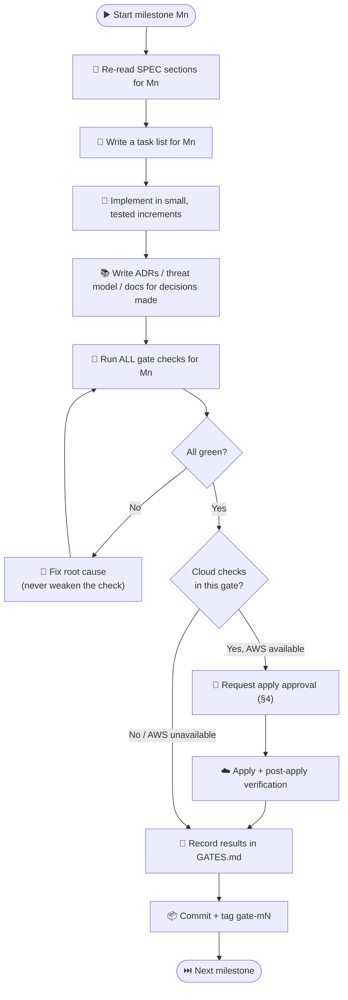
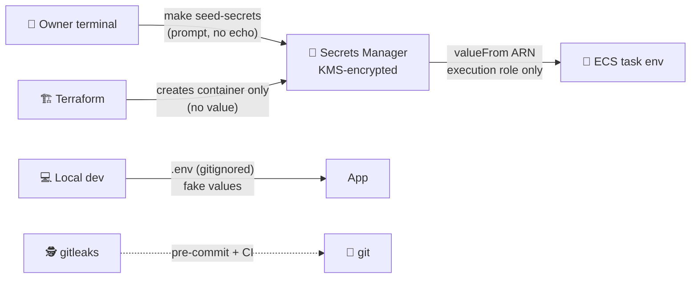

# 🤖 AGENTS.md — How to Build Snip

> Instructions for coding agents (Claude Code) working in this repository.
> **[`SPEC.md`](SPEC.md) defines what to build. This file defines how to work.** If they conflict, SPEC.md wins.

## 📑 Table of Contents

1. [Mission](#1--mission)
2. [The Operating Loop](#2--the-operating-loop)
3. [Hard Rules](#3--hard-rules)
4. [Approval Protocol for AWS Changes](#4-️-approval-protocol-for-aws-changes)
5. [Gate Protocol](#5--gate-protocol)
6. [Repository Layout](#6--repository-layout)
7. [Commands](#7-️-commands)
8. [Go Conventions](#8--go-conventions)
9. [Terraform Conventions](#9-️-terraform-conventions)
10. [Secrets Handling](#10--secrets-handling)
11. [Documentation Conventions](#11--documentation-conventions)
12. [Git Conventions](#12--git-conventions)
13. [When You Are Stuck](#13--when-you-are-stuck)
14. [Definition of Done](#14--definition-of-done)

---

## 1. 🎯 Mission

Build Snip end to end, milestone by milestone (SPEC §18), in a single continuous session. Work autonomously; pause **only** for:

- approval before any AWS-mutating command (§4),
- 👤 human-only steps (entering a secret, confirming an email, GitHub settings),
- a genuine blocker you cannot resolve with a conservative, documented assumption (§13).

While waiting on a human, continue with any work that does not depend on the answer.

---

## 2. 🔁 The Operating Loop



1. **Read** the milestone's section of SPEC §18 plus every SPEC section it references.
2. **Plan** with a task list. Keep it updated; it is how the human tracks progress.
3. **Build** in small steps: write the test, write the code, run the test. Commit at meaningful points.
4. **Document as you go.** Write each ADR in the milestone where the decision is made, not at the end.
5. **Run every gate check** listed for the milestone. Run the full check, not a subset.
6. **Fix failures at the root.** Re-run the entire gate after a fix, not only the failed check.
7. **Log** results in `GATES.md` (§5), **commit**, **tag** `gate-mN`, move on.

Do not start milestone N+1 until gate N is closed (or `🟡 closed-local` per §5).

---

## 3. 🚫 Hard Rules

These are non-negotiable. Violating one is worse than stopping.

**Secrets**
- ❌ Never write a real secret value into any file, commit, Terraform config/state, tfvars, Docker image, build arg, log, test fixture, or chat message.
- ❌ Never read secret values from AWS (`get-secret-value`). Verify secrets exist via metadata only (`describe-secret`, `list-secret-version-ids`).
- ❌ Never ask the human to paste a secret into the chat. Secrets are entered via `make seed-secrets` in their own terminal.

**AWS**
- ❌ Never run `terraform apply`, `terraform destroy`, `terraform import`, `terraform state rm/mv`, or any mutating `aws` CLI command without explicit human approval for that specific action (§4).
- ❌ Never apply to **prod** unless the human explicitly instructs it in this session. Plan prod only.
- ❌ Never use `-target` to work around dependency problems; fix the configuration.
- ❌ Never create long-lived IAM access keys.

**Quality**
- ❌ Never skip, delete, `t.Skip()`, or loosen a test, lint rule, coverage threshold, or scanner to close a gate.
- ❌ Never add a scanner suppression (`#checkov:skip`, `nolint`, `.trivyignore`, tflint ignore) without an inline justification **and** a row in the threat model's suppressions table.
- ❌ Never mark a gate closed with a failing or unrun check.
- ❌ Never use `latest` tags for images, actions, or modules. Pin versions; pin GitHub Actions to full commit SHAs.

**Git**
- ❌ Never force-push, rewrite published history, or commit directly to a remote `main` that has branch protection. Never disable hooks (`--no-verify`).

**Scope**
- ❌ Don't add features beyond SPEC. Put ideas in SPEC §20-style "Future work" notes in the relevant ADR.

---

## 4. ☁️ Approval Protocol for AWS Changes

Before any AWS-mutating action, stop and present:

```text
🟠 APPROVAL NEEDED — terraform apply (dev / <root module>)

Plan summary:   +<add>  ~<change>  -<destroy>
Destroys:       <list every resource being destroyed or replaced, or "none">
Notable:        <IAM changes, security group changes, anything public-facing>
Est. cost impact: <monthly delta, from docs/cost.md model>
Plan file:      infra/envs/dev/tfplan (saved; apply will use exactly this plan)

Reply "approve" to apply this exact plan, or tell me what to change.
```

Rules:
- Always `terraform plan -out=tfplan` and apply **that saved plan file**, so what was approved is what runs.
- Any destroy or replace of a stateful resource (DynamoDB table, S3 bucket, KMS key, Valkey cache, secret) must be called out in **bold** and explained.
- Approval covers one plan. A new plan requires new approval.
- If AWS credentials are not available (`aws sts get-caller-identity` fails), do not ask the human for credentials in chat. Continue in **local mode** (§5) and list what the human must run later.

---

## 5. 🚦 Gate Protocol

### Gate states

| State | Meaning |
|-------|---------|
| ⬜ open | Work in progress |
| ✅ closed | All 🧪 local and ☁️ cloud checks passed and are logged |
| 🟡 closed-local | All 🧪 local checks passed; ☁️ checks pending because AWS access or approval was unavailable. Allowed to continue. Pending checks must be listed. |
| 👤 waiting | Blocked on a human-only step; continue non-dependent work |

### `GATES.md` format

Append one section per gate:

````markdown
## M3 🐳 Containers — ✅ closed

- **Date:** 2026-10-14T18:22Z
- **Commit:** `a1b2c3d` (tag `gate-m3`)
- **Checks:**

| Check | Command | Result | Evidence |
|-------|---------|--------|----------|
| Build arm64 | `make images` | ✅ | redirect 14.2 MB, api 15.1 MB, worker 15.6 MB, nightly 13.9 MB |
| Non-root | `make check-images` | ✅ | User=65532 for all |
| Trivy | `make scan-images` | ✅ | 0 fixable HIGH/CRITICAL |

- **Decisions / ADRs:** ADR-0020
- **Deviations from SPEC:** none
- **Pending (if closed-local):** none
````

Evidence is short and factual (counts, sizes, latencies, resource IDs). Never paste secrets, full plans, or long logs.

### Re-opening

If a later milestone breaks an earlier gate's checks, fix it immediately and note it under the current gate as "Regression fixed: …".

---

## 6. 📁 Repository Layout

```
.
├── AGENTS.md  SPEC.md  README.md  GATES.md
├── Makefile
├── go.mod  go.sum
├── .tool-versions  .terraform-version
├── .env.example                # fake values only — committed
├── .gitignore  .gitleaks.toml  .golangci.yml  .tflint.hcl  .markdownlint.yaml
├── .pre-commit-config.yaml
├── docker-compose.yml
├── api/openapi.yaml
├── build/Dockerfile
├── cmd/
│   ├── redirect/  api/  worker/  nightly/  snipctl/
├── internal/
│   ├── analytics/   # counters, stats queries, S3 batch writer
│   ├── auth/        # API keys, scopes
│   ├── cache/       # Valkey client, IAM token provider
│   ├── config/      # env-based config with validation
│   ├── events/      # click event model, producer, consumer
│   ├── httpx/       # middleware, problem+json, request IDs, limits
│   ├── keygen/      # range allocator + Sqids
│   ├── links/       # domain logic, URL validation/normalization
│   ├── ratelimit/
│   ├── scanner/     # Safe Browsing, fake, noop
│   ├── store/       # DynamoDB repositories
│   ├── telemetry/   # slog + EMF metrics
│   └── visitor/     # HMAC visitor IDs, UA parsing, referrer host
├── tests/
│   ├── integration/  smoke/  load/
├── infra/
│   ├── bootstrap/
│   ├── modules/<module>/{main,variables,outputs,versions}.tf, README.md, tests/
│   └── envs/{dev,prod}/{main,variables,outputs,versions}.tf, example.tfvars, backend.hcl.example
├── scripts/            # seed-secrets.sh, check-mermaid.sh, validate-iam.sh, check-pins.sh, ...
├── docs/
│   ├── design.md  threat-model.md  runbook.md  cost.md
│   └── adr/README.md  adr/0001-record-architecture-decisions.md ...
└── .github/
    ├── workflows/ci.yml  deploy.yml
    └── dependabot.yml
```

---

## 7. 🛠️ Commands

The `Makefile` is the single entry point. Every gate check must be runnable through a target. Create these in M0 (stub later ones with a clear "not yet implemented (Mn)" failure, never a silent success).

| Target | Purpose |
|--------|---------|
| `make help` | List targets |
| `make tools` | Verify/install pinned tool versions |
| `make up` / `make down` | Start/stop local compose stack (+ `local-init`) |
| `make lint` | golangci-lint, gofmt, markdownlint, tflint, actionlint |
| `make test` | Unit tests with `-race` + coverage gate |
| `make test-integration` | Integration tests against compose |
| `make test-secret-scan` | gitleaks self-test |
| `make vuln` | govulncheck |
| `make images` | Build arm64 images tagged with git SHA |
| `make check-images` / `make scan-images` | Non-root/size checks, Trivy |
| `make tf-check` | fmt, validate, tflint, checkov, trivy config, `terraform test` for all roots/modules |
| `make plan ENV=dev` | `terraform plan -out=tfplan` |
| `make apply ENV=dev` | Applies the saved plan — **approval required** |
| `make bootstrap` | Plan/apply bootstrap — **approval required** |
| `make seed-secrets ENV=dev` | 👤 Human-run; prompts for values, never echoes |
| `make push-images ENV=dev` | Push images to ECR — **approval required** |
| `make smoke BASE_URL=…` | Smoke tests |
| `make load BASE_URL=…` | k6 baseline |
| `make validate-iam` | Access Analyzer over planned policies |
| `make docs-check` | markdownlint, Mermaid render, link check |
| `make ci` | Everything CI runs, locally |
| `make destroy ENV=dev` | Destroy one environment — **approval required** |
| `make teardown` | Destroy everything incl. bootstrap state bucket, then verify (SPEC §19.1) — **approval required at each step** |
| `make verify-teardown` | Report any leftover project resources (read-only) |

---

## 8. 🐹 Go Conventions

- Latest stable Go (verify at M0, pin in `go.mod` `toolchain` and `.tool-versions`).
- Standard library first: `net/http` (method + path patterns), `log/slog`, `context`. Approved deps: `aws-sdk-go-v2`, `redis/go-redis/v9`, `sqids/sqids-go`, `google/uuid` (UUIDv7), `golang.org/x/sync/singleflight`, a small UA parser, test helpers. Anything else needs a one-line justification in the PR/commit and must pass `govulncheck`.
- **Structure:** `cmd/*` wires dependencies only; logic lives in `internal/*`. Define interfaces where they are consumed. No package-level mutable state; no `init()` side effects.
- **Config:** parsed from env into a typed struct, validated at startup; fail fast with a clear error listing missing/invalid keys (never print values).
- **Context & timeouts:** every outbound call has a context deadline (Valkey 50 ms on redirect path, DynamoDB 200 ms, Safe Browsing 300 ms, SQS 1 s). Server has read/write/idle timeouts and `MaxHeaderBytes`.
- **Errors:** wrap with `%w`; map domain errors to problem+json in one place; never leak internals to clients.
- **Graceful shutdown:** handle `SIGTERM`; stop accepting; drain; flush buffers within 20 s.
- **Logging:** structured JSON; never log secrets, API keys, `Authorization`, raw IPs, or full long URLs on the redirect path.
- **Tests:** table-driven; fakes over mocks; integration tests behind `//go:build integration`; deterministic (inject clocks and ID sources).
- **Healthchecks:** each binary supports a `healthcheck` subcommand used by the ECS container health check.

---

## 9. 🏗️ Terraform Conventions

- Pin Terraform and provider versions; run `terraform init -upgrade` only intentionally.
- Policies via `data "aws_iam_policy_document"`, never inline JSON strings. Resource-scoped ARNs; conditions where available (`aws:SourceArn`, `aws:SourceAccount`, `kms:ViaService`).
- `for_each` over `count` for named resources. No hardcoded account IDs, regions, AZ names, or ARNs — use data sources and variables.
- Every variable has `type`, `description`, and `validation` where meaningful. Every output has a `description`. Mark sensitive outputs `sensitive = true` (but there should be almost none).
- Stateful resources in prod: deletion protection and/or `lifecycle { prevent_destroy = true }`.
- Use AWS-managed prefix lists and managed policies via data sources (e.g., CloudFront origin-facing prefix list, CloudFront managed cache/origin policies).
- Generate module READMEs with `terraform-docs`.
- Verify AWS service behavior against current AWS documentation when unsure (e.g., CloudFront VPC origin security group requirements, ElastiCache Serverless IAM user setup, ALB access-log bucket encryption support). Record anything surprising in the relevant ADR.

---

## 10. 🔐 Secrets Handling



- Values flow **human → Secrets Manager → ECS** only. Terraform knows names and ARNs, never values.
- `scripts/seed-secrets.sh`: `set -euo pipefail`, `read -rs` for prompted values, generates the salt with `aws secretsmanager get-random-password`, uses `put-secret-value`, never prints values, idempotent (skips existing unless `--rotate`).
- Local `.env` contains dummy AWS credentials for local emulators and fake app secrets. `.env.example` documents every variable.
- If you ever detect a real secret in the working tree or history: stop, tell the human immediately, and treat it as compromised (rotation steps from the runbook). Do not try to quietly rewrite history.

---

## 11. 📚 Documentation Conventions

- **Mermaid everywhere a picture helps:** architecture, sequences, data flows with trust boundaries, runbook diagnosis flowcharts, CI/CD. Every diagram must render via `make docs-check`. Prefer `flowchart`, `sequenceDiagram`, `classDiagram`; quote labels containing special characters; use `<br/>` for line breaks.
- **Table of contents** for any Markdown file over ~100 lines or with more than 4 top-level sections. Keep anchors working.
- **Emojis:** welcome in headings, callouts, and diagram labels for scannability. Keep prose professional; no emoji in code, commands, or file names.
- **README** walks through the design (SPEC §17.1): each walkthrough step opens with a short summary, then See / Trade-off / Common questions, and links to its ADRs. Commands in the Quickstart must be copy-pasteable and tested by the fresh-clone check.
- **ADRs:** MADR format with the extra "Summary" section. Never edit an accepted ADR's decision — supersede it with a new ADR.
- Docs must describe what was **actually built**. If implementation deviates from SPEC, update docs and note the deviation in `GATES.md` and the relevant ADR.

---

## 12. 🌿 Git Conventions

- Conventional Commits: `feat(api): …`, `fix(worker): …`, `infra(network): …`, `docs(adr): …`, `test: …`, `chore: …`.
- Small, focused commits that each pass `make lint test`.
- Tag each closed gate: `git tag gate-m3` (`gate-m3-local` for closed-local).
- Pre-commit hooks must stay enabled.

---

## 13. 🧭 When You Are Stuck

1. Re-read the SPEC section and this file.
2. Check current official docs (AWS, Terraform provider, library) — APIs and defaults change.
3. If still ambiguous, pick the **more secure, more conservative, cheaper** option, implement it, and record it in an ADR and under "Deviations / assumptions" in `GATES.md`.
4. Ask the human only when the choice is irreversible, costs money, touches security posture materially, or needs information only they have. Ask one concise question with a recommended default, then continue with other work while waiting.
5. If a check fails three times for the same reason, stop thrashing: write down what you tried, form a hypothesis, and simplify (smaller reproduction) before trying again.

---

## 14. ✅ Definition of Done

The project is done when:

- [ ] Gates M0–M9 are ✅ closed (or 🟡 closed-local with every pending cloud check listed for the human).
- [ ] `make lint test test-integration tf-check docs-check` passes on a fresh clone.
- [ ] Dev is deployed and smoke tests pass through CloudFront (if AWS access was provided).
- [ ] README, design doc, all 20 ADRs, threat model, runbook, and cost doc exist, render, and match the code.
- [ ] No secrets in git history (`gitleaks detect` over full history).
- [ ] A final summary is presented: what was built, gate table, measured baselines, known limitations, monthly cost estimate, and the exact commands for teardown.
