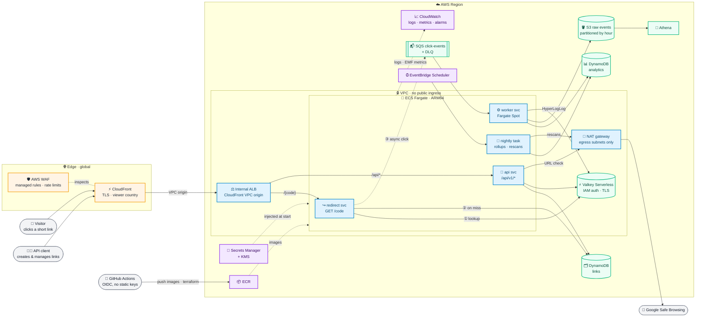

# 🔗 URL Shortener

[](https://github.com/perspectivism/url-shortener-ecs-fargate/actions/workflows/ci.yml)

> A production-grade URL shortener with click analytics, built on AWS ECS
> Fargate. It is organised as a ~20-minute walkthrough of the classic "design
> a URL shortener" interview, and everything in it has been built and tested.



## 📑 Contents

1. [✨ Features](#-features)
2. [🚀 Quickstart](#-quickstart)
3. [🎤 Interview Walkthrough](#-interview-walkthrough)
4. [🏗️ Architecture deep dive](#️-architecture-deep-dive)
5. [🔐 Security and secrets](#-security-and-secrets)
6. [📈 Observability](#-observability)
7. [💸 Cost](#-cost)
8. [🧪 Testing](#-testing)
9. [📁 Repository layout](#-repository-layout)
10. [📚 Docs index](#-docs-index)
11. [🧹 Teardown](#-teardown)
12. [📄 License](#-license)

## ✨ Features

- **Links:**
  - short links with optional custom aliases and expiry;
  - 302 redirects; 404 for unknown codes, 410 for expired, disabled or deleted links;
  - idempotent creates (`Idempotency-Key`), safe under concurrent retries.
- **Analytics:**
  - clicks over time, unique visitors, top referrer hosts, countries, devices and browsers;
  - counted exactly once from an at-least-once queue, in batched writes so a
    viral link doesn't throttle its own counters.
- **Safety:**
  - Google Safe Browsing checks at create time and nightly;
  - admin kill switch;
  - WAF rate limits.
- **Privacy:**
  - application data holds no IPs: per-day keyed HMAC visitor IDs, referrer host only;
  - CloudFront logs exclude IPs, referrers and user agents;
  - WAF logs keep the client IP only for blocked or counted requests (14 days
    in dev, 90 in prod), since WAF cannot redact it
    ([ADR-0029](docs/adr/0029-edge-log-privacy.md)).
- **Operations:**
  - one encrypted SNS topic for 14 alarms, budgets and anomaly alerts;
  - a dashboard and a runbook section for every alarm.
- **Delivery:**
  - Terraform for everything; GitHub Actions with OIDC;
  - images built once and promoted with verified digests;
  - one-command teardown with leftover verification.

## 🚀 Quickstart

### Local in 5 minutes

Prerequisites: Docker with Compose v2 and Buildx, GNU make, bash, curl and
jq. Go and the other tools are needed only for tests; `make tools` installs
pinned, checksum-verified versions into `./.tools`.

```bash
git clone https://github.com/perspectivism/url-shortener-ecs-fargate.git
cd url-shortener-ecs-fargate
```

<!-- quickstart-local:start -->

```bash
cp .env.example .env
make up   # builds local images; starts emulators, redirect :8080, api :8081 and worker
```

Create an API key. It goes straight into a variable and is never printed:

```bash
export API_KEY="$(make -s apikey OWNER=demo | awk '/^api_key:/ {print $2}')"
```

Create a link, follow it, and watch the click arrive in the stats:

```bash
CODE="$(curl -fsS -X POST http://localhost:8081/api/v1/links \
  -H "Authorization: Bearer $API_KEY" -H 'Content-Type: application/json' \
  -d '{"url":"https://example.com/hello"}' | jq -r .code)"
echo "short link: http://localhost:8080/$CODE"

# A browser User-Agent: requests from curl's default agent count as bot clicks.
curl -sS -o /dev/null -w '%{http_code} -> %{redirect_url}\n' \
  -A 'Mozilla/5.0 (X11; Linux x86_64; rv:131.0) Gecko/20100101 Firefox/131.0' \
  "http://localhost:8080/$CODE"

for i in $(seq 30); do
  clicks="$(curl -fsS "http://localhost:8081/api/v1/links/$CODE/stats" \
    -H "Authorization: Bearer $API_KEY" | jq .total_clicks)"
  [ "$clicks" -ge 1 ] && break
  sleep 2
done
echo "total_clicks: $clicks"
```

<!-- quickstart-local:end -->

`make down` stops the stack and discards its data. Tests: `make tools`, then `make test test-integration`.

### Deploy to AWS

Prerequisites: an AWS account and an **admin role session** (not root
access keys), AWS CLI v2, plus the local prerequisites and `make tools`.
Each mutating step plans first and applies **exactly** the reviewed plan.

```bash
# 1. Bootstrap: state bucket + CMK, GitHub OIDC roles, permissions boundary
cp infra/bootstrap/example.tfvars infra/bootstrap/terraform.tfvars   # edit repository, owner
make bootstrap                      # review the plan
APPROVED=yes make bootstrap-apply   # applies it and migrates its state into S3

# 2. Phase 1: network, data, cache, secrets, ECR
# Settings are committed in infra/envs/dev/deploy.tfvars (repository, owner, overrides).
# Your alert address stays out of git, in the gitignored per-run overlay:
echo 'alert_email = "you@example.com"' > infra/envs/dev/terraform.tfvars
make plan ENV=dev && APPROVED=yes make apply ENV=dev

# 3. Secret values: hidden prompts in your terminal, never in git or state
make seed-secrets ENV=dev

# 4. Images: built once from a clean commit, pushed with digest verification
make images-oci && APPROVED=yes make push-images ENV=dev

# 5. Phase 2: add enable_services = true and image_tag = "<printed tag>" to terraform.tfvars
make plan ENV=dev && APPROVED=yes make apply ENV=dev

# 6. Smoke test through CloudFront (API key created straight into a variable)
export SMOKE_API_KEY="$(go run ./cmd/shortenerctl apikey create --env dev --table shortener-dev-links \
  --owner smoke --scopes links:read,links:write | awk '/^api_key:/ {print $2}')"
make smoke-env ENV=dev

# 7. Teardown (typed confirmation per step), then verify nothing is left
make teardown
```

After the one-time setup in [runbook §5.1](docs/runbook.md#51-cicd-setup-one-time--repository-admin),
deploys run through GitHub Actions, but never automatically. You start the
`deploy` workflow by hand. For each environment a read-only job plans first,
and a reviewer approves that saved plan before it is applied
([ADR-0027](docs/adr/0027-manual-approval-for-every-deploy.md),
[ADR-0028](docs/adr/0028-approve-the-saved-plan-versioned-environment-settings.md)).

## 🎤 Interview Walkthrough

A 20-minute path through the system in the order an interview usually
flows. Diagrams are in [docs/design.md](docs/design.md).

### 1. Requirements and clarifying questions

- 🗣️ **Say:** "Shorten URLs, redirect fast, count clicks. I'd confirm read:write
  ratio, custom aliases, expiry, analytics depth, abuse expectations, and whether
  links can be edited — that last one decides 301 vs 302."
- 🔍 **Show:** [design §1](docs/design.md#1-requirements-and-scope): functional requirements F1–F9 and non-functional N1–N8.
- ⚖️ **Trade-off:** analytics plus editable links rule out permanent (301) redirects and edge caching.
- ❓ **Follow-ups:**
  - *"Users and a UI?"* Out of scope: API keys per owner ([ADR-0015](docs/adr/0015-api-key-authentication.md)).
  - *"Custom domains?"* Future work; the edge supports one domain per environment.
- 📎 [ADR-0001](docs/adr/0001-record-architecture-decisions.md)

### 2. Back-of-envelope estimates

- 🗣️ **Say:** "100 M links a month is about 40 creates/s and, at 100:1, about
  4,000 redirects/s, with 10× peaks. Five years of links is about 3 TB.
  62⁷ codes is 3.5 trillion, so 6–7 characters is plenty."
- 🔍 **Show:** [design §2](docs/design.md#2-back-of-envelope-estimates), including
  the analytics-write line: about 48,000 WCU/s at full scale if every click
  were its own transaction, which is why counter writes are batched (step 8).
- ⚖️ **Trade-off:** the read path must be cached and stateless; analytics
  writes are the true hot spot.
- ❓ **Follow-ups:**
  - *"What is this deployment sized for?"* Tens of requests per second in dev.
    Locally, the redirect p99 was 9.7 ms under k6; cloud baselines are pending.

### 3. API design

- 🗣️ **Say:** "Public `GET /{code}`. A versioned management API with Bearer
  keys and scopes, problem+json errors, idempotent creates, and owner-scoped
  everything: other owners get 404, not 403."
- 🔍 **Show:** [`api/openapi.yaml`](api/openapi.yaml); handler tests validate
  every response against it ([`internal/contract`](internal/contract/contract.go)).
- ⚖️ **Trade-off:** API keys instead of OAuth/Cognito. Simpler and
  machine-to-machine, but without user login.
- ❓ **Follow-ups:**
  - *"Idempotency?"* The key is claimed atomically in Valkey before the create,
    so concurrent retries on different tasks make one link (a repeat still in
    flight gets 409). The response is stored per owner and key for 24 h, with
    a body fingerprint; a different body → 400
    ([ADR-0030](docs/adr/0030-consistency-under-concurrency.md)).
- 📎 [ADR-0015](docs/adr/0015-api-key-authentication.md)

### 4. Data model and why DynamoDB

- 🗣️ **Say:** "Every hot access is a single-key lookup, so DynamoDB on-demand
  gives single-digit-ms reads, no connection pools and no idle cost.
  Conditional writes handle aliases. Analytics live in a second table with
  different scaling and blast radius."
- 🔍 **Show:** [design §4](docs/design.md#4-data-model), the `classDiagram` and access patterns.
- ⚖️ **Trade-off:** no ad-hoc SQL, so analytics queries go to S3 + Athena instead.
- ❓ **Follow-ups:**
  - *"Listing an owner's links?"* GSI `OWNER#id` / `CREATED#ts#code`.
  - *"Backups?"* PITR on both tables, and a restore-and-swap runbook.
- 📎 [ADR-0004](docs/adr/0004-dynamodb-for-the-link-store.md), [ADR-0005](docs/adr/0005-separate-links-and-analytics-tables.md)

### 5. Short code generation

- 🗣️ **Say:** "Each API task claims a block of 1,000 IDs with one atomic
  counter update, then encodes them with Sqids. There is no coordination per
  create and no collision between generated codes. Aliases use conditional writes."
- 🔍 **Show:** [design §5](docs/design.md#5-short-code-generation); the
  integration test creates 10,000 links through two instances with 0 duplicates.
- ⚖️ **Trade-off:** codes are decodable (obfuscation, not security), and
  restarts leave ID gaps. Neither matters, because links are not secrets.
- ❓ **Follow-ups:**
  - *"Why not hash the URL?"* Collisions and truncation. Same URL, different owners.
  - *"Random codes?"* They need a collision check on every write.
  - *"Same long URL, same code?"* No. Each link has its own owner,
    analytics, expiry and disable state; sharing codes would leak that
    someone else shortened the URL. Retries use `Idempotency-Key`
    ([design §3](docs/design.md#3-api-design)).
- 📎 [ADR-0006](docs/adr/0006-short-code-generation-range-allocation-and-sqids.md)

### 6. Redirect path, 301 vs 302

- 🗣️ **Say:** "302 with `no-store`: browsers and CloudFront never cache it, so
  every click reaches us and edits or disables apply immediately. Expiry is
  checked on every request; the click event is sent after the response."
- 🔍 **Show:** [design §6](docs/design.md#6-redirect-path) sequence diagram;
  [`internal/redirect`](internal/redirect/redirect.go).
- ⚖️ **Trade-off:** each click costs an origin round trip, and the edge saves no requests.
- ❓ **Follow-ups:**
  - *"When would you use 301?"* Immutable links where analytics don't matter.
  - *"HEAD requests?"* They resolve but are not counted.
  - *"Users far from us-east-1?"* With a nearby CloudFront edge, TLS ends
    there and a redirect costs one backbone round trip. This distribution
    uses `PriceClass_100` (North America and Europe only), so Asia-Pacific
    users connect to a distant edge: several ~200 ms round trips on a new
    connection. `PriceClass_All` fixes that cheaply; beyond it come short
    edge caching, edge redirects and multi-region
    ([design §6](docs/design.md#6-redirect-path)).
- 📎 [ADR-0007](docs/adr/0007-302-redirects-and-no-edge-caching.md)

### 7. Caching

- 🗣️ **Say:** "Cache-aside in Valkey: a positive entry for up to 1 h, a
  negative entry for 60 s (code scans never reach DynamoDB), singleflight per
  code against stampedes. Writes invalidate with a short fence that a racing
  fill can't overwrite. Any cache error fails open to DynamoDB."
- 🔍 **Show:** [design §7](docs/design.md#7-caching);
  [`internal/links/resolver.go`](internal/links/resolver.go).
- ⚖️ **Trade-off:** if both invalidation attempts fail, a link can stay stale
  for up to 1 h. That case is alarmed (`cache-invalidation-failed`), and the
  runbook re-issues the change.
- ❓ **Follow-ups:**
  - *"Race between a cache fill and a disable?"* A fill that read the link
    before the disable could write it back after the `DEL`. So a write
    leaves a 10 s fence instead, fills are `SET NX`, and a fill slower than
    5 s skips the write; a test reproduces the race
    ([ADR-0030](docs/adr/0030-consistency-under-concurrency.md)).
  - *"Why not DAX?"* Valkey also serves rate limits, idempotency and
    HyperLogLog uniques. Auth is IAM tokens, not passwords.
  - *"Cache full?"* Serverless evicts LRU keys that have a TTL, and every key
    here has one, so a full cache becomes misses, not errors. 1 GB holds
    ~5 M links.
  - *"Hot key?"* One viral code sits on one shard. Beyond tens of thousands
    of reads per second, add a 1–5 s in-process cache per task.
- 📎 [ADR-0008](docs/adr/0008-elasticache-serverless-valkey.md), [ADR-0009](docs/adr/0009-valkey-iam-authentication.md)

### 8. Analytics pipeline

- 🗣️ **Say:** "Redirect buffers click events and batches them to SQS without
  blocking. The worker collects clicks for up to 2 seconds, then writes each
  link's batch in one DynamoDB transaction: every click's dedupe marker plus
  one summed update per counter. That's exactly-once counting from
  at-least-once delivery. Raw events go to S3 for Athena, and HyperLogLog
  gives unique visitors."
- 🔍 **Show:** [design §8](docs/design.md#8-analytics-pipeline). Two
  integration tests back it: 500 replays change nothing, and 1,500 clicks
  on one link, each delivered twice, count exactly in batched writes.
- ⚖️ **Trade-off:** under overload, clicks are dropped (and counted) rather
  than slowing redirects. Counters lag by up to 2 s. Uniques are per day.
- ❓ **Follow-ups:**
  - *"A link goes viral?"* Its counters are written once per transaction (up
    to ~90 clicks), not once per click. That is ~5× cheaper and keeps the item
    far below DynamoDB's per-item limit ([ADR-0024](docs/adr/0024-batched-exactly-once-click-counting.md)).
  - *"Poison messages?"* They go to the DLQ after 5 receives; the redrive
    runbook works within 4 days, the dedupe markers' lifetime.
  - *"Privacy?"* Per-day HMAC visitor IDs; the application never stores IPs.
    CloudFront logs exclude them; WAF logs keep them only for blocked
    requests, because WAF can't redact IPs ([ADR-0029](docs/adr/0029-edge-log-privacy.md)).
  - *"How long is data kept?"* Counters for 13 months (via TTL), including
    after a link is deleted; raw events 13 months in prod ([ADR-0025](docs/adr/0025-analytics-retention-13-months.md)).
- 📎 [ADR-0010](docs/adr/0010-async-click-pipeline.md), [ADR-0024](docs/adr/0024-batched-exactly-once-click-counting.md), [ADR-0025](docs/adr/0025-analytics-retention-13-months.md), [ADR-0011](docs/adr/0011-analytics-hot-and-cold-paths.md), [ADR-0018](docs/adr/0018-privacy-hmac-visitor-ids-referrer-host-only.md)

### 9. Abuse prevention and security

- 🗣️ **Say:** "Phishing is the real abuse case. Safe Browsing runs at create
  time and nightly, there is an admin kill switch, and WAF rate rules answer
  429. Infrastructure has no public origin, least-privilege roles, endpoint
  policies that block exfiltration, and secrets that never touch git or Terraform state."
- 🔍 **Show:** [threat model](docs/threat-model.md) (61 STRIDE rows, none
  open); [design §9](docs/design.md#9-abuse-prevention-and-security).
- ⚖️ **Trade-off:** WAF may block some legitimate URLs (for example ones with IP
  literals); this is accepted and tuned from the WAF logs.
- ❓ **Follow-ups:**
  - *"SSRF?"* We never fetch destination URLs; only Safe Browsing sees them, as data.
  - *"Stolen API key?"* Keys are stored hashed and can be revoked within 60 s.
- 📎 [ADR-0021](docs/adr/0021-url-safety-scanning-safe-browsing-v5.md), [ADR-0014](docs/adr/0014-secrets-management.md), [ADR-0023](docs/adr/0023-iam-review-data-perimeter-and-waf-tuning.md)

### 10. Deployment architecture on AWS

- 🗣️ **Say:** "CloudFront reaches an internal ALB through a VPC origin, so
  there is nothing public to attack. Redirect, worker and cache sit in subnets
  with no internet route; only api and nightly can reach Safe Browsing
  through NAT. Services run on ECS Fargate ARM64, with Spot where
  interruptions are harmless."
- 🔍 **Show:** [design §10](docs/design.md#10-deployment-architecture);
  [`infra/envs/dev`](infra/envs/dev/main.tf).
- ⚖️ **Trade-off:** ALB + WAF fixed costs (~$30/month) even when idle.
  Fargate instead of Lambda, for warm connection pools.
- ❓ **Follow-ups:**
  - *"Deploys?"* Images are built once and the same digests are promoted.
    Nothing deploys automatically: a human starts the workflow; for each
    environment a read-only job plans, and a reviewer approves that saved
    plan, which is applied only if its hash matches. Settings are committed,
    so CI never falls back to defaults. Rolling deploys use the circuit breaker
    ([ADR-0028](docs/adr/0028-approve-the-saved-plan-versioned-environment-settings.md)).
  - *"What's running in prod?"* The latest GitHub Release. The pipeline
    tags each commit that passes prod smoke tests and records its image
    digests ([ADR-0026](docs/adr/0026-release-versioning-with-tags.md)).
  - *"Why one account?"* Demo simplicity, with cross-environment guardrails ([ADR-0019](docs/adr/0019-single-aws-account-for-dev-and-prod.md)).
  - *"What if us-east-1 goes down?"*
    - **Today:** an outage until AWS recovers, with no data lost.
    - **AZ loss and data corruption are covered:** the AZ failover is automatic;
      corruption uses PITR, losing at most 5 minutes of data, in 1–2 h.
    - **Cross-region DR** would be global tables plus a second stack (RTO in
      minutes, about the cost of a second prod), or a backup "pilot light".
    - Details: [design §11](docs/design.md#11-operations).
- 📎 [ADR-0003](docs/adr/0003-ecs-on-fargate.md), [ADR-0026](docs/adr/0026-release-versioning-with-tags.md), [ADR-0012](docs/adr/0012-cloudfront-vpc-origin-internal-alb-waf.md), [ADR-0013](docs/adr/0013-subnet-tiers-vpc-endpoints-nat-only-for-scanning.md), [ADR-0016](docs/adr/0016-terraform-layout-environments-s3-native-locking.md), [ADR-0017](docs/adr/0017-cicd-github-oidc-rolling-deploys.md), [ADR-0019](docs/adr/0019-single-aws-account-for-dev-and-prod.md), [ADR-0020](docs/adr/0020-graviton-arm64-and-fargate-spot.md)

### 11. Operations: observability, SLOs, runbook

- 🗣️ **Say:** "Services log JSON and emit EMF metrics through stdout, so
  there is no agent. Alarms watch what users feel (5xx rate, p99, dropped
  clicks, stale stats) and go to one encrypted topic. Every alarm has a
  runbook section with a diagnosis flowchart, and a test keeps the two in sync."
- 🔍 **Show:** [runbook](docs/runbook.md#3-alerts-and-escalation); [observability module](infra/modules/observability/main.tf).
- ⚖️ **Trade-off:** CloudWatch is less flexible than Prometheus/Grafana, but
  needs no infrastructure.
- ❓ **Follow-ups:**
  - *"SLOs?"* N1 is ALB p99 < 100 ms; N2 is 99.9 % non-5xx, computed from ALB metrics.
  - *"Cost visibility?"* Budgets and anomaly detection run per environment, by tag.
- 📎 [ADR-0022](docs/adr/0022-observability-alerting-and-cost-guardrails.md)

### 12. Scaling to 100× and what would change

- 🗣️ **Say:** "At 400,000 redirects/s, per-request edge and ALB fees
  dominate. I'd move hot redirects to CloudFront Functions + KeyValueStore,
  stream clicks from real-time logs, and pre-aggregate analytics per minute
  in a stream processor (today's batching still pays 2 write units per click
  for dedupe markers). Then multi-region with global tables."
- 🔍 **Show:** [design §12](docs/design.md#12-scaling-to-100).
- ⚖️ **Trade-off:** edge redirects make analytics eventually consistent and
  disable checks slower.
- ❓ **Follow-ups:**
  - *"What breaks first?"* ALB/WAF and CloudFront request fees, then the
    per-click dedupe markers. Hot links are already batched; the link store
    and cache scale horizontally.

## 🏗️ Architecture deep dive

[docs/design.md](docs/design.md) covers requirements, estimates, API, data
model, code generation, redirect and create flows, caching, the analytics
pipeline, security, deployment, operations and scaling, with all diagrams.

## 🔐 Security and secrets

- **No public origin:** CloudFront VPC origin → internal ALB; WAF at the edge.
- **No long-lived credentials:** GitHub OIDC roles with exact `sub` claims and
  a permissions boundary; IAM users and access keys are denied.
- **Secrets:** values flow from a human (`make seed-secrets`, hidden
  prompts) to Secrets Manager to ECS `valueFrom`. Terraform knows only names
  and ARNs; gitleaks runs in pre-commit and CI.
- **Least privilege:**
  - one task role and one execution role per service;
  - every IAM wildcard is justified inline and checked;
  - Access Analyzer validation;
  - endpoint data-perimeter policies;
  - one CMK per environment.
- **Hardened runtime:** distroless, non-root, read-only root filesystem, no capabilities, ARM64.
- **Reviewed:** a full STRIDE [threat model](docs/threat-model.md); every
  scanner suppression is listed there (enforced by script).

## 📈 Observability

Structured JSON logs and EMF metrics (`Shortener/{env}`) feed the
`shortener-{env}` dashboard (golden signals, cache hit ratio, pipeline, queue,
DynamoDB, WAF, cost). Fourteen alarms, the nightly-exit rule, budgets and Cost
Anomaly Detection send to one SNS topic. SLOs and responses:
[runbook](docs/runbook.md). Load test: `make load BASE_URL=…` (k6) and
`scripts/load-report.sh`.

## 💸 Cost

| Environment | Monthly (us-east-1, prices 2026-10-14) |
| --- | --- |
| dev, foundation only | ≈ $46 |
| dev, with services | ≈ $110–135 |
| prod, idle | ≈ $255–270 before traffic |

Fixed costs dominate: interface endpoints, ALB + WAF, Container Insights and
Valkey's minimum. Levers and the full model are in [docs/cost.md](docs/cost.md).

## 🧪 Testing

| Layer | Command | What it proves |
| --- | --- | --- |
| Unit | `make test` | ≈ 98 % coverage of `internal/` (gate 80 %), race detector, OpenAPI contract |
| Integration | `make test-integration` | 17 end-to-end flows against emulators: dedupe under 500 replays, 30 concurrent creates with one idempotency key across 3 API tasks (one link), a hot link with 1,500 clicks each delivered twice (exact counts, batched writes), 10,000 creates with no duplicate codes, rate limits, graceful shutdown |
| Images | `make images check-images scan-images` | arm64, UID 65532, ~16 MB, 0 fixable HIGH/CRITICAL |
| Terraform | `make tf-check` | 61 `terraform test` runs; checkov, Trivy, tflint; plan, IAM, metric and suppression invariants |
| Workflows | `make check-workflows` | actionlint, zizmor, every action pinned to a SHA |
| Docs | `make docs-check` | markdownlint, Mermaid rendering, links, threat-model and ADR completeness |
| Smoke | `make smoke-env ENV=dev` | the full flow through CloudFront, security negatives, direct ALB unreachable |
| Load | `make load` | k6 baseline (RPS, p50/p95/p99, errors, cache hit ratio) |

`make ci` runs everything CI runs, locally.

## 📁 Repository layout

```text
cmd/            redirect, api, worker, nightly, shortenerctl (wiring only)
internal/       domain and adapters: links, keygen, cache, store, events, analytics, auth, ...
api/            OpenAPI 3.1 contract
build/          Dockerfile (distroless, multi-service)
tests/          integration (emulators), smoke (deployed env), load (k6)
infra/          bootstrap, envs/{dev,prod} (identical roots), modules/* with terraform tests
scripts/        tooling, checks, deploy, teardown (every Makefile target lands here)
docs/           design, ADRs, threat model, runbook, cost
.github/        ci.yml, deploy.yml, dependabot, CODEOWNERS
```

## 📚 Docs index

| Document | Contents |
| --- | --- |
| [docs/design.md](docs/design.md) | System design, in walkthrough order |
| [docs/adr/](docs/adr/README.md) | 30 architecture decision records, each with an Interview Angle |
| [CHANGELOG.md](CHANGELOG.md) | Releases (tagged automatically when a commit reaches prod) |
| [docs/threat-model.md](docs/threat-model.md) | Trust boundaries, STRIDE, residual risks, suppressions |
| [docs/runbook.md](docs/runbook.md) | SLOs, every alarm, deploy/rollback and operational procedures |
| [docs/cost.md](docs/cost.md) | Cost model, levers, guardrails |
| [GATES.md](GATES.md) | Milestone gate log and pending cloud checks |
| [SPEC.md](SPEC.md), [AGENTS.md](AGENTS.md) | What was built and how |

## 🧹 Teardown

```bash
make teardown          # prod (if deployed) → dev → bootstrap, typed confirmation per step
make verify-teardown   # read-only; exits non-zero if anything is left
```

Every destroy runs from a saved, reviewed plan. Prod first applies
`force_destroy = true`, which lifts deletion protection, then is destroyed.
Bootstrap state is moved back to local before the state bucket is removed.

- **KMS keys** cannot be deleted immediately. They stay *pending deletion* for
  7 days (not billed) and are listed as expected.
- **Unconfirmed SNS email subscriptions** disappear after 3 days.

## 📄 License

[MIT](LICENSE) © 2026 Pero Matic
