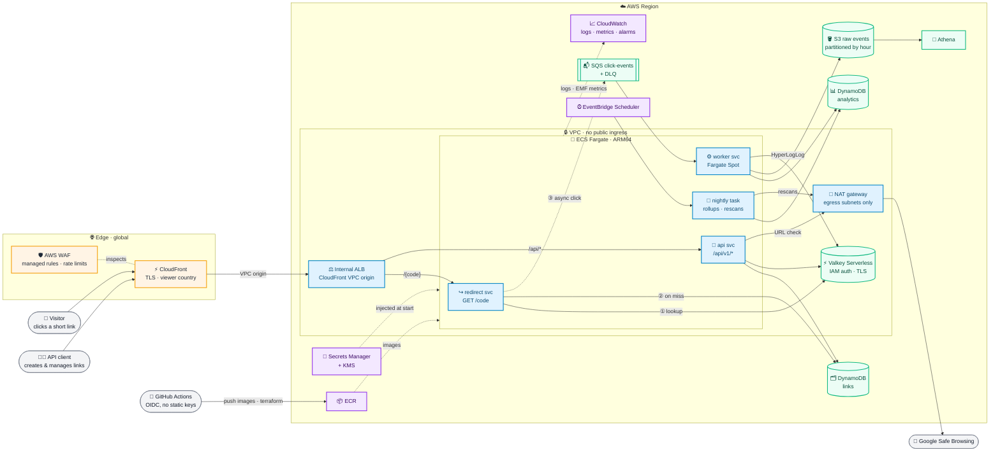
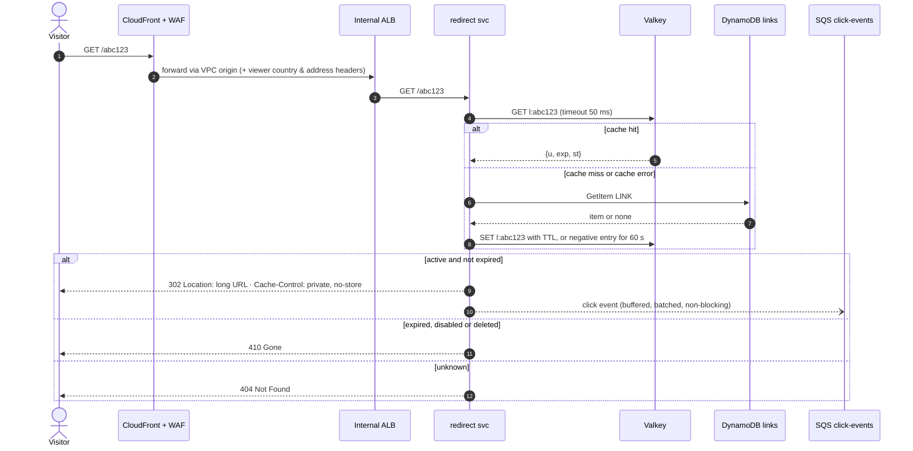
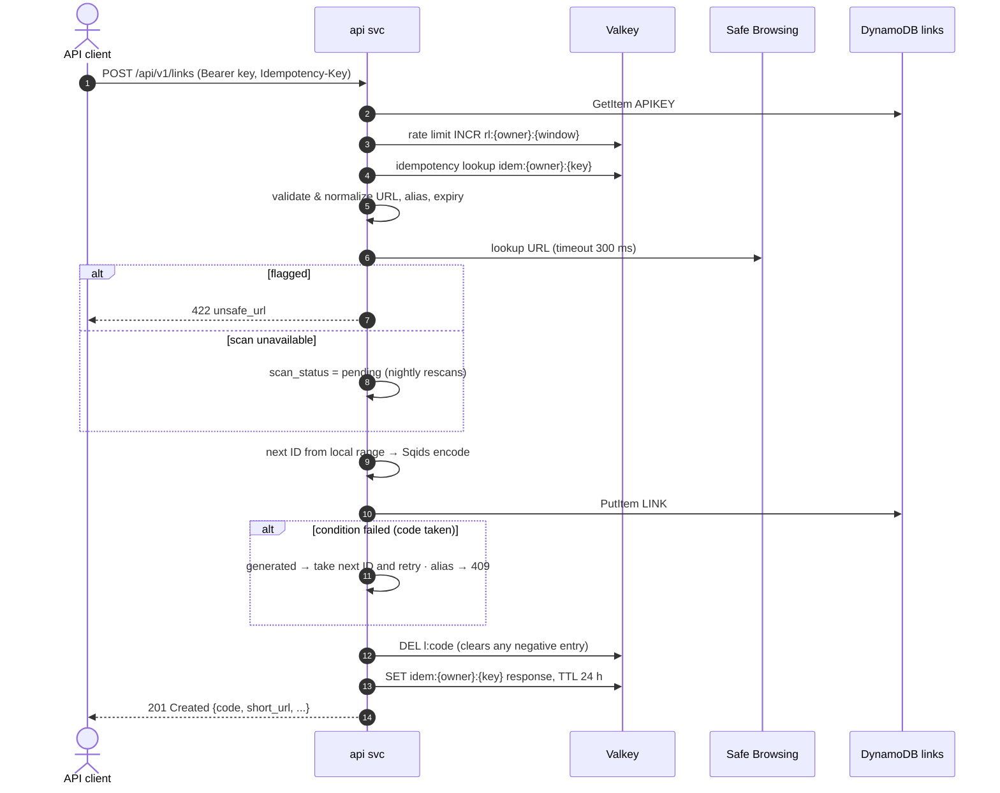
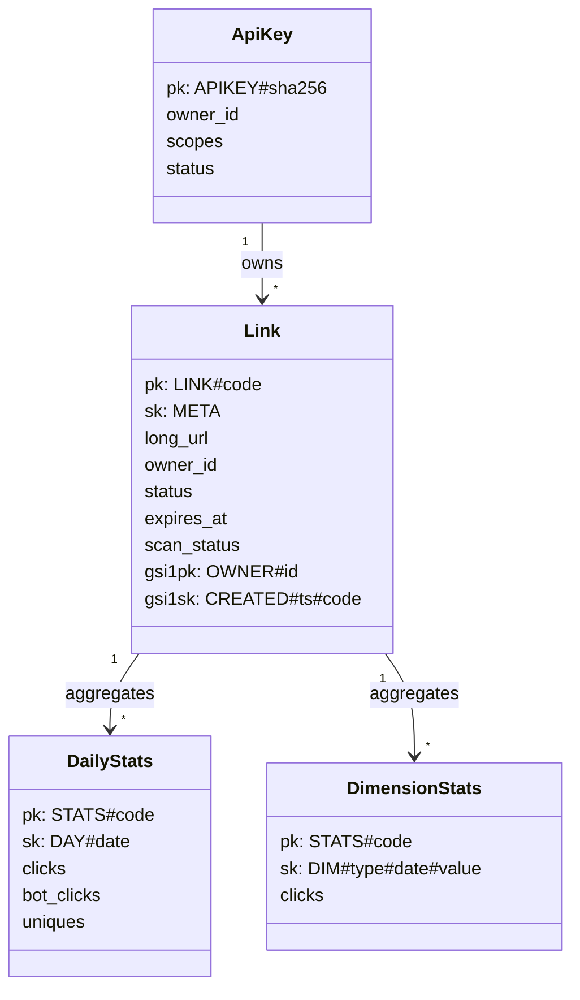
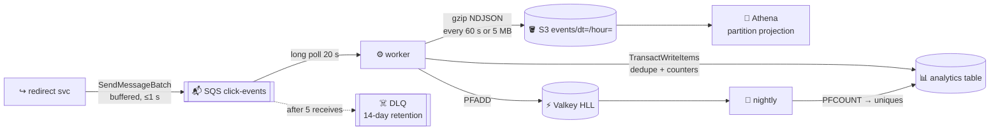
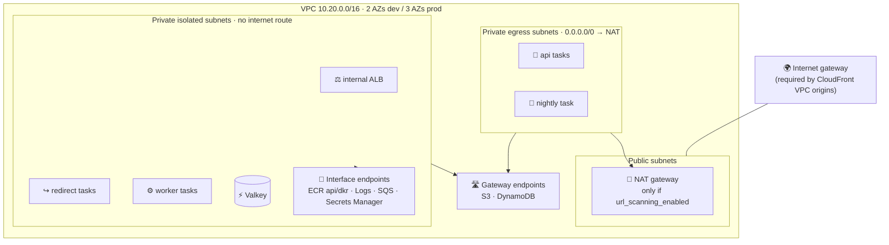
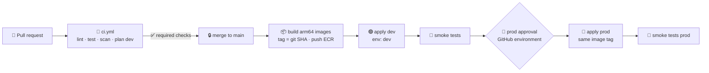
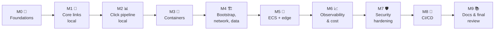
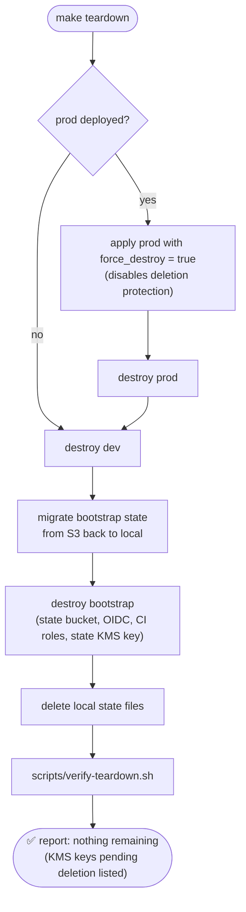

# 🔗 Snip — URL Shortener on ECS Fargate · Specification

> **Status:** Source of truth for building Snip from an empty repository to a production-grade, interview-ready deployment on AWS.
> **Audience:** A coding agent (Claude Code) and the human owner. Read [`AGENTS.md`](AGENTS.md) for *how* to work; this file defines *what* to build.
> **Precedence:** SPEC.md > AGENTS.md > anything else. If something here is ambiguous, choose the more secure/conservative option and record it in an ADR.

## 📑 Table of Contents

1. [Purpose & Goals](#1--purpose--goals)
2. [Requirements](#2--requirements)
3. [Architecture Overview](#3-️-architecture-overview)
4. [Request Flows](#4--request-flows)
5. [Data Model (DynamoDB)](#5-️-data-model-dynamodb)
6. [Short Code Generation](#6--short-code-generation)
7. [Caching Strategy (Valkey)](#7--caching-strategy-valkey)
8. [Click Pipeline & Analytics](#8--click-pipeline--analytics)
9. [API Contract](#9--api-contract)
10. [Abuse Prevention & URL Safety](#10-️-abuse-prevention--url-safety)
11. [Security & Secrets](#11--security--secrets)
12. [AWS Infrastructure (Terraform)](#12-️-infrastructure-terraform)
13. [Observability](#13--observability)
14. [CI/CD](#14--cicd)
15. [Local Development](#15--local-development)
16. [Testing Strategy](#16--testing-strategy)
17. [Documentation Deliverables](#17--documentation-deliverables)
18. [Gated Milestones](#18--gated-milestones)
19. [Cost Guardrails](#19--cost-guardrails)
20. [Out of Scope / Future Work](#20-️-out-of-scope--future-work)
21. [Glossary](#21--glossary)

---

## 1. 🎯 Purpose & Goals

Snip is a URL shortener with click analytics, built to demonstrate **production-grade AWS container architecture** and to serve as a **walkthrough for the classic "design a URL shortener" system design interview**. Every major design decision maps to an interview talking point and is recorded as an ADR.

### Goals

- ✅ Read-heavy architecture: separate **redirect** (hot read path) and **API** (write path) services on ECS Fargate.
- ✅ Real implementations of interview concepts: range-allocated key generation, cache-aside with negative caching, 302 redirects, async event pipeline, idempotent consumers, abuse prevention.
- ✅ AWS best practices everywhere: least privilege, no public origins, encryption at rest and in transit, no long-lived credentials, no secrets in git or Terraform state.
- ✅ Everything as code in Terraform; everything reproducible from a fresh clone.
- ✅ Documentation that teaches: README interview walkthrough, ADRs, STRIDE threat model, runbook, all with Mermaid diagrams.

### Non-goals

- ❌ A web UI dashboard (API only; stretch goal).
- ❌ Multi-region active/active (documented as a scale path).
- ❌ Bitly-scale traffic in the actual deployment (the design *explains* that scale; the deployment is sized for a demo).

---

## 2. 📋 Requirements

### 2.1 Functional

| ID | Requirement |
|----|-------------|
| F1 | Authenticated clients create a short link from a long URL. |
| F2 | Optional custom alias (`[A-Za-z0-9_-]{4,32}`, not reserved). |
| F3 | Optional expiry (`expires_at`, ISO-8601 UTC, must be in the future, ≤ 5 years). |
| F4 | `GET /{code}` redirects with **302**; unknown → **404**; expired/disabled/deleted → **410**. |
| F5 | Owners can list, view, update destination, update expiry, and delete their links. |
| F6 | Owners can view analytics: clicks over time, unique visitors, top referrer hosts, countries, device classes, browsers. |
| F7 | Destination URLs are checked against Google Safe Browsing at creation and re-checked nightly; flagged links are disabled. |
| F8 | Admins can disable/enable any link. |
| F9 | Create endpoints support an `Idempotency-Key` header. |

### 2.2 Non-functional

| ID | Requirement | Target |
|----|-------------|--------|
| N1 | Redirect latency at origin (ALB `TargetResponseTime`) | p99 < 50 ms on cache hit, < 100 ms overall |
| N2 | Availability objective (prod) | 99.9% monthly for redirects |
| N3 | Redirect path never blocks on analytics | Click enqueue is async; failures drop events, never fail redirects |
| N4 | Analytics freshness | Counters visible within 2 minutes |
| N5 | Click counting correctness | Exactly-once counting via idempotent consumer (SQS is at-least-once) |
| N6 | Privacy | No raw IPs stored anywhere; referrer stored as host only |
| N7 | Security | No public ingress except CloudFront; no long-lived AWS keys; no secrets in git/state |
| N8 | Cost | Dev idles at a documented monthly cost; one-command teardown |

### 2.3 Back-of-envelope (for the README interview section)

Present the math twice: **interview scale** (e.g., 100M new links/month, 100:1 read:write → ~40 creates/s and ~4k redirects/s average, ~10× peak) and **demo scale** (what this deployment is sized for). Include storage math (~500 bytes/link × 100M/month × 12 × 5 years) and code-space math (62⁷ ≈ 3.5 trillion). Show how the numbers justify the read/write split, caching, and DynamoDB.

---

## 3. 🏗️ Architecture Overview

### 3.1 System diagram (use this as the README hero diagram)

The README **must** open with this diagram (update it if the architecture changes; keep the styling).



### 3.2 Components

| Component | Responsibility | Runs on |
|-----------|---------------|---------|
| `redirect` | `GET/HEAD /{code}`: resolve code, return 302/404/410, enqueue click event | ECS service, on-demand Fargate (prod), Spot allowed in dev |
| `api` | `/api/v1/*`: auth, create/manage links, stats, admin | ECS service, on-demand Fargate |
| `worker` | Consume click events → DynamoDB counters (idempotent), HLL uniques, raw events → S3 | ECS service, Fargate Spot |
| `nightly` | Persist daily uniques, rescan URLs, disable flagged links | ECS scheduled task (EventBridge Scheduler), Fargate Spot |
| `snipctl` | Operator CLI: local table init, API key create/revoke | Runs locally |

### 3.3 Key decisions (each becomes an ADR — see §17.2)

- **302, not 301**: we need every click for analytics and the ability to change/disable links.
- **DynamoDB, not Postgres**: single-key lookups, no connection pooling, no idle cost, conditional writes for aliases.
- **CloudFront VPC origin + internal ALB**: the origin has no public endpoint at all.
- **No edge caching of redirects**: CloudFront uses `CachingDisabled` for both behaviors; Valkey is the cache.
- **Isolated subnets**: redirect/worker/ALB/cache have **no internet route**. Only `api` and `nightly` (which call Safe Browsing) sit in egress subnets behind NAT, and NAT exists only when `url_scanning_enabled = true`.

---

## 4. 🔄 Request Flows

### 4.1 Redirect (hot path)



Rules:
- The redirect response is written **before** the event is enqueued; enqueue never blocks the response.
- `HEAD` requests resolve identically but do **not** emit click events.
- Expiry is checked on every request using `exp` (never trust DynamoDB TTL deletion timing).
- Headers on 302: `Location`, `Cache-Control: private, no-store, max-age=0`, `X-Robots-Tag: noindex`, `Referrer-Policy: no-referrer-when-downgrade`.

### 4.2 Create link (write path)



### 4.3 Update / disable / delete

Write to DynamoDB first, then `DEL l:{code}`. Staleness is bounded by the positive cache TTL (max 1 h) in the rare case the DEL fails; on DEL failure, log + emit `CacheInvalidationFailed` metric and retry once. Record this trade-off in the caching ADR.

---

## 5. 🗂️ Data Model (DynamoDB)

Two tables (ADR: links is a tiny hot read table; analytics is write-heavy — separate scaling, alarms, and blast radius).

Both tables: on-demand billing with **on-demand max throughput** set (cost cap), **PITR enabled**, **SSE with the environment CMK**, **deletion protection in prod**, TTL attribute `ttl`.

### 5.1 `snip-{env}-links`

| Item | `pk` | `sk` | Attributes |
|------|------|------|------------|
| Link | `LINK#{code}` | `META` | `code`, `long_url`, `owner_id`, `custom` (bool), `status` (`active`\|`disabled`\|`deleted`), `disabled_reason`, `created_at`, `updated_at`, `expires_at` (opt), `scan_status` (`clean`\|`pending`\|`flagged`), `last_scanned_at`, `ttl` (opt = `expires_at` + 30 days), `gsi1pk`, `gsi1sk` |
| ID counter | `COUNTER#link_id` | `META` | `value` (number) |
| API key | `APIKEY#{sha256_hex}` | `META` | `owner_id`, `name`, `scopes` (string set), `status`, `created_at`, `last_used_day` |

GSI `gsi1` (projection: KEYS_ONLY + `long_url`, `status`, `created_at`, `expires_at`): `gsi1pk = OWNER#{owner_id}`, `gsi1sk = CREATED#{created_at}#{code}`.

### 5.2 `snip-{env}-analytics`

| Item | `pk` | `sk` | Attributes |
|------|------|------|------------|
| Daily totals | `STATS#{code}` | `DAY#{yyyy-mm-dd}` | `clicks`, `bot_clicks`, `uniques` (written nightly) |
| Dimension counter | `STATS#{code}` | `DIM#{ref\|country\|device\|browser}#{yyyy-mm-dd}#{value}` | `clicks` |
| Event dedupe marker | `EVENT#{event_id}` | `META` | `ttl` (now + 3 days) |

Dimension values are normalized and capped (≤ 64 chars); unknowns become `unknown`. Referrer value is **host only**.

### 5.3 Access patterns

| # | Access pattern | Operation |
|---|----------------|-----------|
| 1 | Resolve code | `GetItem links pk=LINK#{code}` (eventually consistent) |
| 2 | Create link | `PutItem` with `attribute_not_exists(pk)` |
| 3 | Allocate ID block | `UpdateItem COUNTER#link_id ADD value :block` return `UPDATED_NEW` |
| 4 | Authenticate API key | `GetItem APIKEY#{hash}` |
| 5 | List owner's links | `Query gsi1 gsi1pk=OWNER#{id}`, newest first, paginated |
| 6 | Record click (idempotent) | `TransactWriteItems`: Put `EVENT#{id}` with `attribute_not_exists(pk)` + `ADD` updates on day & dimension items |
| 7 | Stats for date range | `Query analytics pk=STATS#{code}` with `sk BETWEEN` per prefix |
| 8 | Nightly rescan | Parallel `Scan` of links with filter (documented scale path: GSI on next-scan date) |



---

## 6. 🔢 Short Code Generation

**Approach: counter range allocation (a lightweight Key Generation Service) + Sqids encoding.**

1. Each `api` task lazily claims a block of IDs: `UpdateItem COUNTER#link_id ADD value :block_size` (default 1000). The returned value `v` gives the range `(v - block_size, v]`.
2. IDs are served from the in-memory range; a new block is claimed when exhausted. Lost IDs on task restart are acceptable gaps.
3. Each ID is encoded with **Sqids** (`github.com/sqids/sqids-go`) using a shuffled alphabet from config (`SQIDS_ALPHABET`, non-secret) and `min_length = 6`, with Sqids' default profanity blocklist.
4. `PutItem` uses `attribute_not_exists(pk)`. If a generated code collides (e.g., with an existing custom alias), skip that ID and retry (max 5).
5. Reserved codes (rejected for aliases, skipped for generated): `api`, `healthz`, `admin`, `static`, `assets`, `favicon.ico`, `robots.txt`, `.well-known`, `docs`, `login`, `status`.

Must be documented honestly: Sqids is **obfuscation, not security** (IDs are decodable). Links are not secrets; unguessability is not a requirement. The ADR must compare: hash-of-URL, random + collision check, sequential Base62, KGS with pre-generated keys, and this approach.

---

## 7. ⚡ Caching Strategy (Valkey)

ElastiCache **Serverless for Valkey** (engine `valkey`, latest supported major version — verify), TLS required, **IAM authentication** (no password), deployed in isolated subnets, CMK encryption, `cache_usage_limits` set (data storage and ECPU caps).

| Key | Value | TTL | Purpose |
|-----|-------|-----|---------|
| `l:{code}` | JSON `{"u": url, "exp": epoch\|null, "st": status}` | `min(3600s, exp - now)` | Positive cache |
| `l:{code}` | JSON `{"nf": true}` | 60 s | Negative cache (blocks code-scanning from hitting DynamoDB) |
| `rl:{owner}:{route}:{window}` | counter | window length | Fixed-window rate limit |
| `idem:{owner}:{key}` | serialized response | 24 h | Idempotency |
| `hll:{{code}}:{yyyy-mm-dd}` | HyperLogLog | 8 days | Unique visitors; hash tag `{code}` keeps a link's keys in one slot so `PFMERGE`/`PFCOUNT` across days works in cluster mode |

Client requirements:
- `github.com/redis/go-redis/v9` cluster client (Serverless is cluster-mode) with a `CredentialsProviderContext` that generates a fresh SigV4 IAM token per new connection, and `ConnMaxLifetime` < 12 h (IAM-authenticated connections are dropped at 12 h). Local mode: `CACHE_AUTH=none`, no TLS.
- Timeouts: 50 ms read on redirect path; failures **fail open** to DynamoDB and increment `CacheErrors`.
- In-process `singleflight` per code on misses to prevent stampedes.
- Rate limiting fails **open** when Valkey is unavailable (WAF rate rules are the backstop); log + metric.

---

## 8. 📊 Click Pipeline & Analytics



### 8.1 Click event (produced by `redirect`)

```json
{
  "v": 1,
  "event_id": "UUIDv7",
  "code": "abc123",
  "ts": "2026-10-14T12:00:00.123Z",
  "visitor": "hex(HMAC-SHA256(salt, ip | user_agent | yyyy-mm-dd))",
  "referrer_host": "news.ycombinator.com",
  "country": "US",
  "user_agent": "truncated to 256 chars",
  "is_bot": false
}
```

- **Raw IP never leaves the redirect service.** IP comes from the `CloudFront-Viewer-Address` header (ALB is only reachable from CloudFront), falling back to the ALB source address locally.
- `visitor` salt is the `visitor-hash-salt` secret. Rotating it resets unique-visitor continuity (documented in runbook).
- Producer: bounded channel (10k), batch flush every 1 s or 10 messages, `ClickEventsDropped` metric when full or on send failure. On `SIGTERM`: stop accepting, drain and flush within 20 s (ECS `stopTimeout` 30 s, ALB deregistration delay 15 s).

### 8.2 Worker semantics

- SQS standard queue, SSE-KMS, visibility timeout 120 s, `maxReceiveCount` 5 → DLQ.
- For each message: `TransactWriteItems` (dedupe `Put EVENT#{id}` with `attribute_not_exists` + `ADD clicks` on day item + dimension items). `TransactionCanceledException` due to the dedupe condition ⇒ duplicate ⇒ count `WorkerDuplicateEvents`, still delete.
- Non-bot events: `PFADD hll:{{code}}:{date} visitor`.
- Raw events buffered and written to S3 every 60 s or 5 MB (`events/dt=YYYY-MM-DD/hour=HH/{task}-{uuidv7}.json.gz`). **Messages are deleted only after both DynamoDB and the S3 flush succeed.** Athena queries deduplicate by `event_id` (documented).
- Poison messages (unparseable / unknown version) go to DLQ via no-delete; never crash the worker.

### 8.3 Nightly task (EventBridge Scheduler, `cron(15 3 * * ? *)` UTC)

1. For each link with yesterday's activity: `PFCOUNT` → write `uniques` on `DAY#{yesterday}`.
2. Rescan URLs where `scan_status = pending` or `last_scanned_at` older than 7 days (batched Safe Browsing lookups). Flagged ⇒ `status = disabled`, `disabled_reason = unsafe_url`, `DEL l:{code}`, metric `LinksDisabled`.
3. Idempotent and safe to re-run; emits a summary log line and metrics.

### 8.4 Athena

Glue table over `events/` with **partition projection** on `dt` (date) and `hour`; dedicated Athena workgroup with enforced, encrypted results location (results bucket, 7-day expiry) and a per-query bytes-scanned limit. Include 3 example saved queries (top links last 7 days, clicks by hour, referrer breakdown) as `aws_athena_named_query`.

---

## 9. 🧾 API Contract

All API errors use **RFC 9457** `application/problem+json`. All API responses are JSON. Request bodies ≤ 8 KiB (413 otherwise). Auth: `Authorization: Bearer snip_{env}_{secret}`.

### 9.1 Public

| Method | Path | Responses |
|--------|------|-----------|
| `GET`, `HEAD` | `/{code}` | 302, 404, 410, 429 (WAF) |
| `GET` | `/healthz` | 200 (not routed through CloudFront caching; used by ALB health checks) |

### 9.2 API (`/api/v1`)

| Method | Path | Scope | Notes |
|--------|------|-------|-------|
| `POST` | `/links` | `links:write` | Body `{url, alias?, expires_at?}` → 201. Supports `Idempotency-Key`. |
| `GET` | `/links?limit=&cursor=` | `links:read` | Owner's links, newest first, opaque cursor. |
| `GET` | `/links/{code}` | `links:read` | 404 if not owner (never reveal existence). |
| `PATCH` | `/links/{code}` | `links:write` | `{url?, expires_at?}`; URL re-scanned. |
| `DELETE` | `/links/{code}` | `links:write` | Soft delete (`status=deleted`) → redirect returns 410. |
| `GET` | `/links/{code}/stats?from=&to=` | `links:read` | Max 90-day range. Returns daily series, uniques (today via live `PFCOUNT`), top 10 referrers/countries/devices/browsers. |
| `POST` | `/admin/links/{code}/disable` | `admin` | `{reason}` |
| `POST` | `/admin/links/{code}/enable` | `admin` | Re-enables if not expired. |
| `GET` | `/healthz` | none | 200 |

### 9.3 Error codes

`400 invalid_request`, `401 unauthorized`, `403 forbidden`, `404 not_found`, `409 alias_taken`, `410 gone`, `413 payload_too_large`, `415 unsupported_media_type`, `422 unsafe_url` / `invalid_url`, `429 rate_limited` (+ `Retry-After`), `500 internal`, `503 unavailable`.

### 9.4 OpenAPI

Maintain `api/openapi.yaml` (OpenAPI 3.1). It is validated in CI and kept in sync with handlers via contract tests.

---

## 10. 🛡️ Abuse Prevention & URL Safety

| Control | Detail |
|---------|--------|
| URL validation | `http`/`https` only; ≤ 2048 chars; must parse with a host; no userinfo (`user:pass@`); no IP-literal hosts in private/loopback/link-local ranges; reject the service's own domain (loop prevention); IDN normalized to punycode. |
| Safe Browsing | Check at create/update (300 ms timeout, fail to `pending`), nightly rescans. Use the Lookup API. Note in ADR: Safe Browsing is non-commercial use; commercial deployments would use Google Web Risk. Behind a `URLScanner` interface with a fake for local/tests. |
| Rate limits | API: per-key fixed windows (create 60/min, read 300/min; configurable). WAF: rate-based rules per IP on `/api/*` and on redirects. |
| Kill switch | Admin disable + nightly auto-disable; cache invalidated immediately. |
| Enumeration | Negative caching; WAF rate rules; codes are non-sequential. |
| Bot hygiene | `is_bot` from UA heuristics → `bot_clicks`, excluded from uniques. |
| Auth hygiene | API keys are 32 random bytes, shown once, stored as SHA-256 (high-entropy secrets do not need slow hashing — explain in ADR); revocable; `last_used_day` tracked. |

---

## 11. 🔐 Security & Secrets

### 11.1 Secrets inventory

| Secret | Store | Consumers | How the value gets there |
|--------|-------|-----------|--------------------------|
| Safe Browsing API key | Secrets Manager `snip/{env}/safe-browsing-api-key` | `api`, `nightly` | `make seed-secrets ENV=…` prompts the human (never echoed) |
| Visitor hash salt | Secrets Manager `snip/{env}/visitor-hash-salt` | `redirect` | `make seed-secrets` generates via `aws secretsmanager get-random-password` |
| API keys | DynamoDB (hash only) | `api` | `snipctl apikey create` prints once to the operator's terminal |
| Valkey credentials | **None** — IAM auth | — | — |
| AWS credentials | **None** — task roles, GitHub OIDC | — | — |

### 11.2 Rules

- Terraform creates secret **containers** (name, KMS key, resource policy, recovery window) — **never values**. No `aws_secretsmanager_secret_version` with real values, no `random_password` for application secrets (both land in state).
- ECS injects secrets via the task definition `secrets` block (`valueFrom` = secret ARN). Only the **execution role** of the consuming service may `secretsmanager:GetSecretValue` on that specific ARN, and only that role may `kms:Decrypt` via the secret's CMK (with `kms:ViaService` condition).
- Secrets never appear in: git, `.tfvars`, Terraform state, Docker images, build args, env files committed to git, logs, CI logs, or error messages.
- Local development uses `.env` (gitignored) created from `.env.example` (committed, fake values only).
- Guardrails: `gitleaks` in pre-commit and CI; `.gitignore` covers `.env*` (except `.env.example`), `*.tfvars` (except `*.example.tfvars`), `*.tfstate*`, `.terraform/`, `backend.hcl` (except `backend.hcl.example`), `*.pem`, `*.key`.
- Rotation procedures for both secrets live in the runbook.

### 11.3 Security baseline

- **Network:** CloudFront is the only ingress. ALB is `internal`, SG allows only the CloudFront origin-facing managed prefix list (and/or the VPC origin service SG — verify current AWS guidance). Task SGs allow only the ALB SG on the container port. Valkey SG allows only task SGs on 6379. Endpoint SG allows only task SGs on 443. VPC Flow Logs enabled.
- **TLS:** viewer TLS ≥ `TLSv1.2_2021`, HSTS via response headers policy. With a custom domain, CloudFront→ALB uses HTTPS with an ACM cert on `origin.{domain}`; without a domain, the VPC-origin hop is HTTP inside the AWS network — document as an accepted risk in the threat model.
- **Encryption:** one customer-managed KMS key per environment (rotation enabled) for DynamoDB, SQS, S3 events, CloudWatch Logs, Secrets Manager, Valkey. S3 buckets: Block Public Access, BucketOwnerEnforced, TLS-only bucket policy, versioning.
- **Containers:** distroless static non-root (UID 65532), read-only root filesystem, no added Linux capabilities (drop all), no privileged mode, immutable ECR tags, scan on push, ARM64.
- **IAM:** one task role and one execution role per service; resource-scoped ARNs; no `*` actions; policies built with `aws_iam_policy_document`; validated with IAM Access Analyzer `validate-policy` at M7.
- **Edge:** WAF with `AWSManagedRulesCommonRuleSet`, `AWSManagedRulesKnownBadInputsRuleSet`, `AWSManagedRulesAmazonIpReputationList`, `AWSManagedRulesAnonymousIpList` (count mode initially), and rate-based rules; WAF logging enabled with redaction of `authorization` header.
- **Debug access:** ECS Exec enabled in dev only (toggle), logged.

---

## 12. ☁️ Infrastructure (Terraform)

### 12.1 Versions & conventions

- Terraform ≥ 1.11 (pin exact version in `.terraform-version`), AWS provider: latest stable major, pinned with `~>` (verify current at M0). `default_tags`: `Project`, `Environment`, `ManagedBy=terraform`, `Repository`, `Owner`.
- Remote state: S3 bucket from `infra/bootstrap` with versioning, SSE-KMS, Block Public Access, TLS-only policy, and **S3 native state locking** (`use_lockfile = true`) — no DynamoDB lock table.
- Backend config via `backend.hcl` (gitignored, generated by `make bootstrap`), `backend.hcl.example` committed.
- `terraform.tfvars` gitignored; `example.tfvars` committed. **tfvars contain no secrets.**
- Two-phase deploy without `-target`: variable `enable_services` (false = foundation only: network, data, secrets, ECR). Services require secrets seeded and images pushed.
- Naming: `${project}-${env}-${component}`. Region via variable (default `us-east-1`); a provider alias in `us-east-1` for CloudFront ACM and WAF (CLOUDFRONT scope).

### 12.2 Layout

```
infra/
├── bootstrap/          # state bucket, KMS for state, GitHub OIDC provider, CI roles (plan/apply per env)
├── modules/
│   ├── kms/            # env CMK + key policy
│   ├── network/        # VPC, 3 subnet tiers, IGW, optional NAT, gateway + interface endpoints, flow logs
│   ├── dynamodb/       # links + analytics tables
│   ├── messaging/      # SQS queue + DLQ
│   ├── events-lake/    # S3 events bucket, Athena workgroup + results bucket, Glue table, named queries
│   ├── cache/          # Valkey serverless, IAM user + user group, SG
│   ├── secrets/        # secret containers + resource policies
│   ├── ecr/            # repos per service, lifecycle policies, scan on push
│   ├── ecs-cluster/    # cluster, capacity providers, Container Insights
│   ├── ecs-service/    # reusable: task def, service, roles, SG, autoscaling, log group, alarms
│   ├── scheduled-task/ # reusable: task def, roles, EventBridge Scheduler schedule
│   ├── edge/           # internal ALB, CloudFront + VPC origin, WAF, ACM (optional domain), Route 53 (optional)
│   ├── observability/  # dashboard, alarms, SNS topic, log metric filters
│   └── budget/         # AWS Budgets + Cost Anomaly Detection
└── envs/
    ├── dev/
    └── prod/
```

Every module: `main.tf`, `variables.tf` (descriptions, types, validations), `outputs.tf`, `versions.tf`, `README.md` (generated with `terraform-docs`), and `tests/*.tftest.hcl` using `mock_provider` for plan-level assertions.

### 12.3 Network



- Gateway endpoints (free) for S3 and DynamoDB on all private route tables, with endpoint policies restricting to this account's resources.
- Interface endpoints: `ecr.api`, `ecr.dkr`, `logs`, `sqs`, `secretsmanager` (+ `ssmmessages` when ECS Exec is on). Variable `interface_endpoint_az_count` (dev default 1 to save cost, prod = all AZs).
- If `url_scanning_enabled = false`: no NAT, `api`/`nightly` use the noop scanner and emit `URLScanSkipped`.
- VPC Flow Logs → CloudWatch Logs (KMS, retention 14 days dev / 90 prod).

### 12.4 ECS

| Service | CPU/Mem | Dev | Prod | Capacity | Scaling |
|---------|---------|-----|------|----------|---------|
| redirect | 256 / 512 | 1 | 2–10 | dev: Spot · prod: on-demand base 2 | Target tracking `ALBRequestCountPerTarget` (500) + CPU 60% |
| api | 256 / 512 | 1 | 2–4 | on-demand | CPU 60% |
| worker | 256 / 512 | 0–1 | 1–5 | Spot with on-demand fallback weight | Backlog-per-task on SQS visible messages |
| nightly | 512 / 1024 | scheduled | scheduled | Spot | — |

Task definitions: `runtimePlatform { cpuArchitecture = ARM64, operatingSystemFamily = LINUX }`, `readonlyRootFilesystem = true`, `user = "65532"`, `linuxParameters.capabilities.drop = ["ALL"]`, `awslogs` driver with `mode = non-blocking`, `stopTimeout = 30`, container health check using the binary's own `healthcheck` subcommand (distroless has no shell/curl). Services: rolling deploy (min healthy 100%, max 200%), **deployment circuit breaker with rollback**, ALB health check `/healthz`, deregistration delay 15 s. Terraform owns task definitions; deploy = apply with a new `image_tag` (git SHA). CI promotes the same tag dev → prod (no rebuild).

### 12.5 Edge

- CloudFront: price class 100, HTTP/2 and HTTP/3, managed `CachingDisabled` policy on both behaviors (`/api/*` and default), custom origin request policy forwarding all query strings, needed headers (`Authorization`, `Content-Type`, `Idempotency-Key`, `User-Agent`, `Referer`) plus `CloudFront-Viewer-Country` and `CloudFront-Viewer-Address`; managed security response headers policy; standard logging to S3 or CloudWatch (with retention).
- Internal ALB in isolated subnets: `drop_invalid_header_fields = true`, deletion protection in prod, listener rules: `/api/*` → api TG, default → redirect TG. Access logs to a dedicated S3 bucket (use encryption that ALB log delivery supports).
- Optional custom domain: Route 53 hosted zone ID + domain variables → ACM certs (us-east-1 for CloudFront, regional for `origin.{domain}`), alias records.

### 12.6 Environments

| Setting | dev | prod |
|---------|-----|------|
| AZs | 2 | 3 |
| Interface endpoint AZs | 1 | all |
| `url_scanning_enabled` | false (default, no NAT) | true |
| DynamoDB deletion protection | off | on |
| Log retention | 7–14 days | 90 days |
| ECS Exec | on | off |
| `force_destroy` (S3, ECR, Athena, secrets recovery, deletion protection) | true | false |
| WAF AnonymousIpList | count | count → block after review |
| Budget | $X (variable) | $Y (variable) |

Prod is **planned only** by the agent; applying prod requires explicit human instruction (see AGENTS.md).

---

## 13. 📈 Observability

- **Logs:** JSON via `log/slog`; fields: `ts`, `level`, `msg`, `service`, `env`, `version`, `request_id` (from `X-Amz-Cf-Id` when present, else generated), `code`, `status`, `latency_ms`. Never log full long URLs at info level on the redirect path, IPs, API keys, or `Authorization`.
- **Metrics:** CloudWatch Embedded Metric Format (namespace `Snip/{env}`) — no PutMetricData calls, no extra endpoint. Required metrics: `RedirectLatencyMs`, `CacheHit`, `CacheMiss`, `NegativeCacheHit`, `CacheErrors`, `ClickEventsEnqueued`, `ClickEventsDropped`, `LinksCreated`, `URLScanFlagged`, `URLScanUnavailable`, `URLScanSkipped`, `LinksDisabled`, `WorkerEventsProcessed`, `WorkerDuplicateEvents`, `KeyBlocksAllocated`, `CacheInvalidationFailed`, `RateLimited`.
- **Dashboard:** one per env: golden signals per service, cache hit ratio, queue age/depth, DLQ depth, DynamoDB throttles, WAF blocked requests, cost widgets.
- **Alarms → SNS (email subscription variable):**

| Alarm | Condition |
|-------|-----------|
| Redirect 5xx | ALB target 5xx rate > 1% for 5 min |
| Redirect latency | ALB p99 `TargetResponseTime` > 100 ms for 10 min |
| Running tasks | Running < desired for 5 min (per service) |
| Queue age | `ApproximateAgeOfOldestMessage` > 300 s |
| DLQ | `ApproximateNumberOfMessagesVisible` > 0 |
| Dropped clicks | `ClickEventsDropped` > 0 for 15 min |
| DynamoDB | Throttled requests > 0 for 5 min |
| Cache | `CacheErrors` > 50 in 5 min |
| Nightly | Scheduled task failure (EventBridge Scheduler target error / task exit ≠ 0 via log metric filter) |
| Budget | 50/80/100% actual + 100% forecast |

- **SLO doc:** `docs/runbook.md` defines SLIs/SLOs (N1, N2) and how to compute them from the dashboard.

---

## 14. 🚀 CI/CD



- **`ci.yml` (PRs):** `golangci-lint`, `go test -race`, coverage gate, `govulncheck`, integration tests (compose), OpenAPI validation, `gitleaks`, `docker build`, Trivy image + config scans, `terraform fmt -check`, `validate`, `tflint`, `checkov`, `terraform test`, `terraform plan` (dev) with summary posted to the PR, `actionlint`, markdown lint, Mermaid render check.
- **`deploy.yml` (main):** build & push, apply dev, smoke, manual approval (GitHub environment `prod` with required reviewers), apply prod, smoke.
- **OIDC roles** (created in `infra/bootstrap`): `plan` role (read-only + state read) trusted for `repo:{org}/{repo}:pull_request`; `apply-dev` and `apply-prod` trusted only for `repo:{org}/{repo}:environment:{env}`; `aud = sts.amazonaws.com`. Apply roles use a **permissions boundary**.
- All actions pinned to full commit SHAs; workflow `permissions` minimal (`contents: read`, `id-token: write` only where needed); `concurrency` per environment; Dependabot for Go modules, GitHub Actions, Docker base images, and Terraform providers.

---

## 15. 💻 Local Development

`docker compose` stack:

| Service | Image (verify current) | Purpose |
|---------|-------|---------|
| dynamodb | `amazon/dynamodb-local` | Tables |
| valkey | `valkey/valkey` (pin version) | Cache, HLL, rate limits |
| sqs | `softwaremill/elasticmq-native` | SQS-compatible queue + DLQ |
| s3 | `adobe/s3mock` | Raw event sink |
| redirect, api, worker | built locally | The app |

- Endpoints via AWS SDK v2 service-specific env vars (`AWS_ENDPOINT_URL_DYNAMODB`, `AWS_ENDPOINT_URL_SQS`, `AWS_ENDPOINT_URL_S3`), dummy credentials in `.env.example`.
- `snipctl local-init` creates tables/queues/bucket; `snipctl apikey create --owner demo --scopes links:read,links:write`.
- Fake Safe Browsing scanner flags any URL containing `malware.testing.google.test`.
- Target: fresh clone → `make up && make test-integration` green in < 5 minutes.

---

## 16. 🧪 Testing Strategy

| Layer | Tooling | Requirement |
|-------|---------|-------------|
| Unit | `go test -race` | ≥ 80% coverage on `internal/...`; table-driven; interfaces faked |
| Integration | `go test -tags=integration` against compose | Full flows incl. dedupe, expiry, aliases, rate limits, graceful shutdown flush |
| Contract | OpenAPI validation of handler responses | Every endpoint and error shape |
| Terraform | `fmt`, `validate`, `tflint` (AWS ruleset), `checkov`, Trivy config, `terraform test` with mock providers | Zero unsuppressed HIGH/CRITICAL; every suppression justified inline |
| Container | Trivy image | No fixable HIGH/CRITICAL |
| Smoke | `tests/smoke` (Go) against a base URL | Create → 302 → stats increment within 2 min → 404 → 410 → 401 → 422 unsafe URL |
| Load | k6 (`tests/load`) | Dev baseline recorded: p99, error rate, cache hit ratio |
| Security negatives | Smoke extensions | Direct ALB unreachable from internet; cross-owner access 404; oversize body 413 |
| Docs | `markdownlint-cli2`, Mermaid render (`@mermaid-js/mermaid-cli`), relative link check | All diagrams render; no broken links |

---

## 17. 📚 Documentation Deliverables

### 17.1 README.md (generated in M9, kept accurate)

Must include, in order, with a **table of contents**:

1. Title, one-line pitch, and the **hero diagram from §3.1**.
2. ✨ Features (short).
3. 🚀 **Quickstart** — two tracks, copy-pasteable:
   - *Local in 5 minutes:* prerequisites, `cp .env.example .env`, `make up`, create API key, `curl` create + follow redirect + stats.
   - *Deploy to AWS:* prerequisites, `make bootstrap`, configure `example.tfvars` → `terraform.tfvars`, phase 1 apply, `make seed-secrets`, `make push-images`, phase 2 apply, smoke test, **teardown**.
4. 🎤 **Interview Walkthrough** — the centerpiece. A numbered path to present the system in ~20 minutes, mirroring how the interview flows. Each step has: **🗣️ Say** (2–3 sentence talking point), **🔍 Show** (diagram or code link), **⚖️ Trade-off**, **❓ Likely follow-ups** (with short answers), and a link to the ADR.
   1. Requirements & clarifying questions
   2. Back-of-envelope estimates (§2.3)
   3. API design
   4. Data model & why DynamoDB
   5. Short code generation
   6. Redirect path, 301 vs 302
   7. Caching (positive, negative, stampede, invalidation)
   8. Analytics pipeline (async, idempotency, hot/cold paths)
   9. Abuse prevention & security
   10. Deployment architecture on AWS (edge → VPC → Fargate)
   11. Operations: observability, SLOs, runbook
   12. Scaling to 100× and what would change
5. 🏗️ Architecture deep dive (links to `docs/design.md` diagrams).
6. 🔐 Security & secrets summary.
7. 📈 Observability summary.
8. 💸 Cost (link to `docs/cost.md`).
9. 🧪 Testing.
10. 📁 Repository layout.
11. 📚 Docs index (ADRs, threat model, runbook, design doc).
12. 🧹 Teardown.

### 17.2 ADRs — `docs/adr/NNNN-kebab-title.md` (MADR format)

Template sections: Status, Date, Context, Decision Drivers, Considered Options, Decision, Consequences (positive/negative), Interview Angle (how to explain it in one breath), optional Mermaid diagram. `docs/adr/README.md` is an index table. Required ADRs:

| # | Title |
|---|-------|
| 0001 | Record architecture decisions |
| 0002 | Go for all services |
| 0003 | ECS on Fargate (vs Lambda, EKS, EC2) |
| 0004 | DynamoDB for the link store (vs Postgres/Aurora) |
| 0005 | Separate links and analytics tables |
| 0006 | Short code generation: range allocation + Sqids |
| 0007 | 302 redirects and no edge caching of redirects |
| 0008 | ElastiCache Serverless Valkey (vs DAX, vs no cache) |
| 0009 | Valkey IAM authentication (no passwords) |
| 0010 | Async click pipeline: SQS, best-effort enqueue, idempotent worker |
| 0011 | Analytics hot/cold paths: DynamoDB counters + S3/Athena |
| 0012 | CloudFront VPC origin with internal ALB and WAF |
| 0013 | Subnet tiers, VPC endpoints, NAT only for URL scanning |
| 0014 | Secrets management: Secrets Manager, out-of-band values, nothing in state |
| 0015 | API key authentication (vs Cognito) |
| 0016 | Terraform layout, environments, S3 native state locking |
| 0017 | CI/CD with GitHub Actions OIDC; rolling deploys with circuit breaker (vs ECS blue/green) |
| 0018 | Privacy: HMAC visitor IDs, referrer host only |
| 0019 | Single AWS account for dev/prod (multi-account as future) |
| 0020 | Graviton (ARM64) and Fargate Spot usage |

Add ADRs for any further significant decision made during implementation.

### 17.3 Threat model — `docs/threat-model.md`

- Scope, assets (link integrity, availability, analytics privacy, API keys, AWS account), actors (anonymous visitor, API client, malicious link creator, compromised dependency, insider/CI).
- **Data-flow diagram** in Mermaid with explicit **trust boundaries** as subgraphs (Internet / Edge / VPC / AWS managed services / CI).
- **STRIDE** table per element and per flow: threat, likelihood, impact, mitigation (linked to code/Terraform/ADR), status (mitigated / accepted / open).
- Must cover: open redirect & phishing abuse, code enumeration, cache poisoning, DoS on redirect path, API key theft, IDOR across owners, SSRF (note: we never fetch destination URLs — explain why), header spoofing of viewer IP/country (ALB only reachable from CloudFront), supply chain (pinned actions, image scanning, govulncheck), CI role abuse (OIDC sub conditions, permissions boundary), data exfiltration (endpoint policies, KMS), log injection, analytics privacy.
- Residual risks and accepted risks (e.g., HTTP on VPC-origin hop without a custom domain; Safe Browsing zero-day gap).

### 17.4 Runbook — `docs/runbook.md`

- Service overview, dashboards, alarm → section map, SLOs.
- For **every alarm in §13**: meaning, impact, Mermaid diagnosis flowchart, commands (AWS CLI), remediation, escalation.
- Procedures: deploy, rollback (redeploy previous `image_tag`; circuit breaker behavior), disable a malicious link, revoke an API key, rotate the Safe Browsing key, rotate the visitor salt (impact on uniques), redrive the DLQ, DynamoDB PITR restore (to a new table + swap procedure), scale up for a traffic spike, Valkey failure mode (expected degradation), cost emergency, full teardown.

### 17.5 Other docs

- `docs/design.md` — the full system design write-up following the interview walkthrough order, with all diagrams.
- `docs/cost.md` — monthly cost model per environment by component, with date and pricing source links; idle vs active; levers.
- `GATES.md` — gate log (format in AGENTS.md).

All Markdown files longer than ~100 lines or with more than 4 top-level sections **must** have a table of contents. Emojis are welcome in headings and callouts; keep body text professional.

---

## 18. 🚦 Gated Milestones



### Gate types

- 🧪 **Local** — always required; runs without AWS.
- ☁️ **Cloud** — requires AWS access **and** human approval of each `terraform apply` (see AGENTS.md approval protocol). If AWS access is unavailable, the gate closes as **🟡 closed-local** with cloud checks listed as pending, and work continues.
- 👤 **Human** — something only the owner can do (enter a secret, confirm an SNS email, configure GitHub settings). The agent prepares everything, asks, and continues with non-dependent work.

A gate is **closed** only when every required check passes and is recorded in `GATES.md`. No skipping, no weakening checks.

---

### M0 🧱 Foundations

**Scope:** repo skeleton per AGENTS.md layout; `go.mod`; tool pinning (`.tool-versions`, `.terraform-version`); `Makefile` with all targets from AGENTS.md (stubs allowed for later milestones); `.gitignore`; `.env.example`; `.pre-commit-config.yaml` (gitleaks, gofmt/goimports, golangci-lint, terraform fmt, markdownlint); `.gitleaks.toml`; `.golangci.yml`; `.tflint.hcl`; `.markdownlint.yaml`; `scripts/check-mermaid.sh`; `GATES.md`; `docs/` skeletons; ADR template + index + ADR-0001.

**Gate checks (🧪):**
- `make lint` passes.
- `gitleaks detect --no-git` and `gitleaks protect --staged` pass on the repo.
- **Secret-scanner self-test:** `make test-secret-scan` writes a fake AWS key into a temp file inside a temp git repo and asserts gitleaks fails on it.
- `git check-ignore` confirms `.env`, `infra/envs/dev/terraform.tfvars`, `backend.hcl`, and `x.tfstate` are ignored, and `.env.example`, `example.tfvars` are not.
- `make docs-check` renders all Mermaid blocks.

---

### M1 🔗 Core links (local)

**Scope:** `internal/config`, `keygen`, `links` (validation/normalization), `store` (DynamoDB repos), `cache` (Valkey client incl. IAM token provider, local no-auth mode), `auth`, `ratelimit`, `httpx` (middleware, problem+json, request IDs, body limits), `scanner` (Safe Browsing + fake + noop), `telemetry` (slog + EMF); `cmd/redirect`, `cmd/api`, `cmd/snipctl`; `docker-compose.yml`; `api/openapi.yaml`.

**Docs:** ADRs 0002, 0004, 0005, 0006, 0007, 0008, 0009, 0015, 0018. Threat model v0 (application-level DFD + STRIDE for API and redirect).

**Gate checks (🧪):**
- `make test` (race) green; coverage on `internal/...` ≥ 80%.
- `make test-integration` green, covering: create → 302 with correct headers; HEAD emits no event; 404 unknown; negative cache hit on repeat 404; 410 expired; 410 disabled; alias 409; reserved alias 400; invalid URLs 422; unsafe URL 422 (fake scanner); 401/403; cross-owner 404; idempotent create returns same body; rate limit 429 with `Retry-After`; key range allocation across two concurrent API instances yields no duplicates (test with ≥ 10k creates).
- Contract tests validate every response against `api/openapi.yaml`.
- `golangci-lint`, `govulncheck` clean.

---

### M2 📊 Click pipeline (local)

**Scope:** click event producer in `redirect` (buffer, batch, graceful drain); `cmd/worker` (transactional idempotent counters, HLL, S3 batch writer, delete-after-flush); `cmd/nightly` (uniques persistence, rescans, auto-disable); stats endpoint.

**Docs:** ADRs 0010, 0011. Threat model updated for the pipeline.

**Gate checks (🧪):**
- Integration: 500 clicks across 3 links → stats exactly match; **redelivering the same messages does not change counts**; bots excluded from uniques; S3 objects contain all events (dedupe by `event_id` yields exact count).
- SIGTERM test: in-flight buffered events are flushed before exit.
- Queue down test: redirects still return 302 and `ClickEventsDropped` increments.
- Valkey down test: redirects still work via DynamoDB.
- Poison message lands in DLQ after max receives; worker keeps running.
- Nightly test: uniques written; fake-flagged URL disabled and its cache entry removed; re-running nightly is a no-op.

---

### M3 🐳 Containers

**Scope:** `build/Dockerfile` (multi-stage, `CGO_ENABLED=0`, `-trimpath`, `-ldflags "-s -w -X version"`, distroless static nonroot, ARM64 via buildx; amd64 allowed for local runs), `healthcheck` subcommands, compose option to run built images.

**Docs:** ADR 0020.

**Gate checks (🧪):**
- Images build for `linux/arm64`; each < 30 MB.
- `docker inspect` confirms non-root user; containers run with `--read-only --cap-drop=ALL` in compose and pass integration tests.
- Trivy image scan: no fixable HIGH/CRITICAL.
- No secrets in image layers or build args (Trivy secret scan + `docker history` review).

---

### M4 🏗️ Bootstrap, network & data

**Scope:** `infra/bootstrap` (state bucket + KMS, GitHub OIDC provider, plan/apply roles with permissions boundary; migrate bootstrap's own state into the bucket after creation); modules `kms`, `network`, `dynamodb`, `messaging`, `events-lake`, `cache`, `secrets`, `ecr`; `envs/dev` and `envs/prod` wiring with `enable_services = false`; `scripts/seed-secrets.sh`.

**Docs:** ADRs 0013, 0014, 0016, 0019. `docs/cost.md` first draft.

**Gate checks:**
- 🧪 `terraform fmt -check -recursive`, `validate` (all roots), `tflint`, `checkov`, Trivy config: zero unsuppressed HIGH/CRITICAL; `terraform test` for every module (assert: encryption with CMK, PITR on, BPA on, TLS-only policies, no `0.0.0.0/0` ingress, isolated subnets have no default route, Valkey IAM auth).
- 🧪 `terraform plan` for dev and prod succeeds (requires read access; otherwise mark pending).
- ☁️ Approved apply of `bootstrap`, then dev foundation. Post-apply verification via AWS CLI (DynamoDB PITR + SSE, S3 BPA, SQS SSE + redrive, Valkey status + auth mode, secrets exist without values) recorded in `GATES.md`.
- 👤 Human runs `make seed-secrets ENV=dev`; agent verifies secret versions exist (metadata only — never fetches values).

---

### M5 🚀 ECS services & edge

**Scope:** modules `ecs-cluster`, `ecs-service`, `scheduled-task`, `edge`; `make push-images`; `envs/dev` with `enable_services = true`; `tests/smoke`.

**Docs:** ADRs 0003, 0012, 0017 (deploy strategy part). Design doc deployment section.

**Gate checks:**
- 🧪 All M4 static checks on new code; `terraform test` asserts: ALB `internal = true`, ALB SG only allows CloudFront prefix list, task SGs only from ALB, read-only root FS, non-root user, ARM64, circuit breaker with rollback, CachingDisabled on both behaviors, WAF associated.
- ☁️ Approved apply. Then: all services steady with healthy targets; `make smoke BASE_URL=<cloudfront>` green; ALB DNS **not reachable** from the public internet (expect failure/timeout); nightly task runs successfully via a manual `aws scheduler`/`ecs run-task` trigger; a forced bad deploy (bad image tag in a throwaway apply) triggers circuit-breaker rollback — record evidence.

---

### M6 📈 Observability & cost

**Scope:** `observability` and `budget` modules; EMF metrics verified; dashboard; alarms; SNS; log retention everywhere; `tests/load` k6 script; `docs/cost.md` completed with measured data.

**Gate checks:**
- 🧪 `terraform test`: every alarm in §13 exists with an SNS action; every log group has retention + KMS.
- ☁️ Approved apply. `aws cloudwatch set-alarm-state` on one alarm → 👤 human confirms the email arrived. k6 baseline in dev recorded in `GATES.md` (RPS, p50/p95/p99, error rate, cache hit ratio). Dashboard shows all widgets with data.

---

### M7 🛡️ Security hardening

**Scope:** full STRIDE threat model; IAM review; Access Analyzer validation; WAF tuning; security negative tests added to smoke.

**Docs:** threat model complete (all sections of §17.3).

**Gate checks:**
- 🧪 Every IAM policy document validated with `aws accessanalyzer validate-policy` (via a script over `terraform show -json`) — no errors or security warnings; no `"Action": "*"` / `"Resource": "*"` except where AWS requires it (each justified inline).
- 🧪 checkov / Trivy / tflint: zero unsuppressed findings at MEDIUM+; suppressions listed in threat model.
- 🧪 `gitleaks detect` over full git history clean.
- ☁️ Smoke security negatives pass: Google's Safe Browsing test URL rejected with 422 (if scanning enabled in the env under test), WAF rate rule triggers 429 under a burst, oversize body 413, cross-owner 404, invalid key 401, direct ALB unreachable.
- Every STRIDE row has status mitigated or accepted (with rationale) — no `open`.

---

### M8 🔁 CI/CD

**Scope:** `.github/workflows/ci.yml`, `deploy.yml`, `dependabot.yml`; OIDC role trust policies verified; `docs/runbook.md` deploy/rollback procedures; `CODEOWNERS` (optional).

**Docs:** ADR 0017 completed.

**Gate checks:**
- 🧪 `actionlint` clean; script asserts every `uses:` is pinned to a 40-char SHA; `zizmor` (GitHub Actions security linter) clean at medium+.
- 🧪 Running the CI job steps locally via `make ci` passes.
- 👤 Human pushes a branch and opens a PR; CI is green; human configures branch protection and the `prod` environment reviewers (agent provides exact steps).
- ☁️ A merge deploys to dev and smoke passes; prod job waits for approval (agent does **not** approve).

---

### M9 📚 Docs & final review

**Scope:** README per §17.1, `docs/design.md`, runbook complete per §17.4, ADR index complete, cost doc final, `GATES.md` summary.

**Gate checks (🧪):**
- `make docs-check` (markdownlint, Mermaid renders, relative links) clean.
- **Fresh-clone test:** clone into a temp dir, follow the README *Local* quickstart verbatim (scripted), integration tests pass.
- Every ADR listed in §17.2 exists with status `Accepted` (or `Superseded` with link).
- Every runbook alarm section matches an alarm defined in Terraform (script compares names).
- `terraform plan -destroy` for every root succeeds and `scripts/verify-teardown.sh` passes shellcheck. ☁️ If the human requests teardown, `make teardown` completes and `verify-teardown.sh` reports nothing remaining except KMS keys pending deletion.
- Final full run: `make lint test test-integration tf-check docs-check` green; summary of all gates and any `🟡 closed-local` pending cloud checks presented to the human.

---

## 19. 💸 Cost Guardrails

- Dominant dev cost drivers (verify current prices at M4 and record in `docs/cost.md` with date): interface VPC endpoints (per endpoint per AZ-hour), NAT gateway (only if scanning enabled), ALB, WAF (web ACL + rules + requests), Valkey Serverless minimums, Fargate tasks, KMS keys, CloudWatch logs/alarms.
- Defaults minimize idle cost in dev: 1 AZ for interface endpoints, no NAT, Spot where safe, short log retention, worker min 0.
- AWS Budgets + Cost Anomaly Detection on every environment.
- Full teardown must leave **nothing** behind (see §19.1).

### 19.1 🧹 Full teardown (zero leftovers)

`make teardown` removes every resource the project created, including the bootstrap state bucket. Each destroy step requires approval per AGENTS.md §4.



Requirements:
- **S3:** every bucket sets `force_destroy = var.force_destroy` so non-empty and **versioned** buckets (all object versions and delete markers) are removed. Includes events, Athena results, ALB logs, CloudFront logs, and the state bucket.
- **ECR:** `force_delete = var.force_destroy` so repositories with images are removed.
- **Secrets Manager:** `recovery_window_in_days = 0` when `force_destroy = true` (immediate deletion, no 7–30 day lingering), otherwise 30.
- **DynamoDB / ALB:** deletion protection driven by `!var.force_destroy`. No on-demand backups are created.
- **Valkey:** no final snapshot.
- **Athena:** workgroup `force_destroy = var.force_destroy`.
- **Log groups:** every log group is Terraform-managed (`awslogs-create-group` is never used), so none survive.
- **`force_destroy`** defaults to `true` in dev, `false` in prod. Prod teardown flips it via an approved apply first — never by editing state.
- **Bootstrap:** the state bucket can't be destroyed while it holds its own state, so the script migrates bootstrap state to a local backend (`terraform init -migrate-state`), destroys bootstrap, then deletes the local state and plan files.
- **KMS caveat (document in runbook and README teardown section):** AWS does not allow immediate key deletion. Keys enter "pending deletion" for the minimum 7-day window (`deletion_window_in_days = 7`) and are then deleted automatically; keys pending deletion are not billed. The verify script lists them so the human knows they are expected.
- **`scripts/verify-teardown.sh`** checks for leftovers and exits non-zero if any are found: Resource Groups Tagging API filtered on `Project = <prefix>` (ignoring KMS keys pending deletion), plus explicit checks the tagging API can miss: S3 buckets by prefix, ECR repos, log groups by prefix, secrets (including scheduled-for-deletion), ECS clusters, ElastiCache serverless caches, CloudFront distributions and VPC origins, WAF web ACLs, VPCs and ENIs tagged for the project, the GitHub OIDC provider and CI roles, Budgets, and Cost Anomaly monitors.
- Known AWS-side stragglers to handle explicitly: CloudFront distributions must be disabled before deletion (Terraform handles this; allow time); security groups AWS creates for VPC origins; unconfirmed SNS email subscriptions (cannot be deleted; AWS removes them after 3 days — document, not a failure).

---

## 20. 🗺️ Out of Scope / Future Work

Document these in README "Scaling to 100×" and relevant ADRs: multi-region active/active with DynamoDB global tables; edge-computed redirects (CloudFront Functions + KeyValueStore) for top links; a GSI-based scan schedule; Kinesis/Firehose instead of the worker's S3 writer; Cognito/OIDC user auth and a web dashboard; Web Risk instead of Safe Browsing; GuardDuty ECS Runtime Monitoring and Security Hub; ECS native blue/green; multi-account via AWS Organizations; OpenTelemetry tracing.

---

## 21. 📖 Glossary

| Term | Meaning |
|------|---------|
| Code | The short identifier in `/{code}` |
| KGS | Key Generation Service — here, the counter range allocator |
| Negative cache | Caching "not found" results to protect the database |
| HLL | HyperLogLog — probabilistic distinct counting |
| VPC origin | CloudFront feature for reaching private ALBs without public IPs |
| Gate | A milestone checkpoint that must pass all checks before work continues |
| closed-local | Gate closed with all local checks passing; cloud checks pending AWS access |
