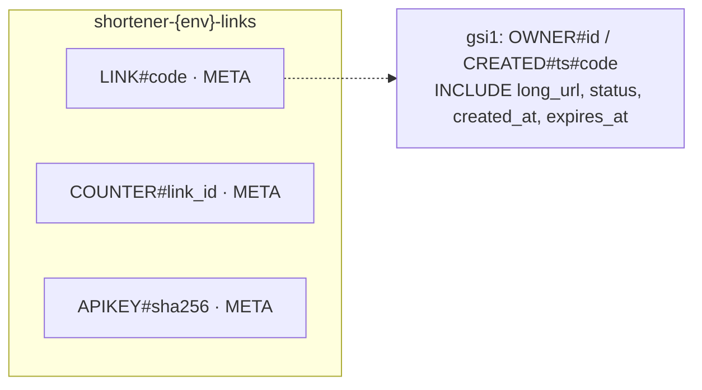

# ADR-0004: DynamoDB for the link store

- **Status:** Accepted (eventually consistent redirect reads superseded by [ADR-0031](0031-consistent-link-reads-and-owned-idempotency-claims.md): link reads are strongly consistent)
- **Date:** 2026-10-14
- **Deciders:** project owner, coding agent

## Context

Every access pattern on links is a single-key lookup or a single-partition
query (SPEC §5.3): resolve a code, create a code if unused, allocate an ID
block, authenticate an API key by hash, and list one owner's links. At
interview scale (100 M new links/month, ~4 k redirects/s average, ~40 k peak)
storage reaches ~3 TB over five years (SPEC §2.3). At demo scale the tables are
nearly idle most of the time.

## Decision Drivers

- Single-digit-millisecond key lookups at any scale
- Atomic conditional writes for "create only if the code is unused"
- No connection pools to size across autoscaling Fargate tasks
- Zero idle cost in dev; horizontal scale without re-sharding
- Encryption with a CMK, PITR, deletion protection, TTL — all managed

## Considered Options

1. Amazon DynamoDB (on-demand)
2. Aurora PostgreSQL Serverless v2
3. RDS PostgreSQL (provisioned)
4. A key-value store only (Valkey with persistence)

## Decision

Chosen option: **1 — DynamoDB on-demand**, with *on-demand maximum throughput*
set as a cost cap, PITR, SSE with the environment CMK, deletion protection in
prod, and TTL on `ttl`.

Key implementation choices:

- **Conditional create:** `PutItem` with `attribute_not_exists(pk)`; a failed
  condition means the code is taken (409 for aliases, retry for generated codes).
- **Optimistic updates:** updates replace the item with
  `attribute_exists(pk) AND updated_at = :prev`; a lost race is retried.
- **Eventually consistent reads** on the redirect path (half the cost); a
  just-created link is also written through the API, which deletes any negative
  cache entry, so readers rarely see the replication window.
- **Soft delete:** deleted links keep their item so a code is never reissued.
- **Pagination cursors** are the `LastEvaluatedKey`, base64url-encoded and
  validated on the way back in (must belong to the caller's partition) so a
  forged cursor cannot read another owner's index partition.
- **Listing** filters `status <> deleted`; a page can therefore hold fewer
  than `limit` items (documented in the API).

## Consequences

### Positive

- O(1) operations with predictable latency; no connection management.
- Pay-per-request: dev costs cents when idle.
- Managed durability features (PITR, CMK, deletion protection) via Terraform.

### Negative

- No ad-hoc queries; analytics are served from a separate table and from
  S3 + Athena ([ADR-0005](0005-separate-links-and-analytics-tables.md), [ADR-0011](0011-analytics-hot-and-cold-paths.md)).
- Expired links are removed by TTL 30 days after expiry; after that, a custom
  alias can be registered again by someone else (acceptable: expired links are
  410 for 30 days first).
- Hot partitions are possible for a viral link's reads — mitigated by the
  Valkey cache ([ADR-0008](0008-elasticache-serverless-valkey.md)).

## Interview Angle

> "Every query is a key lookup or one partition, so a key-value store fits:
> conditional writes give me collision-safe creates, there are no connection
> pools to size, and it costs nothing when idle."

## Future Work

- DynamoDB global tables for multi-region active/active (SPEC §20).
