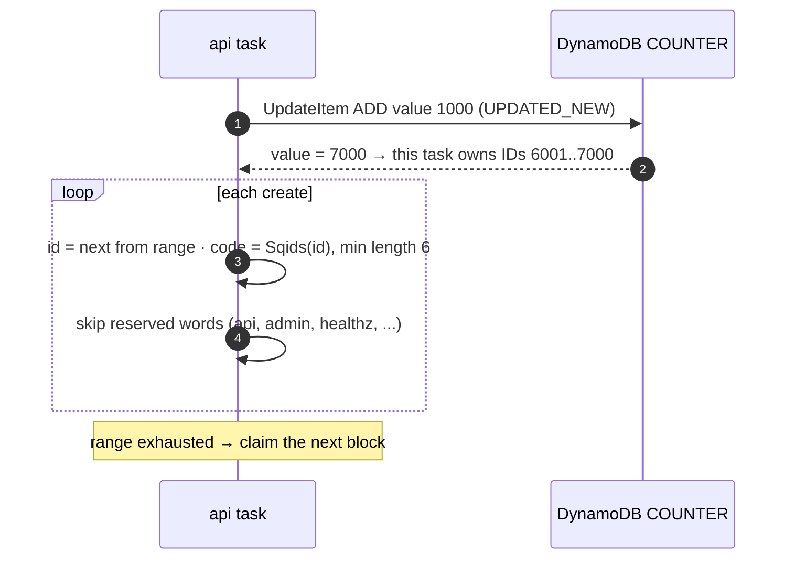

# ADR-0006: Short code generation — range allocation + Sqids

- **Status:** Accepted
- **Date:** 2026-10-14
- **Deciders:** project owner, coding agent

## Context

Every new link needs a short, unique code (SPEC §6). Multiple API tasks create
links concurrently. Codes should be short (≥ 6 chars), URL-safe, and should not
look sequential. Codes are **not secrets**: anyone with the link can use it.

## Decision Drivers

- Uniqueness without coordination on every create
- No collision retries in the common case
- Short codes (62⁶ ≈ 57 billion; 62⁷ ≈ 3.5 trillion)
- Not trivially enumerable in order
- Cheap: no extra service to run

## Considered Options

1. **Hash of the URL** (e.g. first 7 chars of base62(SHA-256(url)))
2. **Random code + collision check**
3. **Sequential counter + Base62** (one atomic increment per create)
4. **Key Generation Service with pre-generated keys** (a table of unused keys)
5. **Counter range allocation + Sqids** (lightweight KGS)

| Option | Uniqueness | Write cost | Collisions | Enumerable | Ops cost |
| --- | --- | --- | --- | --- | --- |
| Hash of URL | Needs check | 1 read + 1 write | Grow with table size | No | None |
| Random + check | Needs check | 1 write (conditional) | Birthday-bound, retries | No | None |
| Sequential Base62 | Guaranteed | 2 writes (counter is a hot key) | None | **Yes** | None |
| Pre-generated KGS | Guaranteed | Claim key + write | None | No | Generator job + key table |
| **Range + Sqids** | **Guaranteed** | **1 write (+1 per 1 000)** | **Only vs custom aliases** | **Not in order** | **None** |

## Decision

Chosen option: **5 — range allocation + Sqids** (`internal/keygen`).

- Block size 1 000 (`KEY_BLOCK_SIZE`): the counter is touched once per 1 000
  creates, so it never becomes a hot key.
- IDs left unused when a task stops are acceptable gaps.
- Sqids uses a shuffled alphabet from config (`SQIDS_ALPHABET`, non-secret),
  minimum length 6, and its default profanity blocklist.
- `PutItem` is conditional; a generated code can only collide with an existing
  **custom alias** — the ID is skipped and the next one tried (max 5).
- **Honesty note:** Sqids is obfuscation, not security. Codes decode back to
  IDs, which reveals approximate creation order and volume. That is acceptable
  because links are not secrets and unguessability is not a requirement.
  Enumeration is throttled by WAF rate rules and negative caching instead.

Verified by an integration test: 10 000 concurrent creates through two API
instances with block size 100 (≈ 100 interleaved block claims) produced
10 000 unique codes and zero failures.

## Consequences

### Positive

- No coordination per create; one DynamoDB write per link.
- No collisions between generated codes by construction.
- Codes do not look sequential (`gBHOc9`, `S8xca0`), unlike Base62 counters.

### Negative

- Codes are decodable; volume can be estimated by anyone who knows the alphabet.
- Changing `SQIDS_ALPHABET` after launch changes future codes (collisions
  with old codes are caught by the conditional write).
- Gaps in the ID space after restarts.

## Summary

Each server leases a block of 1 000 IDs with one atomic increment, then
encodes IDs with Sqids — uniqueness is guaranteed without coordination, the
counter is touched once per thousand writes, and codes don't look sequential.
It's obfuscation, not secrecy, and links aren't secrets anyway.
