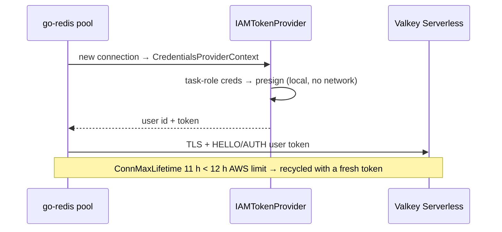

# ADR-0009: Valkey IAM authentication (no passwords)

- **Status:** Accepted
- **Date:** 2026-10-14
- **Deciders:** project owner, coding agent

## Context

ElastiCache supports password (AUTH token / RBAC user password) or IAM
authentication for Valkey 7.2+. Passwords would be another secret to create,
store, inject and rotate (SPEC §11.1 lists Valkey credentials as **none**).

## Decision Drivers

- No long-lived secrets for service-to-service auth
- Per-task-role, least-privilege access (`elasticache:Connect`)
- Works with go-redis connection pooling

## Considered Options

1. AUTH token (single shared password)
2. RBAC users with passwords in Secrets Manager
3. RBAC user with IAM authentication

## Decision

Chosen option: **3 — IAM authentication.** Facts verified against the
[ElastiCache IAM auth documentation](https://docs.aws.amazon.com/AmazonElastiCache/latest/dg/auth-iam.html)
on 2026-10-14:

- Requires TLS; user ID and user name must be identical.
- Token = SigV4 presigned `GET http://{cache-name}/?Action=connect&User={user-id}&ResourceType=ServerlessCache`,
  service `elasticache`, valid 15 minutes, with the `http://` prefix removed.
  Cache names are lowercased by ElastiCache, so the client lowercases too.
- IAM-authenticated connections are dropped after 12 hours.

Implementation (`internal/cache`):

- A fresh token is signed for **every new connection** (signing is local).
- `ConnMaxLifetime = 11h` so connections are recycled before AWS drops them.
- The task role is granted `elasticache:Connect` on exactly the cache ARN and
  the IAM user ARN (M4/M5 Terraform).
- Config validation refuses `CACHE_AUTH=none` and `CACHE_TLS=false` in dev/prod.

## Consequences

### Positive

- Nothing to store, inject or rotate; access follows the task role.
- Revocation is an IAM change; CloudTrail records authorization.

### Negative

- The cache user and user group must be modelled in Terraform.
- A clock-skewed task would mint invalid tokens (Fargate keeps time in sync).

## Interview Angle

> "The cache has no password at all: each new connection presents a
> 15-minute SigV4 token signed with the task's role, and the pool recycles
> connections before AWS's 12-hour cut-off."
