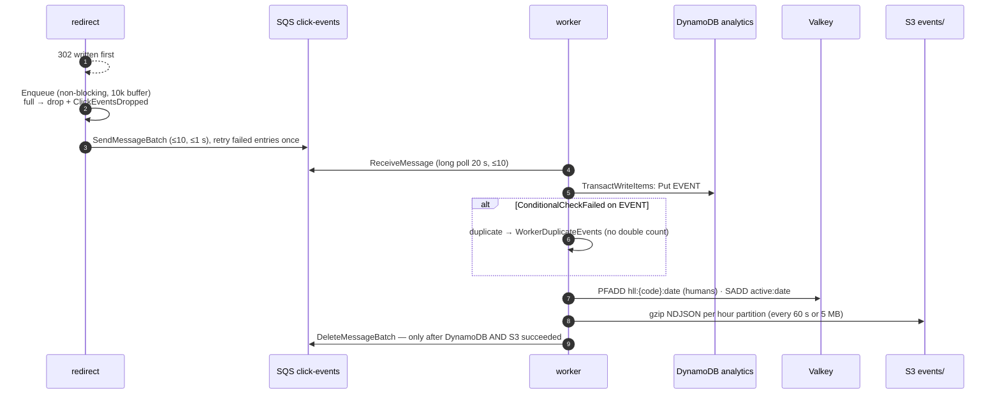

# ADR-0010: Async click pipeline — SQS, best-effort enqueue, idempotent worker

- **Status:** Accepted (per-event counting transaction superseded by [ADR-0024](0024-batched-exactly-once-click-counting.md))
- **Date:** 2026-10-14
- **Deciders:** project owner, coding agent

## Context

Every redirect produces a click. Counting must never slow down or fail a
redirect (SPEC N3), counters must be exactly-once although queues deliver
at-least-once (SPEC N5), and counts should be visible within 2 minutes (SPEC N4).

## Decision Drivers

- Redirect latency and availability are independent of analytics
- Exactly-once counts with at-least-once delivery
- Bounded memory and graceful shutdown on Fargate Spot
- Poison messages never block the pipeline or crash the worker
- Low fixed cost; scale to zero in dev

## Considered Options

1. Synchronous counter update on the redirect path
2. Kinesis Data Streams + consumer
3. SQS standard queue + worker service (best-effort producer, idempotent consumer)
4. CloudFront/ALB access logs → batch processing

## Decision

Chosen option: **3 — SQS + idempotent worker.**

**Producer (`internal/events`):** bounded channel (10 000), 4 sender goroutines
batching up to 10 messages or 1 s; failed batch entries are retried once, then
dropped and counted. On SIGTERM the HTTP server drains first, then the producer
stops accepting, flushes everything buffered and exits within the shutdown
budget (20 s; ECS `stopTimeout` 30 s).

**Consumer (`internal/worker`):**

- **Exactly-once counting:** the dedupe marker `EVENT#{event_id}` (TTL 3 days)
  is written in the same transaction as the counter increments, so a replay
  cancels the whole transaction. (`ClientRequestToken` is deliberately not
  used: it would report replays inside its 10-minute window as successes and
  hide them from `WorkerDuplicateEvents`; correctness does not depend on it.)
- **Delete after flush:** messages are deleted only after their DynamoDB write
  *and* the S3 object containing them are durable. If S3 fails, the batch is
  discarded and redelivered; DynamoDB absorbs the replay and Athena
  deduplicates S3 by `event_id`.
- **Poison messages** (bad JSON / unknown version) are never deleted: the
  worker sets their visibility to 0 so SQS moves them to the DLQ after
  `maxReceiveCount` 5 within seconds, not 5 × 120 s.
- **Transient failures** (throttling) leave the message for redelivery after
  the 120 s visibility timeout.
- **Valkey failures degrade uniques only**; they never push valid events to the DLQ.
- Flush interval + long-poll wait (≤ 80 s) stays below the 120 s visibility timeout.

Verified by integration tests: 500 clicks across 3 links match exactly;
re-sending all 500 events changes nothing; SIGTERM flushes buffered events;
SQS down → redirects still 302 and `ClickEventsDropped` rises; a poison message
reaches the DLQ while the worker keeps processing.

## Consequences

### Positive

- Redirects never wait for analytics; a queue outage loses clicks, not users.
- Exactly-once counts; replays are safe at any time within 3 days.
- Worker runs on Fargate Spot and scales on queue backlog (M5).

### Negative

- Counts are eventually consistent (seconds normally; worker outage → backlog).
- Best-effort enqueue drops clicks under extreme overload or SQS outage (alarmed).
- Redriving DLQ messages older than 3 days could double count (dedupe marker
  expired) — runbook says redrive within 3 days.
- Each click costs a 2–6 item transaction (2× write units).

## Interview Angle

> "The redirect writes the 302 first and drops the click into a non-blocking
> buffer that batches to SQS — analytics can never take redirects down. The
> worker makes at-least-once delivery exactly-once with a dedupe marker in the
> same DynamoDB transaction as the counters, and only deletes a message once
> both the counters and the raw-event file are durable."

## Future Work

- Kinesis Data Firehose for the S3 raw-event path instead of the worker's writer (SPEC §20).
