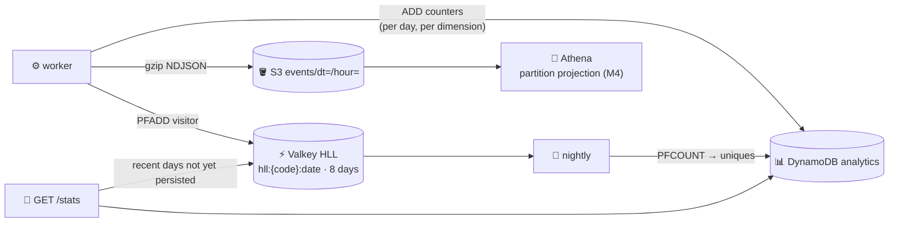

# ADR-0011: Analytics hot/cold paths — DynamoDB counters + S3/Athena

- **Status:** Accepted
- **Date:** 2026-10-14
- **Deciders:** project owner, coding agent

## Context

Owners want dashboards-style answers fast — clicks per day, uniques, top
referrers/countries/devices/browsers (SPEC F6) — while analysts occasionally
want arbitrary questions over the raw history. One store cannot serve both
cheaply.

## Decision Drivers

- Stats endpoint answers in a few single-partition queries
- Arbitrary historical queries without running a database
- Unique visitors without storing visitor lists
- Cost proportional to use; nothing to run when idle

## Considered Options

1. Raw events only (S3 + Athena) for everything
2. Pre-aggregated counters only (DynamoDB)
3. Hot path: pre-aggregated counters in DynamoDB + HyperLogLog; cold path: raw events in S3 queried by Athena
4. A time-series/OLAP database (Timestream, ClickHouse)

## Decision

Chosen option: **3 — hot and cold paths.**

**Hot path** (`internal/store/analytics.go`, `internal/analytics`):

| Item | Key | Counters |
| --- | --- | --- |
| Daily totals | `STATS#{code}` / `DAY#{date}` | `clicks` (humans), `bot_clicks`, `uniques` (nightly) |
| Dimension | `STATS#{code}` / `DIM#{ref\|country\|device\|browser}#{date}#{value}` | `clicks` (humans) |

- `clicks` and `bot_clicks` are **disjoint**: bots are counted, but excluded
  from `clicks`, from every dimension, and from uniques.
- Dimension values are normalized and capped at 64 chars: referrer host only
  (`direct` when absent), ISO country (`unknown`), device class
  (desktop/mobile/tablet/bot/other) and browser name from a small UA parser.
- Stats = one `Query` for days + one per dimension (`sk BETWEEN`), zero-filled
  daily series, top 10 per dimension, max 90 days.
- **Uniques:** per-day HyperLogLog (≈ 0.81 % error, 12 KB max per key, exact
  in practice at small cardinalities). The nightly job persists yesterday's
  `PFCOUNT`; the stats endpoint reads the live HLL for recent days that are not
  yet persisted. Multi-day uniques are not computed (visitor IDs rotate daily — [ADR-0018](0018-privacy-hmac-visitor-ids-referrer-host-only.md)).

**Cold path:** raw events in S3 as gzip NDJSON under
`events/dt=YYYY-MM-DD/hour=HH/`, queried by Athena with partition projection
(M4). Objects may contain duplicates (redelivery after a failed flush), so
queries deduplicate by `event_id`.

## Consequences

### Positive

- Stats reads are a handful of single-partition queries regardless of history size.
- Raw history is cheap (S3) and fully queryable without a database.
- Uniques cost kilobytes per link-day, not a visitor list.

### Negative

- Write amplification: up to 6 items per human click.
- Top-N is computed at read time over the range; at very high cardinality
  (millions of referrers) it would need pre-aggregated top-N items.
- Uniques for days older than 8 days exist only if the nightly job ran.

## Interview Angle

> "Two paths: counters that are pre-aggregated at write time so the dashboard
> is a few key lookups, and the raw events in S3 for anything ad hoc via
> Athena. Uniques come from HyperLogLog — kilobytes instead of visitor lists."
