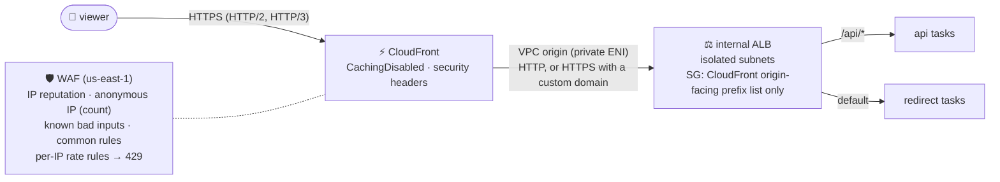

# ADR-0012: CloudFront VPC origin with internal ALB and WAF

- **Status:** Accepted
- **Date:** 2026-10-14
- **Deciders:** project owner, coding agent

## Context

The services must have no public ingress except the edge (SPEC N7). The
classic "public ALB restricted to CloudFront's IP ranges plus a secret header"
pattern still leaves a public endpoint that can be scanned and attacked.
CloudFront VPC origins (2024) let CloudFront reach an **internal** ALB in
private subnets.

## Decision Drivers

- No internet-reachable origin at all
- Global TLS termination, HTTP/2 and HTTP/3, DDoS absorption at the edge
- WAF in front of everything (managed rules, rate limits)
- Trustworthy viewer IP and country for analytics (ADR-0018)

## Considered Options

1. Public ALB + WAF (no CloudFront)
2. CloudFront → public ALB restricted by prefix list + custom secret header
3. CloudFront → **VPC origin** → internal ALB, WAF on CloudFront
4. API Gateway HTTP API + VPC link

## Decision

Chosen option: **3** (`infra/modules/edge`).

- **ALB**: `internal = true`, isolated subnets, `drop_invalid_header_fields`,
  deletion protection unless `force_destroy`, access logs to the SSE-S3 log
  bucket (ALB log delivery supports only SSE-S3). Its security group admits only
  `com.amazonaws.global.cloudfront.origin-facing` and may only reach the task
  security groups on 8080. Target groups: IP targets, `/healthz`, 15 s deregistration delay.
- **CloudFront**: VPC origin; **both behaviors use the managed `CachingDisabled`
  policy** (ADR-0007); a custom origin request policy forwards `Authorization`,
  `Content-Type`, `Idempotency-Key`, `User-Agent`, `Referer`,
  `CloudFront-Viewer-Country`, `CloudFront-Viewer-Address` and all query strings
  (no cookies); managed security-headers policy (HSTS); PriceClass_100;
  standard logging v2 to a CMK-encrypted CloudWatch log group.
- **WAF** (CLOUDFRONT scope): `AmazonIpReputationList`, `AnonymousIpList` (count
  first), `KnownBadInputsRuleSet` (incl. Log4j), `CommonRuleSet` (with
  `SizeRestrictions_BODY` counted so the API returns its own 413), and per-IP
  rate rules for `/api/*` and redirects that answer **429** with `Retry-After`.
  Logs redact `authorization`.

Facts verified against AWS documentation on 2026-10-14:

- VPC origins need an internet gateway in the VPC (not used for routing) and
  are **not supported in `use1-az3`**; subnets are chosen by AZ ID (ADR-0013).
- The ALB security group may allow the CloudFront origin-facing prefix list (used
  here; can be set before the VPC origin exists) or the service-managed
  `CloudFront-VPCOrigins-Service-SG` (stricter, but only after creation).
- `Authorization` can be forwarded via an origin request policy; with caching
  disabled there is no risk of serving one caller's response to another.
- CloudFront strips `Authorization` on GET/HEAD unless it is forwarded — without
  the custom policy, authenticated GETs would fail with 401.
- With the default `*.cloudfront.net` certificate AWS fixes the viewer TLS
  policy; `TLSv1.2_2021` requires the optional custom domain + ACM certificate.

**Deviations recorded:**

- AWS provider 6.x supports a per-resource `region` argument; the WAF, viewer
  certificate and CloudFront/WAF log groups use `region = "us-east-1"` instead of
  the provider alias SPEC §12.1 describes (same result, no alias plumbing, and
  the module stays independently validatable).
- Without a custom domain the CloudFront→ALB hop is HTTP inside the AWS network
  (accepted risk, threat model); `domain_name` switches to HTTPS end to end
  (`origin.{domain}` certificate, `ELBSecurityPolicy-TLS13-1-2-2021-06`).

## Consequences

### Positive

- The origin has no public IP or DNS name reachable from the internet.
- Viewer IP/country headers are trustworthy because only CloudFront can reach the ALB.
- WAF and DDoS protection apply before traffic enters the VPC.

### Negative

- ALB + WAF fixed costs (~$28/month) even for a demo.
- CloudFront changes take minutes to deploy; distributions must be disabled before deletion.
- VPC-origin AZ restrictions constrain subnet placement.

## Interview Angle

> "There's no public origin to attack: CloudFront reaches an internal ALB
> through a VPC origin, the ALB only admits CloudFront's origin-facing
> addresses, and WAF plus rate limits sit at the edge. Nothing is cached there,
> because every click must reach the origin."
