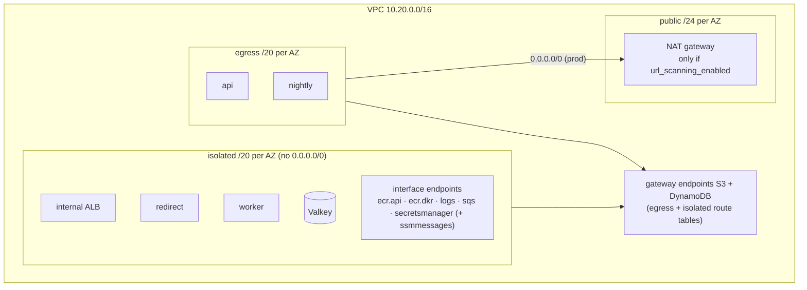

# ADR-0013: Subnet tiers, VPC endpoints, NAT only for URL scanning

- **Status:** Accepted
- **Date:** 2026-10-14
- **Deciders:** project owner, coding agent

## Context

The services need AWS APIs (ECR, CloudWatch Logs, SQS, Secrets Manager,
DynamoDB, S3) but almost nothing on the public internet. The only outbound
internet dependency is Google Safe Browsing, called by `api` (at create/update)
and `nightly` (rescans) — and only when URL scanning is enabled. A NAT gateway
costs ~$33/month plus data processing per AZ; interface endpoints cost
~$7.30/month per endpoint per AZ (prices verified 2026-10-14, `docs/cost.md`).

## Decision Drivers

- No internet route for anything that does not need one (exfiltration, C2 resistance)
- Reach AWS APIs privately
- Lowest idle cost in dev; HA in prod
- CloudFront VPC origins need specific AZs and an internet gateway

## Considered Options

1. Public subnets for tasks (public IPs, no NAT)
2. Private subnets for everything with a NAT gateway per AZ
3. Three tiers: public (NAT only), private egress (only tasks that call the internet), private isolated (no internet route) + VPC endpoints; NAT only when scanning is enabled

## Decision

Chosen option: **3** (`infra/modules/network`).

- **Gateway endpoints** (free) for S3 and DynamoDB on both private route
  tables. Policies: DynamoDB limited to `shortener-{env}-*` tables; S3 limited to
  buckets owned by this account (`aws:ResourceAccount`) **plus the AWS-owned ECR
  layer bucket `prod-{region}-starport-layer-bucket`**, without which image pulls fail.
- **Interface endpoints** in isolated subnets with private DNS; their security
  group admits 443 only from a `vpce-clients` group that tasks attach.
  `interface_endpoint_az_count` = 1 in dev (a single AZ outage only affects
  dev), all AZs in prod. `ssmmessages` only when ECS Exec is enabled (dev).
- **NAT** exists only when `url_scanning_enabled = true` (prod default). In dev
  the egress tier has no default route; `api`/`nightly` use the noop scanner and
  emit `URLScanSkipped`.
- **AZ selection by AZ ID**, excluding `use1-az3`: CloudFront VPC origins do not
  support it ([docs](https://docs.aws.amazon.com/AmazonCloudFront/latest/DeveloperGuide/private-content-vpc-origins.html),
  verified 2026-10-14). The internet gateway exists because VPC origins require
  one, even though nothing routes through it except the NAT.
- **Flow logs** (all traffic) to a CMK-encrypted log group (14 days dev, 90 prod).
- The default security group has no rules.

Surprises recorded during implementation:

- ALB access logs and S3 server access logs support only **SSE-S3** targets, so
  those land in a dedicated SSE-S3 log bucket (`infra/modules/log-bucket`).
- `aws_availability_zones` is filtered by state and opt-in status; subnets are
  keyed by AZ ID so a new AZ never moves existing subnets.

## Consequences

### Positive

- Redirect, worker, ALB and Valkey cannot reach the internet at all.
- Dev idles without NAT; endpoint cost scales with AZ count only where HA matters.

### Negative

- Interface endpoints are the largest fixed dev cost (~$44/month for six).
- A new AWS dependency needs a new endpoint (e.g. ECS Exec → ssmmessages).
- Single NAT in prod is an AZ-level single point of failure for scanning only;
  scanning fails open to `pending`, so redirects and creates are unaffected.

## Summary

Three tiers: the hot path and the cache live in subnets with no internet
route at all and reach AWS through endpoints; only the two tasks that call
Safe Browsing get NAT egress, and in dev there's no NAT at all.

## Future Work

- IPv6 egress-only gateway instead of NAT for Safe Browsing (no NAT hourly cost).
