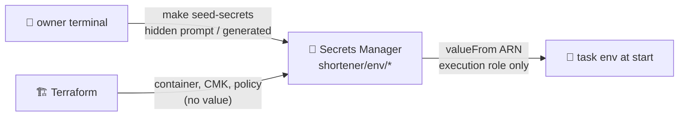

# ADR-0014: Secrets management — Secrets Manager, out-of-band values, nothing in state

- **Status:** Accepted
- **Date:** 2026-10-14
- **Deciders:** project owner, coding agent

## Context

Two runtime secrets exist (SPEC §11.1): the Google Safe Browsing API key
(`api`, `nightly`) and the visitor-hash salt (`redirect`). API keys are stored
as hashes in DynamoDB ([ADR-0015](0015-api-key-authentication.md)); Valkey and AWS need no credentials (IAM).
Terraform state is readable by anyone with state access, so any value Terraform
manages — including `random_password` and `aws_secretsmanager_secret_version` —
is effectively stored in plain text in state.

## Decision Drivers

- Secret values never in git, tfvars, Terraform state, images, build args, logs or CI logs
- Least privilege: only the consuming task can decrypt its secret
- Simple rotation procedures

## Considered Options

1. Terraform-generated values (`random_password` + secret version)
2. SSM Parameter Store SecureString
3. Secrets Manager containers in Terraform; values written out of band by a human-run script

## Decision

Chosen option: **3**.

- `infra/modules/secrets` creates `shortener/{env}/safe-browsing-api-key` and
  `shortener/{env}/visitor-hash-salt` with the environment CMK and a recovery
  window of 0 (dev, for clean teardown) or 30 days (prod).
- A resource policy **denies `GetSecretValue` to every principal except the
  listed readers** (each service's execution role, wired in M5). With no readers
  configured, nobody can read the value — not even CI.
- `scripts/seed-secrets.sh` (human-run): `set -euo pipefail`; the salt is
  generated with `get-random-password`; the API key is read with `read -rs`;
  values are passed to the CLI through a `/dev/fd` file descriptor
  (`file://<(printf …)`, printf being a shell builtin), so they never appear in a
  process argument list, on disk, or in output. Existence is checked with
  `list-secret-version-ids` (metadata only). Idempotent; `--rotate` replaces.
- ECS injects values through the task definition `secrets` block (`valueFrom`
  = ARN); only the execution role may `GetSecretValue` on that ARN and
  `kms:Decrypt` with `kms:ViaService = secretsmanager.{region}.amazonaws.com`.
- In code, secrets are a `config.Secret` type whose `String`, `GoString`,
  `LogValue` and `MarshalText` all redact.
- No automatic rotation (checkov `CKV2_AWS_57` suppressed with justification):
  the Safe Browsing key is issued by Google, and rotating the salt resets
  unique-visitor continuity; both follow runbook procedures.

## Consequences

### Positive

- State, plans, CI logs and the repository never contain a secret value.
- Compromise of the CI plan role does not expose secrets (explicit deny + no reader).

### Negative

- A manual step between foundation and services (two-phase deploy).
- Rotation is manual (documented, rare).

## Summary

Terraform creates the secret's container, encryption and access policy, but
never the value — anything Terraform touches ends up in state. A human seeds
the value from their terminal, and only the consuming task's execution role
can read it.
