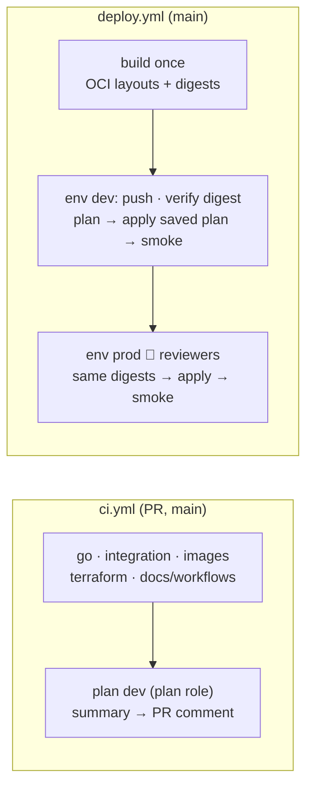

# ADR-0017: CI/CD with GitHub Actions OIDC; rolling deploys with circuit breaker (vs ECS blue/green)

- **Status:** Accepted (deployment strategy decided in M5; CI/CD completed in M8)
- **Date:** 2026-10-14
- **Deciders:** project owner, coding agent

## Context

Deploys must be reproducible, auditable and safe to roll back, without
long-lived AWS keys in CI (SPEC §14). Terraform owns the task definitions
(SPEC §12.4): a deploy is a `terraform apply` with a new `image_tag`.

## Decision Drivers

- Same artifact in every environment (no rebuild for prod)
- Automatic rollback of bad deploys
- Minimal moving parts; no extra deployment service
- No static credentials anywhere

## Considered Options

1. Rolling deploys with the ECS deployment circuit breaker
2. ECS blue/green (CodeDeploy, or ECS-native blue/green)
3. Canary/linear traffic shifting

## Decision (deployment strategy — M5)

Chosen option: **1 — rolling deploys with the circuit breaker and rollback.**

- `deployment_minimum_healthy_percent = 100`, `deployment_maximum_percent = 200`:
  new tasks start before old ones stop; capacity never drops.
- `deployment_circuit_breaker { enable = true, rollback = true }`: if new tasks
  keep failing health checks (container `healthcheck`, ALB `/healthz`), ECS stops
  the deployment and restores the last healthy task definition.
- `wait_for_steady_state = true`: `terraform apply` waits for the deployment and
  fails when the circuit breaker rolls back, so CI goes red.
- **Images are immutable and tagged with the git SHA**; `make push-images`
  refuses dirty trees. Prod receives the *same digest* that passed dev (M8
  promotes it, no rebuild).
- **Rollback procedure**: re-apply the previous `image_tag` (runbook).
- Graceful shutdown makes rolling deploys lossless: the ALB deregistration
  delay is 15 s, then SIGTERM; redirect drains HTTP and flushes buffered clicks
  within 20 s (`stopTimeout` 30 s).

**Why not blue/green:** it adds a second target group, test listeners and
traffic-shifting configuration for little gain at this scale; the circuit
breaker already provides automatic rollback. ECS-native blue/green is listed as
future work (SPEC §20).

## Decision (CI/CD — M8)

Chosen: **GitHub Actions + OIDC roles from `infra/bootstrap`**, with every
step a Makefile target (`make ci` runs the same checks locally).

- **Workflows:**
  - `ci.yml` runs five parallel jobs: Go lint/unit/vuln/secret scans;
    integration against compose; images (arm64 build, non-root/size checks,
    Trivy); Terraform (fmt, validate, tflint, checkov, Trivy, `terraform test`,
    plan invariants, IAM checks); docs and workflows (markdown, Mermaid,
    links, threat-model status, actionlint, zizmor, pins).
  - For same-repository PRs, a `plan-dev` job assumes the read-only plan
    role and posts `plan-summary.txt` to the PR.
- **Build once, promote digests:**
  - `make images-oci` builds single-platform arm64 OCI layouts, without
    attestations, so each service has exactly one manifest digest.
  - `scripts/push-images.sh` pushes them with `crane` (pinned, checksum-verified)
    and fails unless ECR reports **that** digest.
  - Prod receives the identical layout artifact, so dev and prod run
    byte-identical images. Re-pushing an existing tag with the same digest
    is accepted; a different digest fails.
- **Apply = the saved plan:** each environment runs `scripts/ci-config.sh`
  (backend and JSON tfvars, nothing secret), `make plan` and `make apply`.
  In CI the plan refuses local state and example values.
- **Approvals are human:**
  - dev deploys what was merged into the protected `main` (a reviewed PR
    with required checks);
  - prod waits for the `prod` environment's required reviewers.
  - The workflow sets `APPROVED=yes` (and `PROD_APPLY_CONFIRMED=yes` for prod)
    only in those jobs, to record that approval for the scripts.
- **Hardening:**
  - top-level `permissions: {}`; per job, `contents: read`, plus
    `id-token: write` only where a role is assumed and `pull-requests: write`
    only for the plan comment;
  - `persist-credentials: false`;
  - every action pinned to a full SHA with a version comment
    (`scripts/check-pins.sh`); untrusted values passed via `env`, never
    interpolated into scripts;
  - no tool cache in the release workflow;
  - `concurrency` per environment that never cancels an apply;
  - zizmor clean even at the `auditor` persona.
- **OIDC:** each role's trust policy requires `aud = sts.amazonaws.com` and an
  exact `sub` (`repo:<repo>:pull_request`, or `repo:<repo>:environment:<env>`).
  Each role carries the permissions boundary (tests in `infra/bootstrap`).
- **Dependabot** covers Go modules, actions, the Dockerfile and compose
  images, Terraform providers, and the Python and Node tool pins.

**Deviations recorded:**

- The deploy pipeline needs phase 1 applied and secrets seeded first (human
  steps), and always deploys with `enable_services = true`.
- Image attestations (provenance/SBOM) are off to keep one digest per image.
  Signing is future work.

## Consequences

### Positive

- One mechanism for deploy and rollback (`image_tag`), visible in Terraform state.
- Bad deploys roll back automatically and fail the pipeline.

### Negative

- Every job installs the pinned toolchain (`make tools`); without a cache in
  the release path this adds a few minutes per deploy.

- No traffic shifting: a bad version that passes health checks serves 100 %
  of traffic until detected by alarms (mitigated by smoke tests after deploy).
- Rolling deploys briefly run two versions side by side (both must be compatible).

## Interview Angle

> "Every deploy is an apply with a new git-SHA image tag; ECS rolls tasks with
> full capacity, and the circuit breaker automatically rolls back a version
> that can't get healthy — Terraform fails, so the pipeline fails."
