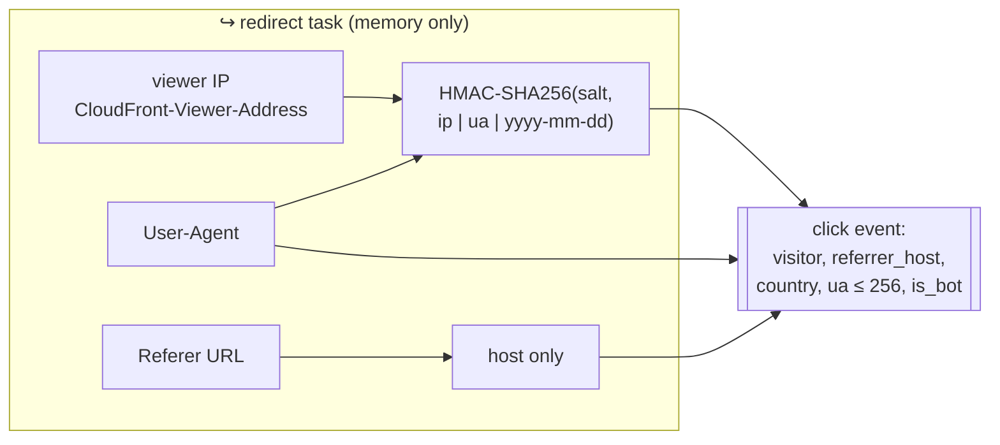

# ADR-0018: Privacy — HMAC visitor IDs, referrer host only

- **Status:** Accepted
- **Date:** 2026-10-14
- **Deciders:** project owner, coding agent

## Context

Analytics need unique visitors, referrers, countries and device classes
(SPEC F6), but no raw IP may be stored anywhere and referrers are stored as
host only (SPEC N6). Click events flow through SQS, the worker, DynamoDB, S3
and Athena — every hop is a place data could leak.

## Decision Drivers

- Raw IPs never leave the redirect service's memory
- Unique counting must still work within a day
- Visitor IDs must not be reversible (IPv4 space is only 2³² — unkeyed hashes are trivially brute-forced)
- Referrer URLs can contain tokens, emails or search terms

## Considered Options

1. Store raw IP (or truncated /24) and full referrer
2. Unkeyed SHA-256(ip | ua)
3. Keyed HMAC-SHA256(salt, ip | ua | date), referrer host only

## Decision

Chosen option: **3** (`internal/visitor`).

- The salt is the `visitor-hash-salt` secret (Secrets Manager, injected only
  into the redirect task). Without it, IDs cannot be reversed.
- The date in the HMAC input makes IDs unlinkable across days: uniques are
  per-day counts, and nobody can follow a visitor over time.
- Referrer → lowercase host only; country from `CloudFront-Viewer-Country`;
  dimension values normalized and capped at 64 characters.
- The client IP comes from `CloudFront-Viewer-Address`, trustworthy only because
  the ALB is reachable solely via CloudFront (ADR-0012); locally the TCP peer.
- Logs never contain IPs, API keys, `Authorization`, or destination URLs on
  the redirect path (verified by unit tests).
- User agents are kept (truncated to 256 bytes) for device/browser
  classification; they are low-identifying on their own.

## Consequences

### Positive

- No personal data at rest beyond truncated user agents; minimal compliance surface.
- Uniques still work (HyperLogLog over daily visitor IDs).

### Negative

- Unique visitors are per day; multi-day "uniques" cannot be computed exactly.
- Rotating the salt resets continuity for the current day (runbook procedure).
- Visitors behind one NAT with the same browser count once (accepted).

## Interview Angle

> "The IP never leaves memory: I keep a keyed, per-day HMAC of IP plus user
> agent, which still counts uniques but can't be reversed or tracked across
> days, and I keep only the referrer's host."
