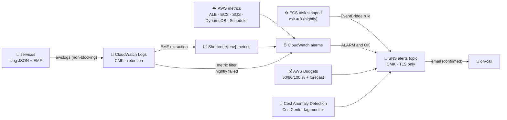

# ADR-0022: Observability, alerting and cost guardrails (EMF, CloudWatch alarms, Budgets, Cost Anomaly Detection)

- **Status:** Accepted
- **Date:** 2026-10-14
- **Deciders:** project owner, coding agent

## Context

SPEC §13 requires structured logs, a fixed set of application metrics, one
dashboard per environment, alarms on the SLOs and the click pipeline delivered
to SNS with an email subscription, and budget notifications. SPEC N1–N4 set
the targets the alarms protect. The demo runs in a single account with dev and
prod side by side ([ADR-0019](0019-single-aws-account-for-dev-and-prod.md)), so every signal and every cost figure must be
scoped to one environment.

## Decision Drivers

- Alert on symptoms users feel (5xx, latency, lost clicks, stale stats), not on every cause
- No extra agents, sidecars or network endpoints on the hot path
- Every alert path is encrypted and tested; nothing silently unwired
- Cost visibility per environment, before the bill arrives

## Considered Options

1. **CloudWatch native:** EMF metrics via `awslogs`, CloudWatch alarms and dashboard, SNS, AWS Budgets, Cost Anomaly Detection
2. OpenTelemetry collector sidecar → Amazon Managed Prometheus/Grafana
3. Third-party SaaS (Datadog, Grafana Cloud)

## Decision

Chosen option: **1 — CloudWatch native**, in two modules
(`infra/modules/observability`, `infra/modules/budget`).

- **Metrics:** CloudWatch Embedded Metric Format written to stdout (namespace
  `Shortener/{env}`, dimension `Service`), aggregated per flush with
  reservoir-sampled latencies. There are no `PutMetricData` calls and no
  monitoring endpoint. `scripts/check-metrics.sh` fails if any SPEC metric is
  not defined, not emitted, or missing from the dashboard.
- **Alarms** (all → SNS on ALARM and OK; `treat_missing_data = notBreaching`;
  "for N minutes" means every datapoint in the window breaches):

  | Alarm | Signal | Window |
  | --- | --- | --- |
  | `redirect-5xx` | `100 × HTTPCode_Target_5XX_Count / RequestCount` > 1 % (redirect target group) | 5 × 1 min |
  | `redirect-latency-p99` | ALB `TargetResponseTime` p99 > 100 ms | 10 × 1 min |
  | `running-tasks-{redirect,api,worker}` | Container Insights `DesiredTaskCount − RunningTaskCount` > 0 | 5 × 1 min |
  | `queue-age` | `ApproximateAgeOfOldestMessage` > 300 s | 1 × 5 min |
  | `dlq` | DLQ `ApproximateNumberOfMessagesVisible` > 0 | 1 × 5 min |
  | `dropped-clicks` | `ClickEventsDropped` > 0 | 3 × 5 min |
  | `dynamodb-throttles-{links,analytics}` | `ReadThrottleEvents + WriteThrottleEvents` > 0 | 5 × 1 min |
  | `cache-errors` | Σ `CacheErrors` over services > 50 | 1 × 5 min |
  | `cache-invalidation-failed` | Σ `CacheInvalidationFailed` > 0 (addition: the threat model relies on it) | 1 × 5 min |
  | `nightly-schedule-failures` | Scheduler `TargetErrorCount + InvocationDroppedCount` > 0 (own schedule group) | 1 × 5 min |
  | `nightly-failed` | log metric filter `{ $.msg = "nightly failed" }` | 1 × 5 min |

  The redirect 5xx alarm is a rate, not a count, so low traffic cannot trip it.
  A nightly crash that never logs (OOM kill, image pull failure) is caught by an
  EventBridge rule on `ECS Task State Change` with a non-zero exit code.
- **SNS:** one topic per environment, encrypted with the environment CMK. The
  topic policy admits CloudWatch alarms and EventBridge rules by source ARN
  prefix, and Budgets and Cost Anomaly Detection by source account. It denies
  non-TLS publish and subscribe. The KMS key policy grants those four service
  principals `kms:GenerateDataKey*`/`kms:Decrypt`, scoped by `aws:SourceAccount`.
- **Dashboard:** created in phase 2. It shows golden signals per service, the
  redirect cache hit ratio, the click pipeline, queue and DLQ, ECS
  utilisation, DynamoDB throttles and capacity, WAF allowed/blocked/counted, and
  estimated charges.
- **Log retention everywhere:** every log group is Terraform-managed with
  retention and the CMK. This includes the Container Insights performance
  group, which ECS would otherwise create with no expiry and an AWS-owned
  key. `scripts/check-plan-invariants.sh` checks every planned log group,
  alarm and topic.
- **Cost:** an AWS Budget per environment (50/80/100 % actual, 100 %
  forecast) and a customer-managed Cost Anomaly Detection tag monitor with
  immediate alerts above a USD threshold.

**Deviations recorded:**

- **`CostCenter` default tag (addition to SPEC §12.1's tag set):** a
  customer-managed tag monitor filters on **one** tag key (up to 10 values;
  AWS documentation checked 2026-10-14), and `Environment = dev` alone is not
  unique to this project in a shared account. Every environment therefore
  carries `CostCenter = <project>-<env>`, and the budget and the anomaly
  monitor both filter on it. Bootstrap resources carry `<project>-shared`.
- **Tag activation is a second step:** Billing lists a tag key only after it
  has seen tagged usage (up to 24 hours). `infra/bootstrap` activates
  `CostCenter` when `activate_cost_allocation_tag = true`. Until then the budget
  and the monitor see $0.
- Tag-based anomaly monitors can only be created in a management or
  standalone account. In an AWS Organizations member account the
  `aws_ce_anomaly_monitor` create fails. The budget still works; the fallback is
  an account-level monitor (future work).

## Consequences

### Positive

- No collectors or sidecars: metrics cost only log ingestion, and the
  redirect path never blocks on telemetry.
- Each alarm maps to a runbook procedure; SLOs (N1, N2) are read straight off
  the alarms and dashboard.
- Spend is visible per environment within a day, with forecasts.

### Negative

- CloudWatch dashboards and alarms are less flexible than PromQL/Grafana.
- EMF percentiles come from sampled values (≤ 100 per flush), not exact
  histograms. The authoritative latency SLI is the ALB's `TargetResponseTime`.
- Budgets and anomaly detection lag usage by up to 24 hours; they are
  guardrails, not real-time limits.
- Email alerting depends on a human confirming the subscription.

## Interview Angle

> "Services print EMF to stdout, so metrics come for free with the logs. That
> means no agent and no extra endpoint. The alarms watch what users feel —
> redirect error rate, p99, lost clicks, stale analytics — and every alarm,
> budget and anomaly alert goes to one encrypted SNS topic. A plan-level check
> fails the build if any log group lacks retention or encryption, or if an
> alarm has no action."

## Future Work

- Composite alarms and SLO burn-rate alerts (multi-window) for prod.
- CloudWatch Application Signals / X-Ray tracing.
- An account-level Cost Anomaly monitor fallback for AWS Organizations member accounts.
- Chat delivery (Amazon Q Developer in chat applications) subscribed to the same topic.
