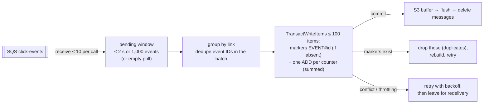

# ADR-0024: Batched exactly-once click counting

- **Status:** Accepted (supersedes the per-event transaction of [ADR-0010](0010-async-click-pipeline.md); the rest of [ADR-0010](0010-async-click-pipeline.md) stands)
- **Date:** 2026-10-15
- **Deciders:** project owner, coding agent

## Context

[ADR-0010](0010-async-click-pipeline.md) and SPEC §8.2 count every click with its own DynamoDB transaction: a
dedupe marker `EVENT#{id}` plus `ADD 1` on the day item and four dimension
items. That is simple and exactly-once, but it has two problems that appear
well below "web scale":

- **Cost:** a transactional write costs 2 write units per item, so every click
  costs about **12 WRU**. At the interview-scale average from
  [design §2](../design.md#2-back-of-envelope-estimates) (4,000 clicks/s) that
  is about 48,000 WRU/s for analytics alone.
- **Hot links:** every click on a link updates the same `DAY#date` item. A
  single item sustains about 1,000 writes per second, so a viral link would
  throttle its counting at a few hundred clicks per second. Redirects keep
  working by design ([ADR-0010](0010-async-click-pipeline.md)), but those clicks are delayed or dropped.

"What happens when one link goes viral?" is the most likely interview
follow-up, and the answer must not be "we stop counting it".

## Decision Drivers

- Keep counting **exactly-once** on an at-least-once queue (SPEC N5)
- Remove the hot-item bottleneck for popular links
- Cut write cost when traffic is concentrated, which is the normal case
- Keep stats fresh (SPEC N4: within 2 minutes)
- No new infrastructure

## Considered Options

1. Status quo: one transaction per event
2. **Batched transactions:** one transaction carries many events' markers and their *summed* counter updates
3. Per-minute aggregation without per-event markers (dedupe by batch or window ID)
4. Write-sharded counters (`DAY#date#shard-n`, summed on read)
5. Stream aggregation (Kinesis + Flink) in front of DynamoDB

## Decision

Chosen option: **2 — batched transactions**
([`store.RecordClicks`](../../internal/store/analytics.go),
[`worker`](../../internal/worker/worker.go)).

- **Window:** the worker decodes messages into a pending window. It commits
  after `WORKER_COUNT_INTERVAL` (2 s), at `WORKER_COUNT_MAX_EVENTS` (1,000),
  when a long poll returns empty, before every S3 flush and at shutdown.
  Freshness gains at most 2 s.
- **Transactions:** events are grouped by link and packed into transactions
  of at most 100 items. Each transaction contains the marker of **every**
  click it counts, plus one `ADD :n` per distinct counter item with the summed
  delta. A transaction commits exactly the clicks whose markers it creates, so
  counting stays exactly-once without any cross-transaction coordination.
- **Duplicates:** an event repeated within the batch is resolved before
  writing. When DynamoDB cancels a transaction because some markers already
  exist (the per-item `CancellationReasons` say which), those clicks are marked
  duplicates, and the transaction is rebuilt without them and retried.
- **Failures:** `TransactionConflict` (two workers updating the same hot
  counter) and throttling are retried with backoff (4 attempts). Clicks still
  uncommitted are reported as failed. Their messages are not deleted, so SQS
  redelivers them and the markers absorb any partial success. Messages are
  deleted only after counting **and** the S3 flush succeed (unchanged).
- **One operation per item:** a transaction may touch each item only once,
  so a day's human and bot clicks on the same `DAY#` item become one update
  with two `ADD` clauses. The integration test caught the first version
  issuing two updates; the unit-test fake now enforces the rule.
- **Visibility:** the new `WorkerCountTransactions` metric, divided by
  `WorkerEventsProcessed`, shows clicks per counting write.

**Cost per click** (transactional writes are 2 WRU per item):

| Traffic shape | Items per transaction | WRU per click |
| --- | --- | --- |
| Every click on a different link (worst case) | 1 marker + 5 counters | 12 (unchanged) |
| Hot link, 91 clicks with shared dimension values | 91 markers + 9 counters | ≈ 2.2 (**≈ 5.5× cheaper**) |
| A counter item | written once per transaction, not once per click | **up to ~90× fewer writes** |

**Measured** (integration test against the local emulators): 1,500 clicks on
one link, each delivered twice, were counted exactly in **17 transactions,
88 clicks per counting write**, with all 1,500 replays detected as duplicates.

Real traffic is concentrated: a few links get most clicks, and dimension
values repeat. Most clicks therefore fall in the cheap case, and the costly
case only applies to traffic that never stressed a single item anyway.

**Deviation recorded:** SPEC §8.2 says "for each message: TransactWriteItems".
Approved by the project owner on 2026-10-15; noted in GATES.md.

**Why not the others:**

- **Option 3** (per-minute aggregation) writes counters once per minute, but
  a minute's markers cannot fit in one transaction (100-item limit). Without
  per-event markers, exactly-once needs a different mechanism (FIFO
  deduplication, windowed state), and counting would become approximate.
- **Option 4** (sharded counters) fixes hot items but not cost, and makes
  every stats read fan out.
- **Option 5** (stream aggregation) is the 100× answer
  ([design §12](../design.md#12-scaling-to-100)) but adds a stream
  processor to run and pay for.

## Consequences

### Positive

- A viral link no longer throttles its own counting. Its counters are
  written once per transaction, and a single worker sustains thousands of
  counted clicks per second for one link.
- Concentrated traffic costs ~5× fewer write units; exactly-once is unchanged.
- No new infrastructure, IAM or cost. Same table and items, so the API and
  stats are unaffected.

### Negative

- Counters appear up to 2 s later (well within the 2-minute target).
- Workers updating the same hot counter can conflict; conflicts are retried,
  and persistent conflicts fall back to redelivery.
- Worker code is more complex: batching, chunking, per-item cancellation reasons.
- Dedupe markers still cost 2 WRU per click; going below that needs option 3 or 5.

## Interview Angle

> "A viral link means one hot counter. I keep the dedupe marker per click,
> but sum the counter updates: one transaction carries up to ~90 clicks'
> markers and a single `+90` on each counter. That's still exactly-once,
> about 5× cheaper for hot traffic, and the hot item is written about 90×
> less often. Past that, you pre-aggregate in a stream processor."

## Future Work

- Adaptive windows (longer under load, shorter when idle).
- Option 5 (stream aggregation) at 100× scale.
