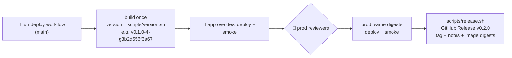

# ADR-0026: Release versioning with tags

- **Status:** Accepted
- **Date:** 2026-10-15
- **Deciders:** project owner, coding agent

## Context

Every image is tagged with its 12-character commit SHA, and that SHA is the
`image_tag` Terraform deploys ([ADR-0017](0017-cicd-github-oidc-rolling-deploys.md)).
That makes deploys traceable to a commit, but nothing says which commits
became *releases*. Many commits reach dev, and only some are approved for prod. There was also no human-readable version: "roll back to
`3b2d556f3a67`" is harder to say under pressure than "roll back to v0.3.0",
and Go's `go.mod` has no field for a module's own version. Go versions modules
by git tag.

## Decision Drivers

- Know at a glance what is running in prod and what changed between releases
- Keep "build once, promote the same digests": the version cannot be changed after the build
- No manual step that can be forgotten
- Little ceremony: this is a service, not a library

## Considered Options

1. Commit SHAs only (status quo)
2. **Release tags `vMAJOR.MINOR.PATCH` created when a commit reaches prod, plus a version string stamped into every binary**
3. Semantic-release style versioning from commit messages
4. Calendar versions (`2026.10.15`)

## Decision

Chosen option: **2**.

- **Release tags.**
  - `v0.1.0` marks the first complete build (2026-10-15).
  - After every successful prod deploy, `deploy.yml` runs
    `scripts/release.sh`. It bumps the **minor** version (`v0.1.0` → `v0.2.0`)
    and creates a GitHub Release, which also creates the tag.
  - The release notes list the commits since the previous release and the
    exact image digests now running in prod.
  - A commit that already carries a release tag is released under that tag,
    which is how a **major** version (e.g. `v1.0.0`) is cut: tag it by hand
    before approving prod.
- **Version in the binary.** `scripts/version.sh` produces the version string
  that `make images-oci` / `images` / `images-local` stamp in through
  `-ldflags` (`internal/version`). It appears in every log line's `version`
  field:
  - exactly on a release tag: `v0.2.0+3b2d556f3a67`;
  - after a tag: `v0.2.0-4-g3b2d556f3a67` (`git describe`: 4 commits after v0.2.0);
  - before any release: `v0.0.0-g3b2d556f3a67`;
  - uncommitted changes add `-dirty`.

  Because images are promoted unchanged, a commit that is released *after* it
  was built keeps its describe form. `git describe --tags <sha>` (or the
  release notes) map it to the release. Changing the version at release time
  would mean rebuilding, which [ADR-0017](0017-cicd-github-oidc-rolling-deploys.md) rules out.
- **Unchanged:** the image tag and `image_tag` stay the bare 12-character SHA,
  so the tag stays immutable, matches the commit and is valid in Terraform.
- **Not public.** The version stays out of the public `/healthz` response
  (it would hand attackers a fingerprint); it is in the logs and the release notes.
- **Gate tags** (`gate-mN`, AGENTS.md §12) are milestone markers, not releases;
  release tooling only matches `vX.Y.Z`.

## Consequences

### Positive

- "What's in prod?" has a one-word answer, with the digests in the release notes.
- Rollback targets have names: a release's tag points at the SHA, which is the `image_tag`.
- Releases happen automatically, and only for what actually reached prod.

### Negative

- Minor-only bumps say nothing about compatibility; semver discipline is not enforced.
- A deployed binary may show `v0.2.0-4-g…` although it was released as `v0.3.0`; the
  mapping lives in git and the release notes.
- The prod job needs `contents: write` to create the release (scoped to that job).

## Summary

Builds are identified by commit SHA, and that is what gets deployed. A release
is just a name for a SHA that made it to prod: the pipeline tags it after the
prod smoke tests pass and records the image digests in the release notes.
Binaries carry `git describe` output, so logs show exactly which commit
is running.
