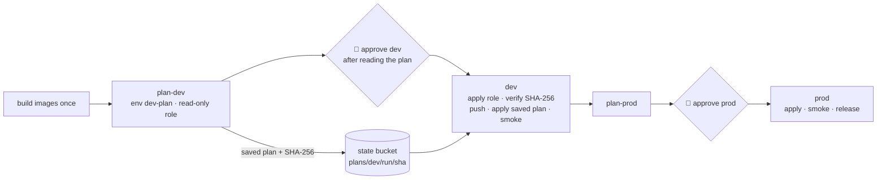

# ADR-0028: Approve the saved plan; versioned environment settings

- **Status:** Accepted; its `dev-plan`/`prod-plan` environments and per-environment plan roles are superseded by [ADR-0032](0032-two-github-environments-deploy-plans-trust-main.md) (supersedes the job layout of [ADR-0027](0027-manual-approval-for-every-deploy.md), where approval preceded the plan, and the `example.tfvars` convention of [ADR-0016](0016-terraform-layout-environments-s3-native-locking.md))
- **Date:** 2026-10-15
- **Deciders:** project owner, coding agent

## Context

An external review found two gaps in the deploy workflow of
[ADR-0027](0027-manual-approval-for-every-deploy.md):

1. **Approval came before the plan.** A reviewer approved the `dev` or `prod`
   job, which then planned and applied in one step. Nobody approved the plan
   that ran, contrary to AGENTS.md §4 ("apply that saved plan file, so what was
   approved is what runs").
2. **CI did not know the environment's settings.** `scripts/ci-config.sh`
   wrote only repository, owner, region, alert email and image tag. Anything
   set in a local, gitignored `terraform.tfvars` (custom domain, capacity,
   budgets) silently fell back to the variable defaults on the runner.

## Decision Drivers

- The reviewer sees the exact plan that is applied, and nothing else can be applied
- No AWS write before the approval
- Settings are versioned and reviewed like code; personal data stays out of git
- The apply role stays the only role that can change resources

## Considered Options

1. Keep one job; print the plan and pause (not possible: a GitHub job cannot wait for approval mid-job)
2. Plan in the approval-gated job, then require a second approval for the apply
3. **Separate plan and apply jobs per environment; the plan runs first without approval and its saved plan is handed to the approval-gated apply job**

## Decision

Chosen option: **3**.

- **Plan job** (`plan-<env>`, GitHub environment `<env>-plan`, no reviewers):
  assumes a new read-only role `shortener-ci-plan-<env>` (OIDC subject
  `repo:<repo>:environment:<env>-plan`). That role has the PR plan role's
  permissions plus `s3:PutObject` on `plans/<env>/*` in the state bucket. The
  job writes the plan summary and the full text plan to the run summary, stores
  the saved plan at `plans/<env>/<run>/<sha256>/`, and outputs the SHA-256.
- **Apply job** (`<env>`, required reviewers): the reviewer approves after
  reading that plan. The job assumes the apply role, downloads the saved plan,
  refuses it unless its SHA-256 equals the plan job's output
  (`scripts/saved-plan.sh`), pushes the images, applies exactly that plan, and
  deletes it. If state changed in between, Terraform rejects the stale plan.
- **Why the state bucket, not a workflow artifact:** the plan contains
  resource attributes. The bucket is private, KMS-encrypted and readable only
  by the CI roles; artifacts are downloadable by anyone who can read the repository.
- **Settings are versioned:** `infra/envs/<env>/deploy.tfvars` is committed
  and used by every plan, local or CI (`scripts/tf-varfiles.sh`). The per-run
  overlay is gitignored and holds only `alert_email` (a GitHub variable in CI)
  and `image_tag` / `enable_services`. `deploy.tfvars` may not set
  `alert_email` or `image_tag` (checked), and `ci-config.sh` refuses to run if
  its `repository` differs from the repository the workflow runs in.
- **The alert email is sensitive** in Terraform, so it is masked in plan
  output, which now appears in the run summary.
- **Enforced:** `scripts/check-deploy-gate.sh` fails unless every `<env>` job
  depends on `plan-<env>` and fetches its saved plan, and unless plan jobs
  never push, apply or use the apply role.

Option 2 doubles the approvals and still lets the approved job compute a
different plan from the one shown.

## Consequences

### Positive

- What the reviewer approved is byte-for-byte what is applied.
- Nothing is written to AWS before approval, apart from the saved plan itself.
- Every setting change goes through a commit and review.

### Negative

- Two more GitHub environments (`dev-plan`, `prod-plan`) and two more roles.
- The plan role can write to `plans/<env>/` in the state bucket. A stored
  plan cannot be swapped: the hash comes from the same run.
- A slow approval can make the plan stale, so the run must be restarted.
- Plans from runs that were never approved stay in the bucket until deleted
  (they are small; noncurrent versions expire after 90 days).

## Summary

Reviewers approve a plan, not a promise. The plan job runs read-only and
publishes the saved plan and its hash; the approval-gated job applies that
exact file or nothing. Environment settings are committed, so CI can't
quietly drift back to defaults.
