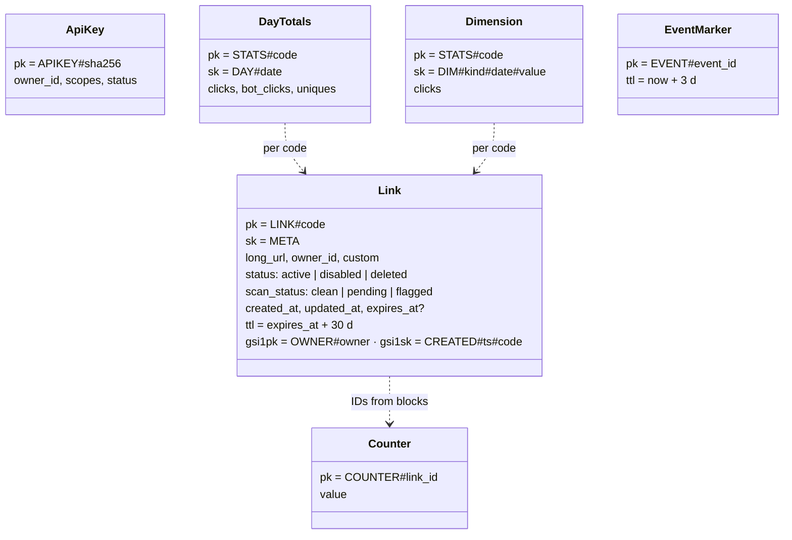
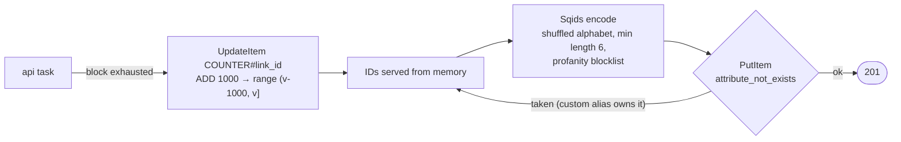
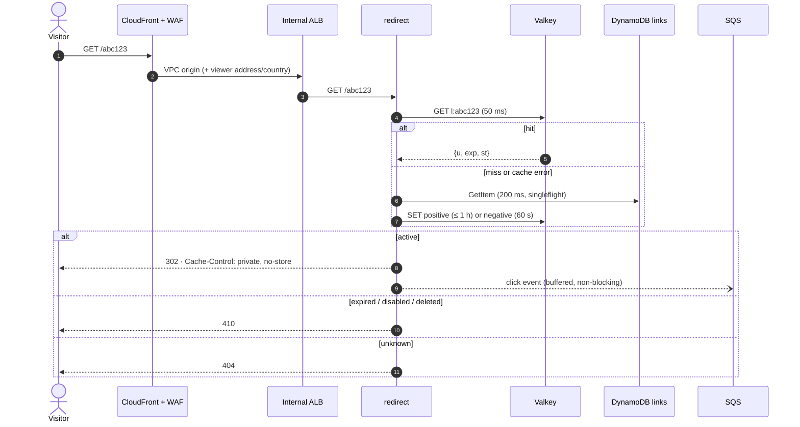
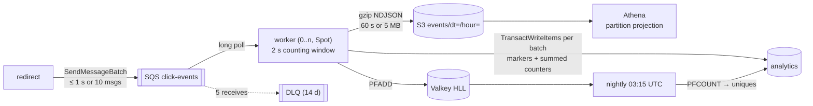
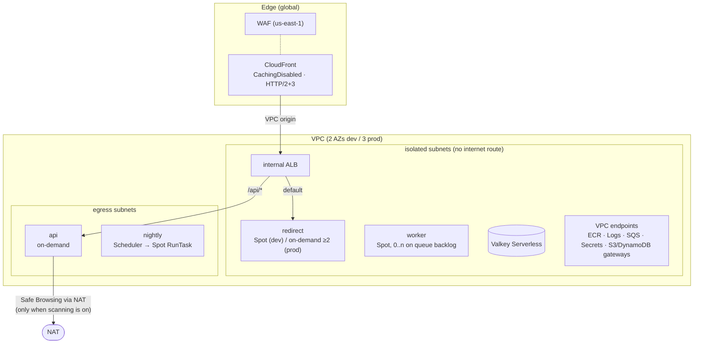

# 🏗️ URL Shortener — System Design

> **Status:** v1.0 (M9). It covers the full design as built, in the same order
> as the [README interview walkthrough](../README.md#-interview-walkthrough).
> Every decision links to its ADR. Measured numbers come from the local stack;
> cloud baselines are pending the first deployment ([GATES.md](../GATES.md)).

## Contents

1. [Requirements and scope](#1-requirements-and-scope)
2. [Back-of-envelope estimates](#2-back-of-envelope-estimates)
3. [API design](#3-api-design)
4. [Data model](#4-data-model)
5. [Short code generation](#5-short-code-generation)
6. [Redirect path](#6-redirect-path)
7. [Caching](#7-caching)
8. [Analytics pipeline](#8-analytics-pipeline)
9. [Abuse prevention and security](#9-abuse-prevention-and-security)
10. [Deployment architecture](#10-deployment-architecture)
11. [Operations](#11-operations)
12. [Scaling to 100×](#12-scaling-to-100)

## 1. Requirements and scope

**Functional** (SPEC §2.1):

| ID | Requirement |
| --- | --- |
| F1 | Authenticated clients create short links |
| F2 | Optional custom alias |
| F3 | Optional expiry (at most 5 years) |
| F4 | 302 redirect; 404 for unknown codes; 410 for expired, disabled or deleted links |
| F5 | Owners list, view, update and delete their links |
| F6 | Owners read analytics: clicks over time, uniques, referrer hosts, countries, devices, browsers |
| F7 | URL safety checks at create time and nightly; flagged links are disabled |
| F8 | Admins disable and enable any link |
| F9 | Idempotent creates (`Idempotency-Key`) |

**Non-functional** (SPEC §2.2):

| ID | Target | How it is met |
| --- | --- | --- |
| N1 | p99 < 50 ms on cache hit, < 100 ms overall (ALB) | Valkey cache-aside with 50 ms deadline, singleflight, warm connections on Fargate |
| N2 | 99.9 % monthly redirects (prod) | ≥ 2 on-demand tasks across AZs, circuit-breaker deploys, cache failures fail open |
| N3 | Redirects never block on analytics | Response written first; bounded buffer; drop-and-count on overload |
| N4 | Stats within 2 minutes | SQS → worker updates counters within seconds |
| N5 | Exactly-once counting | Dedupe marker in the same DynamoDB transaction as the counters |
| N6 | No raw IPs stored | Per-day keyed HMAC visitor IDs; referrer host only |
| N7 | No public ingress except CloudFront; no static keys; no secrets in git/state | VPC origin + internal ALB; OIDC; out-of-band secrets |
| N8 | Documented idle cost; one-command teardown | [cost.md](cost.md); `make teardown` + `make verify-teardown` |

Out of scope (SPEC §20): custom domains per customer, multi-region,
user accounts/UI, QR codes.

## 2. Back-of-envelope estimates

**Interview scale:** 100 M new links per month, a 100:1 read:write ratio and 10× peaks.

| Quantity | Math | Result |
| --- | --- | --- |
| Creates | 100 M / (30 × 86,400 s) | **≈ 40/s** avg, 400/s peak |
| Redirects | 40/s × 100 | **≈ 4,000/s** avg, 40,000/s peak |
| Link storage (5 years) | 500 B × 100 M × 12 × 5 | **≈ 3 TB** |
| Code space | 62⁷ | ≈ 3.5 trillion; 6 chars (62⁶ ≈ 57 billion) last ~47 years at 100 M/month |
| Hot cache | ~20 % of active links × ~200 B per entry | single-digit GB |
| Click events | 4,000/s × ~400 B | ≈ 140 GB/day raw, ~15 GB gzipped to S3 |
| Analytics writes | 4,000 clicks/s × 6 items, transactional (2×), if counted one click at a time | ≈ 48,000 WCU/s, so counter writes are batched (§8): ≈ 2.2 WRU per click for hot links instead of 12 |

**What the numbers justify:**

- Reads dominate, so the read path is separate and cached.
- Lookups are single-key at thousands per second with no joins, which suits DynamoDB.
- Analytics writes outnumber link writes by orders of magnitude, so they go
  to their own table behind a queue, and counter updates are batched so a
  viral link never hammers a single item.

**Demo scale (this deployment):** dev runs one redirect task on Spot and
handles tens of requests per second. The k6 baseline runs 15 redirects per
second, which stays under one IP's WAF limit. Locally, redirect p99 measured
**9.7 ms** with 0 % errors (M6). The cloud baseline is a pending check.

## 3. API design

Public paths: `GET|HEAD /{code}` → 302/404/410 (429 from WAF), and `GET /healthz`.
Management API under `/api/v1`, authenticated with `Authorization: Bearer
shortener_{env}_…` keys and per-route scopes
([ADR-0015](adr/0015-api-key-authentication.md)). The contract is
[`api/openapi.yaml`](../api/openapi.yaml) (OpenAPI 3.1). Handler tests validate
every response against it.

| Method | Path | Scope | Notes |
| --- | --- | --- | --- |
| `POST` | `/links` | `links:write` | `{url, alias?, expires_at?}` → 201; `Idempotency-Key` (24 h, body fingerprint) |
| `GET` | `/links` | `links:read` | newest first, opaque owner-bound cursor |
| `GET` / `PATCH` / `DELETE` | `/links/{code}` | read / write | 404 for other owners (never 403); delete is soft → redirect 410 |
| `GET` | `/links/{code}/stats` | `links:read` | ≤ 90-day range; daily series, uniques, top 10 per dimension |
| `POST` | `/admin/links/{code}/disable`, `/enable` | `admin` | kill switch |

Errors are `application/problem+json` with stable `code` values (`unsafe_url`,
`alias_taken`, `rate_limited` + `Retry-After`, …), mapped in one place.

**Does the same long URL get the same short code? No, every create issues a new code.**

- **A link is more than a URL.** Each link has its own owner, analytics,
  expiry and disable state. Two campaigns pointing at the same page need
  separate click counts.
- **Sharing codes across owners would leak information.** Returning an
  existing code would reveal that someone else already shortened that URL,
  and would tie one owner's link to another owner's lifecycle (expiry,
  deletion, disable).
- **Retries are handled separately.** A client that retries a create sends
  the same `Idempotency-Key` and gets the same response back (24 h).
- **The extra storage is negligible:** about 500 B per duplicate link.

If a product wanted per-owner deduplication, a `gsi2` on `OWNER#id` +
`URL#sha256(normalized url)` would look up an existing link before creating
one. It isn't built, because nobody has asked for it.

## 4. Data model

Two DynamoDB tables ([ADR-0004](adr/0004-dynamodb-for-the-link-store.md),
[ADR-0005](adr/0005-separate-links-and-analytics-tables.md)). Both use on-demand
capacity with maximum-throughput caps, PITR, the environment CMK, a TTL
attribute and deletion protection in prod.

Access patterns:

- **Resolve:** `GetItem LINK#code`.
- **Create:** conditional `PutItem`.
- **Allocate IDs:** `UpdateItem ADD` on the counter.
- **List an owner's links:** `gsi1` query.
- **Stats:** one query on `STATS#code` over a date range.
- **Count clicks:** `TransactWriteItems` per batch: each click's dedupe
  marker plus one summed update per counter (≤ 100 items, [ADR-0024](adr/0024-batched-exactly-once-click-counting.md)).

**Retention** ([ADR-0025](adr/0025-analytics-retention-13-months.md)).
DynamoDB TTL deletes expired items in the background, usually within days;
reads ignore expiry, so they only ever see data that is due to expire.

| Data | Kept for | Mechanism |
| --- | --- | --- |
| Link | until deleted; with an expiry, `expires_at` + 30 days | TTL `ttl` (redirect answers 410 from `expires_at` on, regardless) |
| Daily and dimension counters, uniques | **13 months** after their day; deleting a link keeps them until then | TTL `ttl` set on every counter write |
| Dedupe markers `EVENT#id` | 3 days | TTL `ttl` |
| Raw click events (S3) | 30 days dev, 395 days (13 months) prod | S3 lifecycle |
| Valkey keys | 60 s to 8 days | key TTL |

Thirteen months allows year-over-year comparison while bounding the table:
analytics storage grows with links × days and no longer forever. Counters
outlive a deleted link because they help abuse investigations. They are
aggregates with no IPs (visitor IDs are per-day HMACs). The API returns 404
for a deleted link, so owners can no longer read them.

## 5. Short code generation

Range allocation is a lightweight key-generation service. Collisions are
impossible between generated codes and rare with aliases. A restart loses
at most one block of IDs, which leaves acceptable gaps. Sqids is
**obfuscation, not security**: codes are decodable, and links are not secrets
([ADR-0006](adr/0006-short-code-generation-range-allocation-and-sqids.md)).
The integration test creates 10,000 links through two API instances
sharing the counter, and asserts zero duplicates.

## 6. Redirect path

**302, not 301** ([ADR-0007](adr/0007-302-redirects-and-no-edge-caching.md)):

- every click must reach us for analytics;
- links can change or be disabled, and browsers cache 301s indefinitely;
- CloudFront uses `CachingDisabled`, so Valkey is the only cache;
- expiry is checked on every request (DynamoDB TTL deletion is lazy).

`HEAD` resolves the same way but emits no click.

**Latency users feel.** SLO N1 is measured at the ALB, so it excludes the
network between the user and us-east-1. Because redirects are not cached at
the edge, every click travels to the origin region:

| User | Extra round trip to us-east-1 (typical) |
| --- | --- |
| US East | < 20 ms |
| US West | ~60–70 ms |
| Europe | ~80–90 ms |
| Asia-Pacific (e.g. Sydney) | ~200 ms |

Where CloudFront has a nearby edge location, it softens this: TLS
terminates at that edge, and CloudFront reaches the origin over the AWS
backbone through persistent connections. Such a user pays roughly **one
backbone round trip** per redirect, not several.

The distribution uses **`PriceClass_100`**, which serves only from North
American and European edge locations (cheapest). Users in Asia-Pacific,
South America or Africa connect to one of those edges, so a Sydney user's
TCP and TLS handshakes cross the ocean too: **several ~200 ms round trips on
a new connection**, and one on a reused connection. `PriceClass_All` would
give them a local edge and cut that back to the single backbone round trip,
for slightly higher per-request prices in those regions (cents at demo
volume). It is a one-line change in the edge module if the audience is global.

That is the price of every click reaching us (analytics, instant disable).

Options, from cheapest to most involved:

1. **Short edge caching for hot links** (e.g. 60 s TTL). This saves the round
   trip for repeat clicks, but clicks must then come from CloudFront
   real-time logs, and a disable takes up to the TTL.
2. **Edge redirects** with CloudFront Functions + KeyValueStore. Every
   redirect is answered at the edge (single-digit ms), at the cost of KVS
   propagation delay for edits and log-based analytics.
3. **Multi-region origins**: DynamoDB global tables, a stack per region,
   latency-based routing. This also answers disaster recovery (§11).

None is built: the demo's users and SLO are US-centric. §12 explains why
option 2 becomes necessary at scale anyway.

## 7. Caching

| Key | Value | TTL |
| --- | --- | --- |
| `l:{code}` | `{u, exp, st}` or `{nf: true}` | `min(1 h, exp − now)`; negative 60 s |
| `rl:{owner}:{route}:{window}` | counter | window |
| `idem:{owner}:{key}` | stored response + body fingerprint | 24 h |
| `hll:{code}:{date}` | HyperLogLog | 8 days |

- **Stampede protection:** singleflight per code per task, so one DynamoDB
  read per miss per task.
- **Negative cache:** code scans do not reach DynamoDB.
- **Invalidation:** write DynamoDB first, then `DEL`. A failed `DEL` is
  retried once, counted and alarmed, and staleness is bounded by the TTL.
- **Failure mode:** every cache error fails open to DynamoDB
  ([ADR-0008](adr/0008-elasticache-serverless-valkey.md)).
- **Auth:** IAM tokens, not passwords; each new connection signs a fresh
  token, and connections are recycled within 12 h
  ([ADR-0009](adr/0009-valkey-iam-authentication.md)).
- **Eviction:** ElastiCache Serverless uses a fixed `volatile-lru` policy:
  when the storage cap is reached, it evicts the least recently used keys
  *that have a TTL*. Keys without one cause out-of-memory errors instead
  ([AWS docs](https://docs.aws.amazon.com/AmazonElastiCache/latest/dg/RedisConfiguration.html)).
  Every key here has a TTL, so a full cache degrades into misses (served from
  DynamoDB), never write failures. Evicted HyperLogLog keys do lose today's
  unique-visitor data, so the cap must hold the working set.
- **Sizing:** a link entry is ~200 B, so 1 GB holds ~5 M hot links. A
  HyperLogLog is ≤ 3 KB sparse and 12 KB dense, per link per day for 8 days,
  so 100 k active links/day need about 1 GB more. The caps are 1 GB in dev
  and 5 GB in prod (`cache_max_data_storage_gb`, a cost guardrail); raise them
  as in [runbook §5.10](runbook.md#510-scale-up-for-a-traffic-spike).
- **Hot keys in the cache:** one viral code maps to one slot on one shard.
  A single key is limited to what one shard can serve, typically tens of
  thousands of reads per second (not measured here), which is enough for this
  design's interview scale. Beyond that, the fix is a tiny
  in-process cache per task (1–5 s TTL) in front of Valkey, so a viral link
  costs one Valkey read per task per second. This is listed in §12, not built.

## 8. Analytics pipeline

- **At-least-once in, exactly-once counted**
  ([ADR-0010](adr/0010-async-click-pipeline.md),
  [ADR-0024](adr/0024-batched-exactly-once-click-counting.md)):
  - each event carries a UUIDv7;
  - the worker collects events for up to 2 s (or 1,000 events), groups them
    by link and commits them in transactions of up to 100 items;
  - each transaction holds every click's dedupe marker `EVENT#id`
    (`attribute_not_exists`) plus **one** summed `ADD` per counter item;
  - a transaction commits exactly the clicks whose markers it creates. When
    DynamoDB reports existing markers, those clicks are duplicates, and the
    transaction is rebuilt without them and retried.
- **Hot links:** a viral link's counters are written once per transaction
  (up to ~90 clicks), not once per click. That is ≈ 2.2 instead of 12 write
  units per click, and the item stays far below DynamoDB's ~1,000 writes/s
  per-item limit. The integration test sends 1,500 clicks on one link, each
  delivered twice, and asserts exact counts with batched writes. Locally it
  measured 17 transactions, 88 clicks per counting write.
- **Deletion only after success:** a message is deleted only after
  DynamoDB **and** the S3 flush succeed. Poison messages go to the DLQ;
  the worker never crashes on them.
- **Hot and cold paths** ([ADR-0011](adr/0011-analytics-hot-and-cold-paths.md)):
  DynamoDB counters serve the API (seconds old); S3 + Athena serve ad-hoc
  questions (dedupe by `event_id`).
- **Privacy** ([ADR-0018](adr/0018-privacy-hmac-visitor-ids-referrer-host-only.md)):
  the visitor ID is `HMAC(salt, ip | ua | date)`, the referrer is reduced to its
  host, and the IP never leaves the redirect task.

## 9. Abuse prevention and security

| Threat | Control |
| --- | --- |
| Phishing / malware links | Google Safe Browsing v5 at create/update + nightly rescan ([ADR-0021](adr/0021-url-safety-scanning-safe-browsing-v5.md)); URL validation (http(s) only, no credentials, no private IPs, not our own domain); admin kill switch |
| Floods, scanning | WAF per-IP rate rules (evaluated first, 429 + `Retry-After`), managed rule groups, negative cache, per-key rate limits |
| Key theft, IDOR | Hashed 256-bit keys, scopes, owner checks returning 404, cursors bound to the owner |
| Origin bypass, header spoofing | CloudFront VPC origin → internal ALB, SG admits only CloudFront ([ADR-0012](adr/0012-cloudfront-vpc-origin-internal-alb-waf.md)) |
| Exfiltration from a task | Isolated subnets, endpoint data-perimeter policies, least-privilege roles, per-environment CMK ([ADR-0013](adr/0013-subnet-tiers-vpc-endpoints-nat-only-for-scanning.md), [ADR-0023](adr/0023-iam-review-data-perimeter-and-waf-tuning.md)) |
| Secrets | Secrets Manager values entered out of band; nothing in git, images or state ([ADR-0014](adr/0014-secrets-management.md)) |

The full STRIDE analysis is in [threat-model.md](threat-model.md): 52 rows, all mitigated or accepted.

## 10. Deployment architecture

| Service | Subnets | Capacity | Scaling | Task role |
| --- | --- | --- | --- | --- |
| redirect | isolated | dev Spot; prod on-demand, base 2 | ALB requests/target 500 + CPU 60 % | `GetItem` links; `SendMessage`; `elasticache:Connect`; CMK via DynamoDB/SQS |
| api | egress | on-demand | CPU 60 % | links CRUD + `gsi1`; analytics `Query`; `elasticache:Connect` |
| worker | isolated | Spot (4) + on-demand (1) | queue backlog step scaling, scales to 0 | receive/delete; analytics writes; `PutObject events/*` |
| nightly | egress | Spot via EventBridge Scheduler | — | links scan/get/put; analytics `UpdateItem` |

- **Runtime** ([ADR-0003](adr/0003-ecs-on-fargate.md), [ADR-0020](adr/0020-graviton-arm64-and-fargate-spot.md)):
  ECS on Fargate, ARM64, with a hardened task runtime (distroless image,
  UID 65532, read-only root FS, all capabilities dropped).
- **Terraform** ([ADR-0016](adr/0016-terraform-layout-environments-s3-native-locking.md)):
  identical dev and prod roots (parity-checked), deployed in two phases
  (`enable_services`), with S3-native state locking.
- **Delivery** ([ADR-0017](adr/0017-cicd-github-oidc-rolling-deploys.md)):
  arm64 images are built once and pushed per environment with digest
  verification. Every deploy is started by hand and approved per environment
  ([ADR-0027](adr/0027-manual-approval-for-every-deploy.md)). Each is a
  rolling update with the circuit breaker, through GitHub OIDC roles that
  carry a permissions boundary. A commit that
  passes prod smoke tests becomes the next GitHub Release (`v0.x.0`) with its
  image digests ([ADR-0026](adr/0026-release-versioning-with-tags.md)).
- **Accounts** ([ADR-0019](adr/0019-single-aws-account-for-dev-and-prod.md)):
  dev and prod share one account. Guardrails stop either pipeline from
  touching the other environment.

## 11. Operations

- **Logs:** slog JSON per service in CMK-encrypted log groups with retention.
  Every log group, Container Insights included, is Terraform-managed and
  checked against the plan.
- **Metrics:** EMF in the log stream (`Shortener/{env}`, dimension
  `Service`), aggregated per flush. There are no metric API calls on the hot path.
- **Alarms:** 14 per environment, plus an EventBridge rule for nightly exits,
  the budget and Cost Anomaly Detection. All deliver to one CMK-encrypted SNS
  topic ([ADR-0022](adr/0022-observability-alerting-and-cost-guardrails.md)).
  Each alarm has a runbook section, and a Terraform test keeps the two in sync.
- **SLOs:** N1 is computed from ALB `TargetResponseTime` p99; N2 from target
  5xx divided by requests (see the [runbook](runbook.md#2-slis-and-slos)).
- **Load:** `make load` (k6) plus `scripts/load-report.sh` for the
  server-side view.
- **Cost:** about $46/month for the dev foundation, about $110–135 with
  services, and about $255–270 for prod idle ([cost.md](cost.md)). Every
  resource carries the `CostCenter` tag for budgets.

**Availability and disaster recovery** (prod; RPO = data that can be lost,
RTO = time to recover):

| Failure | RPO | RTO | How |
| --- | --- | --- | --- |
| Task or Spot interruption | 0 | seconds | ALB health checks, ECS replaces the task; ≥ 2 redirect tasks across AZs |
| Availability Zone | 0 | ~0 (automatic) | tasks and ALB span 3 AZs; DynamoDB, SQS, S3 and Valkey Serverless are multi-AZ by design |
| Valkey outage | 0 for links; today's uniques at most | none needed | fail open to DynamoDB ([runbook §5.11](runbook.md#511-valkey-failure-mode)) |
| Bad deploy | 0 | minutes | circuit breaker or redeploy the previous tag ([runbook §5.3](runbook.md#53-rollback)) |
| Data corruption or bad write | ≤ 5 min (PITR, 35 days) | ~1–2 h | restore and swap ([runbook §5.9](runbook.md#59-dynamodb-pitr-restore-new-table-then-swap)) |
| **Region outage** | 0 (data is durable in-region) | **until AWS recovers** | no second region today |

The last row is the honest gap: a region outage is an outage, because nothing
is deployed elsewhere.

- **Cross-region DR** would add DynamoDB global tables (seconds of RPO) and a
  second region's stack (Terraform already parameterizes the region), behind
  CloudFront origin failover or latency routing. That gives an RTO of minutes,
  at roughly the cost of a second prod environment.
- **A cheaper "pilot light"** copies backups cross-region with AWS Backup. The
  RPO becomes the backup interval and the RTO about 1–2 h of `terraform apply`
  plus restore.

Either is a cost decision for when the product needs it
([ADR-0019](adr/0019-single-aws-account-for-dev-and-prod.md) lists
multi-region as future work).

## 12. Scaling to 100×

At 100× the interview scale (≈ 400,000 redirects/s average):

| Area | Today | At 100× |
| --- | --- | --- |
| Redirect compute | Fargate tasks behind an ALB | Still works (hundreds of tasks), but per-request ALB, WAF and CloudFront fees dominate. Serve hot links **at the edge** with CloudFront Functions + KeyValueStore, and collect clicks from CloudFront real-time logs |
| Cache | Valkey Serverless | Add a tiny in-process LRU (1–5 s) per task for the hottest codes; Valkey stays the shared tier |
| Link store | DynamoDB on-demand | Unchanged; DynamoDB scales horizontally, and the cache absorbs hot keys |
| Analytics writes | Batched transactions: per-click markers + summed counters (≈ 2.2 WRU per hot-link click, 12 worst case; [ADR-0024](adr/0024-batched-exactly-once-click-counting.md)) | The markers (2 WRU per click) become the floor; drop to per-minute aggregation in a stream processor (Kinesis + Flink) with windowed dedupe |
| Queue | SQS standard | SQS still scales; Kinesis if replay or ordering is needed |
| IDs | 1,000-ID blocks | Larger blocks (10,000+); the single counter item handles a few updates per second |
| Regions | one | DynamoDB global tables for links, a regional cache and pipeline per region, latency-based routing |
| Accounts | one | Organizations: separate prod/dev accounts, SCPs/RCPs ([ADR-0019](adr/0019-single-aws-account-for-dev-and-prod.md)) |
