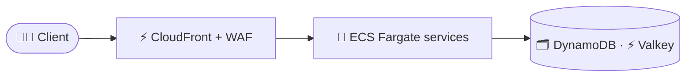
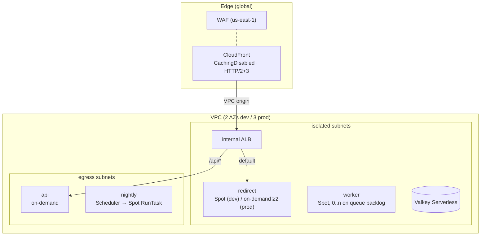

# 🏗️ URL Shortener — System Design

> **Status:** in progress — deployment section (M5) written; the full
> write-up following the interview walkthrough order lands in M9 (SPEC §17.5).

## Contents

1. [Requirements](#1-requirements)
2. [Architecture](#2-architecture)
3. [Deployment](#3-deployment)

## 1. Requirements

See SPEC §2. To be expanded in M9.

## 2. Architecture

## 3. Deployment

> Full design write-up in M9; this section describes the deployment as built in M5.

| Service | Subnets | Capacity | Scaling | IAM (task role) |
| --- | --- | --- | --- | --- |
| redirect | isolated | dev Spot; prod on-demand, base 2 | ALB requests/target 500 + CPU 60 % | `GetItem` links; `SendMessage` clicks; `elasticache:Connect`; CMK via DynamoDB/SQS |
| api | egress | on-demand | CPU 60 % | links CRUD + `gsi1` query; analytics `Query`; `elasticache:Connect`; CMK via DynamoDB |
| worker | isolated | Spot (4) + on-demand (1) | queue backlog step scaling, scales to 0 | receive/delete clicks; analytics writes; `PutObject events/*`; `elasticache:Connect` |
| nightly | egress | Spot via EventBridge Scheduler 03:15 UTC | — | links scan/get/put; analytics `UpdateItem`; `elasticache:Connect` |

- Two-phase apply (ADR-0016): `enable_services = false` creates the foundation;
  after `make seed-secrets` and `make push-images`, `enable_services = true` with
  `image_tag = <git SHA>` adds the cluster, services, nightly job and edge.
- Every task: ARM64, read-only root FS, UID 65532, all capabilities dropped,
  non-blocking awslogs, binary health check, 30 s stop timeout, no public IP;
  its own security group (ingress from the ALB only) plus the VPC-endpoint and
  cache client groups; egress only to the S3/DynamoDB gateway endpoints (and
  HTTPS via NAT for api/nightly when URL scanning is on).
- Each service's execution role can pull only its repository, write only its
  log group and read only its own secrets; secret resource policies deny every
  other principal (ADR-0014).
- Deploys are rolling with the circuit breaker and rollback (ADR-0017).
