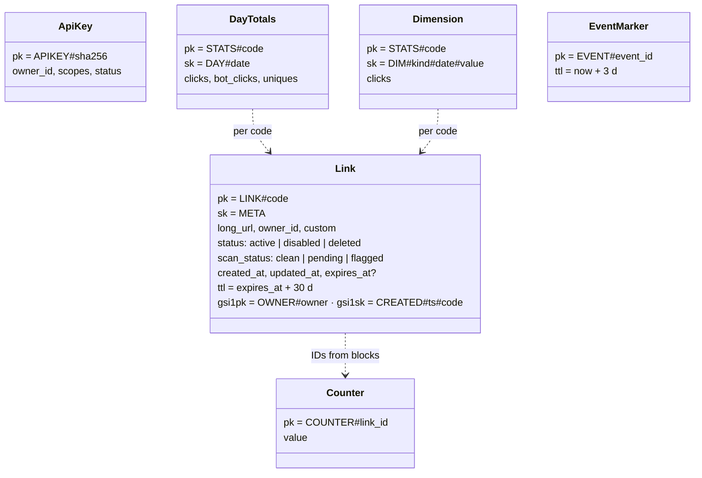
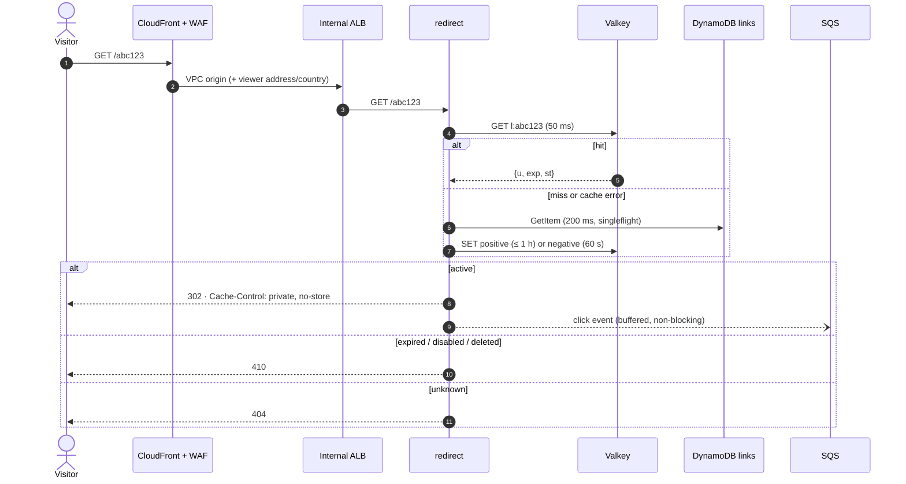
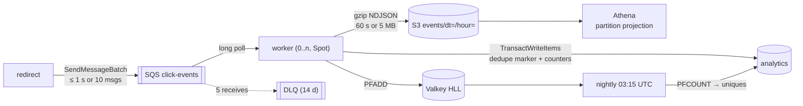

# 🏗️ URL Shortener — System Design

> **Status:** v1.0 (M9). It covers the full design as built, in the same order
> as the [README interview walkthrough](../README.md#-interview-walkthrough).
> Every decision links to its ADR. Measured numbers come from the local stack;
> cloud baselines are pending the first deployment ([GATES.md](../GATES.md)).

## Contents

1. [Requirements and scope](#1-requirements-and-scope)
2. [Back-of-envelope estimates](#2-back-of-envelope-estimates)
3. [API design](#3-api-design)
4. [Data model](#4-data-model)
5. [Short code generation](#5-short-code-generation)
6. [Redirect path](#6-redirect-path)
7. [Caching](#7-caching)
8. [Analytics pipeline](#8-analytics-pipeline)
9. [Abuse prevention and security](#9-abuse-prevention-and-security)
10. [Deployment architecture](#10-deployment-architecture)
11. [Operations](#11-operations)
12. [Scaling to 100×](#12-scaling-to-100)

## 1. Requirements and scope

**Functional** (SPEC §2.1):

- create short links (optional custom alias and expiry; idempotent creates);
- 302 redirect, 404 for unknown codes, 410 for expired, disabled or deleted links;
- owners manage their links and read analytics (clicks over time, uniques,
  referrer hosts, countries, devices, browsers);
- URL safety checks at create time and nightly;
- admin disable/enable.

**Non-functional** (SPEC §2.2):

| ID | Target | How it is met |
| --- | --- | --- |
| N1 | p99 < 50 ms on cache hit, < 100 ms overall (ALB) | Valkey cache-aside with 50 ms deadline, singleflight, warm connections on Fargate |
| N2 | 99.9 % monthly redirects (prod) | ≥ 2 on-demand tasks across AZs, circuit-breaker deploys, cache failures fail open |
| N3 | Redirects never block on analytics | Response written first; bounded buffer; drop-and-count on overload |
| N4 | Stats within 2 minutes | SQS → worker updates counters within seconds |
| N5 | Exactly-once counting | Dedupe marker in the same DynamoDB transaction as the counters |
| N6 | No raw IPs stored | Per-day keyed HMAC visitor IDs; referrer host only |
| N7 | No public ingress except CloudFront; no static keys; no secrets in git/state | VPC origin + internal ALB; OIDC; out-of-band secrets |
| N8 | Documented idle cost; one-command teardown | [cost.md](cost.md); `make teardown` + `make verify-teardown` |

Out of scope (SPEC §20): custom domains per customer, multi-region,
user accounts/UI, QR codes.

## 2. Back-of-envelope estimates

**Interview scale:** 100 M new links per month, a 100:1 read:write ratio and 10× peaks.

| Quantity | Math | Result |
| --- | --- | --- |
| Creates | 100 M / (30 × 86,400 s) | **≈ 40/s** avg, 400/s peak |
| Redirects | 40/s × 100 | **≈ 4,000/s** avg, 40,000/s peak |
| Link storage (5 years) | 500 B × 100 M × 12 × 5 | **≈ 3 TB** |
| Code space | 62⁷ | ≈ 3.5 trillion; 6 chars (62⁶ ≈ 57 billion) last ~47 years at 100 M/month |
| Hot cache | ~20 % of active links × ~200 B per entry | single-digit GB |
| Click events | 4,000/s × ~400 B | ≈ 140 GB/day raw, ~15 GB gzipped to S3 |
| Analytics writes | 4,000 clicks/s × 6 items, transactional (2×) | ≈ 48,000 WCU/s, the first thing to redesign at scale (§12) |

**What the numbers justify:**

- Reads dominate, so the read path is separate and cached.
- Lookups are single-key at thousands per second with no joins, which suits DynamoDB.
- Analytics writes outnumber link writes by orders of magnitude, so they go
  to their own table behind a queue.

**Demo scale (this deployment):** dev runs one redirect task on Spot and
handles tens of requests per second. The k6 baseline runs 15 redirects per
second, which stays under one IP's WAF limit. Locally, redirect p99 measured
**9.7 ms** with 0 % errors (M6). The cloud baseline is a pending check.

## 3. API design

Public paths: `GET|HEAD /{code}` → 302/404/410 (429 from WAF), and `GET /healthz`.
Management API under `/api/v1`, authenticated with `Authorization: Bearer
shortener_{env}_…` keys and per-route scopes
([ADR-0015](adr/0015-api-key-authentication.md)). The contract is
[`api/openapi.yaml`](../api/openapi.yaml) (OpenAPI 3.1). Handler tests validate
every response against it.

| Method | Path | Scope | Notes |
| --- | --- | --- | --- |
| `POST` | `/links` | `links:write` | `{url, alias?, expires_at?}` → 201; `Idempotency-Key` (24 h, body fingerprint) |
| `GET` | `/links` | `links:read` | newest first, opaque owner-bound cursor |
| `GET` / `PATCH` / `DELETE` | `/links/{code}` | read / write | 404 for other owners (never 403); delete is soft → redirect 410 |
| `GET` | `/links/{code}/stats` | `links:read` | ≤ 90-day range; daily series, uniques, top 10 per dimension |
| `POST` | `/admin/links/{code}/disable`, `/enable` | `admin` | kill switch |

Errors are `application/problem+json` with stable `code` values (`unsafe_url`,
`alias_taken`, `rate_limited` + `Retry-After`, …), mapped in one place.

## 4. Data model

Two DynamoDB tables ([ADR-0004](adr/0004-dynamodb-for-the-link-store.md),
[ADR-0005](adr/0005-separate-links-and-analytics-tables.md)). Both use on-demand
capacity with maximum-throughput caps, PITR, the environment CMK, a TTL
attribute and deletion protection in prod.

Access patterns:

- **Resolve:** `GetItem LINK#code`.
- **Create:** conditional `PutItem`.
- **Allocate IDs:** `UpdateItem ADD` on the counter.
- **List an owner's links:** `gsi1` query.
- **Stats:** one query on `STATS#code` over a date range.
- **Count a click:** `TransactWriteItems` (dedupe marker plus counters).

## 5. Short code generation

Range allocation is a lightweight key-generation service. Collisions are
impossible between generated codes and rare with aliases. A restart loses
at most one block of IDs, which leaves acceptable gaps. Sqids is
**obfuscation, not security**: codes are decodable, and links are not secrets
([ADR-0006](adr/0006-short-code-generation-range-allocation-and-sqids.md)).
The integration test creates 10,000 links through two API instances
sharing the counter, and asserts zero duplicates.

## 6. Redirect path

**302, not 301** ([ADR-0007](adr/0007-302-redirects-and-no-edge-caching.md)):

- every click must reach us for analytics;
- links can change or be disabled, and browsers cache 301s indefinitely;
- CloudFront uses `CachingDisabled`, so Valkey is the only cache;
- expiry is checked on every request (DynamoDB TTL deletion is lazy).

`HEAD` resolves the same way but emits no click.

## 7. Caching

| Key | Value | TTL |
| --- | --- | --- |
| `l:{code}` | `{u, exp, st}` or `{nf: true}` | `min(1 h, exp − now)`; negative 60 s |
| `rl:{owner}:{route}:{window}` | counter | window |
| `idem:{owner}:{key}` | stored response + body fingerprint | 24 h |
| `hll:{code}:{date}` | HyperLogLog | 8 days |

- **Stampede protection:** singleflight per code per task, so one DynamoDB
  read per miss per task.
- **Negative cache:** code scans do not reach DynamoDB.
- **Invalidation:** write DynamoDB first, then `DEL`. A failed `DEL` is
  retried once, counted and alarmed, and staleness is bounded by the TTL.
- **Failure mode:** every cache error fails open to DynamoDB
  ([ADR-0008](adr/0008-elasticache-serverless-valkey.md)).
- **Auth:** IAM tokens, not passwords; each new connection signs a fresh
  token, and connections are recycled within 12 h
  ([ADR-0009](adr/0009-valkey-iam-authentication.md)).

## 8. Analytics pipeline

- **At-least-once in, exactly-once counted**
  ([ADR-0010](adr/0010-async-click-pipeline.md)): each event carries a
  UUIDv7. The dedupe marker `EVENT#id` is written with
  `attribute_not_exists` in the same transaction as the counters, so a
  redelivered message cancels the transaction and is counted as a duplicate.
- **Deletion only after success:** a message is deleted only after
  DynamoDB **and** the S3 flush succeed. Poison messages go to the DLQ;
  the worker never crashes on them.
- **Hot and cold paths** ([ADR-0011](adr/0011-analytics-hot-and-cold-paths.md)):
  DynamoDB counters serve the API (seconds old); S3 + Athena serve ad-hoc
  questions (dedupe by `event_id`).
- **Privacy** ([ADR-0018](adr/0018-privacy-hmac-visitor-ids-referrer-host-only.md)):
  the visitor ID is `HMAC(salt, ip | ua | date)`, the referrer is reduced to its
  host, and the IP never leaves the redirect task.

## 9. Abuse prevention and security

| Threat | Control |
| --- | --- |
| Phishing / malware links | Google Safe Browsing v5 at create/update + nightly rescan ([ADR-0021](adr/0021-url-safety-scanning-safe-browsing-v5.md)); URL validation (http(s) only, no credentials, no private IPs, not our own domain); admin kill switch |
| Floods, scanning | WAF per-IP rate rules (evaluated first, 429 + `Retry-After`), managed rule groups, negative cache, per-key rate limits |
| Key theft, IDOR | Hashed 256-bit keys, scopes, owner checks returning 404, cursors bound to the owner |
| Origin bypass, header spoofing | CloudFront VPC origin → internal ALB, SG admits only CloudFront ([ADR-0012](adr/0012-cloudfront-vpc-origin-internal-alb-waf.md)) |
| Exfiltration from a task | Isolated subnets, endpoint data-perimeter policies, least-privilege roles, per-environment CMK ([ADR-0013](adr/0013-subnet-tiers-vpc-endpoints-nat-only-for-scanning.md), [ADR-0023](adr/0023-iam-review-data-perimeter-and-waf-tuning.md)) |
| Secrets | Secrets Manager values entered out of band; nothing in git, images or state ([ADR-0014](adr/0014-secrets-management.md)) |

The full STRIDE analysis is in [threat-model.md](threat-model.md): 51 rows, all mitigated or accepted.

## 10. Deployment architecture

| Service | Subnets | Capacity | Scaling | Task role |
| --- | --- | --- | --- | --- |
| redirect | isolated | dev Spot; prod on-demand, base 2 | ALB requests/target 500 + CPU 60 % | `GetItem` links; `SendMessage`; `elasticache:Connect`; CMK via DynamoDB/SQS |
| api | egress | on-demand | CPU 60 % | links CRUD + `gsi1`; analytics `Query`; `elasticache:Connect` |
| worker | isolated | Spot (4) + on-demand (1) | queue backlog step scaling, scales to 0 | receive/delete; analytics writes; `PutObject events/*` |
| nightly | egress | Spot via EventBridge Scheduler | — | links scan/get/put; analytics `UpdateItem` |

- **Runtime** ([ADR-0003](adr/0003-ecs-on-fargate.md), [ADR-0020](adr/0020-graviton-arm64-and-fargate-spot.md)):
  ECS on Fargate, ARM64, with a hardened task runtime (distroless image,
  UID 65532, read-only root FS, all capabilities dropped).
- **Terraform** ([ADR-0016](adr/0016-terraform-layout-environments-s3-native-locking.md)):
  identical dev and prod roots (parity-checked), deployed in two phases
  (`enable_services`), with S3-native state locking.
- **Delivery** ([ADR-0017](adr/0017-cicd-github-oidc-rolling-deploys.md)):
  arm64 images are built once and pushed per environment with digest
  verification. Every deploy is a rolling update with the circuit breaker,
  through GitHub OIDC roles that carry a permissions boundary.
- **Accounts** ([ADR-0019](adr/0019-single-aws-account-for-dev-and-prod.md)):
  dev and prod share one account. Guardrails stop either pipeline from
  touching the other environment.

## 11. Operations

- **Logs:** slog JSON per service in CMK-encrypted log groups with retention.
  Every log group, Container Insights included, is Terraform-managed and
  checked against the plan.
- **Metrics:** EMF in the log stream (`Shortener/{env}`, dimension
  `Service`), aggregated per flush. There are no metric API calls on the hot path.
- **Alarms:** 14 per environment, plus an EventBridge rule for nightly exits,
  the budget and Cost Anomaly Detection. All deliver to one CMK-encrypted SNS
  topic ([ADR-0022](adr/0022-observability-alerting-and-cost-guardrails.md)).
  Each alarm has a runbook section, and a Terraform test keeps the two in sync.
- **SLOs:** N1 is computed from ALB `TargetResponseTime` p99; N2 from target
  5xx divided by requests (see the [runbook](runbook.md#2-slis-and-slos)).
- **Load:** `make load` (k6) plus `scripts/load-report.sh` for the
  server-side view.
- **Cost:** about $46/month for the dev foundation, about $110–135 with
  services, and about $255–270 for prod idle ([cost.md](cost.md)). Every
  resource carries the `CostCenter` tag for budgets.

## 12. Scaling to 100×

At 100× the interview scale (≈ 400,000 redirects/s average):

| Area | Today | At 100× |
| --- | --- | --- |
| Redirect compute | Fargate tasks behind an ALB | Still works (hundreds of tasks), but per-request ALB, WAF and CloudFront fees dominate. Serve hot links **at the edge** with CloudFront Functions + KeyValueStore, and collect clicks from CloudFront real-time logs |
| Cache | Valkey Serverless | Add a tiny in-process LRU (1–5 s) per task for the hottest codes; Valkey stays the shared tier |
| Link store | DynamoDB on-demand | Unchanged; DynamoDB scales horizontally, and the cache absorbs hot keys |
| Analytics writes | One transaction per click (≈ 12 WCU) | Pre-aggregate per code/minute/dimension in the worker (or Kinesis + Flink) and write counters in batches, with dedupe over a window, not per item |
| Queue | SQS standard | SQS still scales; Kinesis if replay or ordering is needed |
| IDs | 1,000-ID blocks | Larger blocks (10,000+); the single counter item handles a few updates per second |
| Regions | one | DynamoDB global tables for links, a regional cache and pipeline per region, latency-based routing |
| Accounts | one | Organizations: separate prod/dev accounts, SCPs/RCPs ([ADR-0019](adr/0019-single-aws-account-for-dev-and-prod.md)) |
