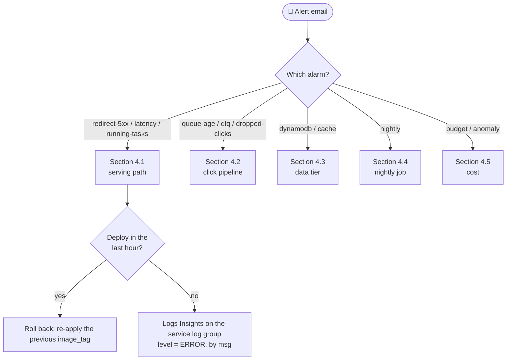
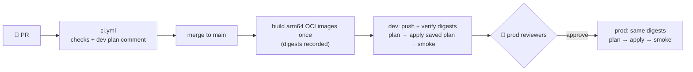

# 📟 URL Shortener — Runbook

> **Status:** v0.3 (M8). Service overview, SLOs, alarm responses, CI/CD
> setup, deploy and rollback are in place. The remaining SPEC §17.4 procedures
> (DLQ redrive, restores, rotations, teardown, …) are completed in M9.

## Contents

1. [Service overview](#1-service-overview)
2. [SLIs and SLOs](#2-slis-and-slos)
3. [Alerts](#3-alerts)
4. [Alarm responses](#4-alarm-responses)
5. [Procedures](#5-procedures)

## 1. Service overview

| Component | What it does | Where to look |
| --- | --- | --- |
| `redirect` (ECS service) | `GET /{code}` → 302; enqueues click events asynchronously | Log group `/shortener/{env}/redirect`; dashboard row "Redirect" |
| `api` (ECS service) | `/api/v1/*`: links, API keys, stats | `/shortener/{env}/api`; row "API" |
| `worker` (ECS service, 0–N) | SQS → DynamoDB counters + S3 raw events | `/shortener/{env}/worker`; "Click pipeline", "Queue" |
| `nightly` (Scheduler → RunTask) | Rescans links, persists uniques | `/shortener/{env}/nightly` |
| Valkey (Serverless) | Link cache, rate limits, HLL uniques | `CacheErrors`, cache hit ratio |
| DynamoDB `links`, `analytics` | Source of truth | "DynamoDB" widget |
| CloudFront + WAF → internal ALB | Only ingress | "WAF" widget, ALB metrics |

The dashboard is the CloudWatch dashboard named `shortener-{env}` (Terraform
output `dashboard_name`). All alerts go to the SNS topic in output `alert_topic_arn`.



## 2. SLIs and SLOs

| SLO | SLI (how to compute) | Target |
| --- | --- | --- |
| **N1 latency** | ALB `TargetResponseTime` p99 for the redirect target group (dashboard "Redirect · latency"); per-request handler time is EMF `RedirectLatencyMs` | p99 < 50 ms on cache hit, < 100 ms overall |
| **N2 availability (prod)** | `1 − Σ HTTPCode_Target_5XX_Count / Σ RequestCount` for the redirect target group over the calendar month (CloudWatch metric math, period 1 month) | 99.9 % (≈ 43 min of full outage per month) |
| **N3 non-blocking analytics** | `ClickEventsDropped / (ClickEventsEnqueued + ClickEventsDropped)`; redirects never fail because of the queue | drops alarmed (§4.2) |
| **N4 analytics freshness** | SQS `ApproximateAgeOfOldestMessage` | < 2 min typical; alarm at 5 min |

Error-budget check (prod, month to date): CloudWatch → Metrics → Graphed
metrics. Add `RequestCount` and `HTTPCode_Target_5XX_Count` (Sum, redirect
target group), then add the expression `100 * (1 - SUM(METRICS("e5")) / SUM(METRICS("req")))`.
4xx responses (404/410) are correct answers, not errors.

## 3. Alerts

Every alarm sends to SNS on both ALARM and OK. Missing data is treated as
healthy. "For N min" means every datapoint in the window breached. Definitions
live in [`infra/modules/observability`](../infra/modules/observability/main.tf)
([ADR-0022](adr/0022-observability-alerting-and-cost-guardrails.md)).

| Alarm (`shortener-{env}-…`) | Fires when | Response |
| --- | --- | --- |
| `redirect-5xx` | redirect target 5xx rate > 1 % for 5 min | [4.1](#41-serving-path) |
| `redirect-latency-p99` | ALB p99 > 100 ms for 10 min | [4.1](#41-serving-path) |
| `running-tasks-{redirect,api,worker}` | running < desired for 5 min | [4.1](#41-serving-path) |
| `queue-age` | oldest click event > 5 min | [4.2](#42-click-pipeline) |
| `dlq` | any message in the DLQ | [4.2](#42-click-pipeline) |
| `dropped-clicks` | `ClickEventsDropped` > 0 for 15 min | [4.2](#42-click-pipeline) |
| `dynamodb-throttles-{links,analytics}` | throttling for 5 min | [4.3](#43-data-tier) |
| `cache-errors` | > 50 Valkey errors in 5 min | [4.3](#43-data-tier) |
| `cache-invalidation-failed` | a cache key could not be deleted after a change | [4.3](#43-data-tier) |
| `nightly-schedule-failures`, `nightly-failed`, EventBridge "nightly non-zero exit" | the nightly job did not start or failed | [4.4](#44-nightly-job) |
| AWS Budgets (50/80/100 % actual, 100 % forecast), Cost Anomaly Detection | spend | [4.5](#45-cost) |

To test the alert path end to end (M6 gate), force an alarm state and confirm
the email arrives:

```bash
aws cloudwatch set-alarm-state --alarm-name shortener-dev-dlq \
  --state-value ALARM --state-reason "alert path test"
```

The alarm returns to OK at its next evaluation, which sends an OK email too.

## 4. Alarm responses

### 4.1 Serving path

1. **Recent deploy?** Check the ECS service events. A deployment that cannot
   get healthy is rolled back automatically by the circuit breaker
   ([ADR-0017](adr/0017-cicd-github-oidc-rolling-deploys.md)). A bad version
   that passes health checks is rolled back by re-applying the previous `image_tag`.
2. **Running tasks low:** look at ECS → service → Events and stopped tasks
   (`stoppedReason`). Common causes are failed health checks, an image that
   is missing from ECR, secret access denied (execution role) and Spot
   capacity. In dev, redirect runs on Spot, so a Spot interruption shows up
   as a brief dip.
3. **5xx:** use Logs Insights on `/shortener/{env}/redirect` with
   `fields @timestamp, msg, err | filter level = "ERROR" | stats count() by msg`.
   DynamoDB errors are covered in 4.3. Valkey errors alone do **not** cause
   5xx, because the redirect falls back to DynamoDB.
4. **Latency:** compare the cache hit ratio with the latency. A falling hit
   ratio (Valkey down, cold cache after a flush) pushes p99 toward DynamoDB
   latency. CPU near the target triggers autoscaling (requests per target
   500, CPU 60 %); if the service is pinned at `max_count`, raise the maximum.

### 4.2 Click pipeline

- **`queue-age`:** check whether the worker is running (`running-tasks-worker`,
  desired count). The worker scales on queue depth from zero, so the first
  minutes after idle are expected. If the worker is running but slow, look
  for DynamoDB throttles (4.3) or S3 errors in `/shortener/{env}/worker`.
- **`dlq`:** messages failed 5 receives. Inspect one with `aws sqs receive-message`
  on the DLQ (read-only; do not delete it). Fix the cause, then redrive with
  `aws sqs start-message-move-task`. Redrive **within 3 days**: after that
  the dedupe markers expire and a redrive may double count.
- **`dropped-clicks`:** redirect could not enqueue (SQS errors or a full
  buffer). Redirects are unaffected (SPEC N3); the lost clicks are not
  recoverable. Check the SQS interface endpoint and the redirect logs for
  `click batch send failed` and `click events dropped after retry`.

### 4.3 Data tier

- **DynamoDB throttles:** the on-demand **maximum-throughput cap** is the
  usual cause (cost guardrail). If the traffic is legitimate, raise the cap
  in the `dynamodb` module and apply. If one key is hot, check the dashboard
  for a single viral link (the cache should absorb it, see `cache-errors`).
- **`cache-errors`:** Valkey is unreachable or rejecting requests. The
  expected degradation is that redirects and the API read DynamoDB directly,
  rate limiting fails open (WAF rules still apply) and unique-visitor counts
  pause. Check the ElastiCache console (cache status, ECPU/storage limits),
  then the IAM auth token errors in the logs.
- **`cache-invalidation-failed`:** a link change or disable reached DynamoDB,
  but the cached entry could not be deleted, so the **old target can be served
  for up to 1 hour**. If the change was a security disable, re-issue it
  (`POST /api/v1/admin/links/{code}/disable`); every link mutation deletes the
  key again. Otherwise, wait for the TTL.

### 4.4 Nightly job

- `nightly-schedule-failures`: Scheduler could not run the task (IAM, task
  definition, subnets). Check the schedule in EventBridge Scheduler (group
  `shortener-{env}-nightly`) and the scheduler role.
- `nightly-failed` / non-zero exit: read `/shortener/{env}/nightly` for the
  `nightly failed` line (it names the step). Re-runs are idempotent; start one
  manually with the Terraform output `nightly_run_task` (`aws ecs run-task`).

### 4.5 Cost

- Budget emails name the threshold. Open Cost Explorer filtered by
  `CostCenter = shortener-{env}`, grouped by service, and compare against
  [cost.md](cost.md). The usual suspects are the NAT gateway, interface
  endpoints, Fargate task counts and Valkey storage.
- **Cost emergency (dev):** set `enable_services = false` and apply, which
  removes the services, ALB, WAF and CloudFront and keeps the data. For a full
  teardown, see the procedures (M9).

## 5. Procedures

### 5.1 CI/CD setup (one time, 👤 repository admin)

Prerequisites: `make bootstrap` applied, phase 1 applied for the environment,
and `make seed-secrets` done ([GATES.md](../GATES.md) pending list). Values come
from `terraform -chdir=infra/bootstrap output`. None of them are secrets,
except the smoke API keys.

1. **Repository variables:**

   ```bash
   gh variable set AWS_REGION --body us-east-1
   gh variable set OWNER --body platform-team
   gh variable set TF_STATE_BUCKET --body "$(terraform -chdir=infra/bootstrap output -raw state_bucket)"
   gh variable set TF_STATE_KMS_KEY_ARN --body "$(terraform -chdir=infra/bootstrap output -raw state_kms_key_arn)"
   gh variable set AWS_PLAN_ROLE_ARN --body "$(terraform -chdir=infra/bootstrap output -raw plan_role_arn)"
   ```

2. **Environments `dev` and `prod`:** Settings → Environments. Restrict
   deployment branches to `main`. On `prod`, add **required reviewers** (the
   owner) and enable "Prevent self-review". Then set the variables:

   ```bash
   for env in dev prod; do
     gh variable set AWS_APPLY_ROLE_ARN --env "$env" \
       --body "$(terraform -chdir=infra/bootstrap output -json apply_role_arns | jq -r --arg e "$env" '.[$e]')"
     gh variable set ALERT_EMAIL --env "$env" --body oncall@example.com
   done
   ```

3. **Smoke API key per environment.** The key goes straight into the GitHub
   secret and is never shown (run with your own AWS credentials):

   ```bash
   env=dev
   go run ./cmd/shortenerctl apikey create --env "$env" --table "shortener-$env-links" \
       --owner ci-smoke --scopes links:read,links:write \
     | tee >(grep -E '^(key_hash|owner|scopes):' >&2) \
     | awk '/^api_key:/ {print $2}' | gh secret set SMOKE_API_KEY --env "$env"
   ```

   Record the printed `key_hash`; you need it to revoke the key.

4. **Branch protection** (Settings → Rules → new branch ruleset on `main`):

   - require a pull request with 1 approval and code-owner review;
   - require these status checks: `go · lint, unit, vuln, secrets`,
     `integration (compose emulators)`, `images · build arm64, non-root, Trivy`,
     `terraform · fmt, validate, tflint, checkov, Trivy, test`,
     `docs and workflows · markdown, Mermaid, links, actionlint, zizmor, pins`,
     `terraform plan (dev)`;
   - block force pushes and deletions.

   Replace `@OWNER` in [`.github/CODEOWNERS`](../.github/CODEOWNERS).

### 5.2 Deploy



- Normal path: merge a reviewed PR. `deploy.yml` builds once, pushes the
  images to dev and checks each ECR digest against the built manifest. It
  then plans with `image_tag = <12-char SHA>`, applies exactly that plan
  (ECS rolling deploy with the circuit breaker) and runs the smoke suite.
- **Prod** waits for a reviewer to approve the `prod` environment. Before
  approving, check that the dev smoke step is green and the dev dashboard is
  quiet. The prod job pushes the **same digests** and verifies them.
- Manual deploy, from a clean commit with admin credentials: run `make
  images-oci`, then `APPROVED=yes make push-images ENV=dev`, then set
  `image_tag` in `terraform.tfvars`. Run `make plan ENV=dev`; once the plan is
  approved, run `APPROVED=yes make apply ENV=dev`, then `make smoke-env ENV=dev`.

### 5.3 Rollback

1. **Automatic:** if new tasks fail health checks, the ECS circuit breaker
   restores the previous task definition. `terraform apply` then fails, so the
   pipeline turns red and prod is never reached.
2. **Manual**, for a bad version that passes health checks, choose one:
   - **Revert (preferred):** merge `git revert <bad sha>`. The pipeline ships
     the reverted code through dev and prod as a new, reviewed SHA.
   - **Fast rollback:** use admin credentials with `image_tag` set to the last
     good SHA (its images are still in ECR, since tags are immutable). Set it in
     `infra/envs/<env>/terraform.tfvars` and run `make plan ENV=<env>`. After
     approval, run `APPROVED=yes make apply ENV=<env>`, then `make smoke-env ENV=<env>`.
     Afterwards, merge a revert so `main` matches what is deployed.
3. Never delete or overwrite an image tag (tags are immutable).

Other SPEC §17.4 procedures (disable a link, revoke an API key, rotations, DLQ
redrive, PITR restore, scaling, Valkey failure, cost emergency, teardown)
follow in M9.
