# 📟 URL Shortener — Runbook

> **Status:** v1.0 (M9) — complete per SPEC §17.4: service overview, SLOs,
> an alarm → section map, one section per alarm (meaning, impact, diagnosis
> flowchart, commands, remediation, escalation) and every operational procedure.
> A Terraform test fails if an alarm has no section here, or a section names an
> alarm that does not exist.

## Contents

1. [Service overview](#1-service-overview)
2. [SLIs and SLOs](#2-slis-and-slos)
3. [Alerts and escalation](#3-alerts-and-escalation)
4. [Alarm responses](#4-alarm-responses)
5. [Procedures](#5-procedures)

## 1. Service overview

| Component | What it does | Where to look |
| --- | --- | --- |
| `redirect` (ECS service) | `GET /{code}` → 302; enqueues click events asynchronously | Log group `/shortener/{env}/redirect`; dashboard row "Redirect" |
| `api` (ECS service) | `/api/v1/*`: links, API keys, stats | `/shortener/{env}/api`; row "API" |
| `worker` (ECS service, 0–N) | SQS → DynamoDB counters + S3 raw events | `/shortener/{env}/worker`; "Click pipeline", "Queue" |
| `nightly` (Scheduler → RunTask) | Rescans links, persists uniques | `/shortener/{env}/nightly` |
| Valkey (Serverless) | Link cache, rate limits, HLL uniques | `CacheErrors`, cache hit ratio |
| DynamoDB `links`, `analytics` | Source of truth | "DynamoDB" widget |
| CloudFront + WAF → internal ALB | Only ingress | "WAF" widget, ALB metrics |

The dashboard is the CloudWatch dashboard named `shortener-{env}` (Terraform
output `dashboard_name`). All alerts go to the SNS topic in output `alert_topic_arn`.

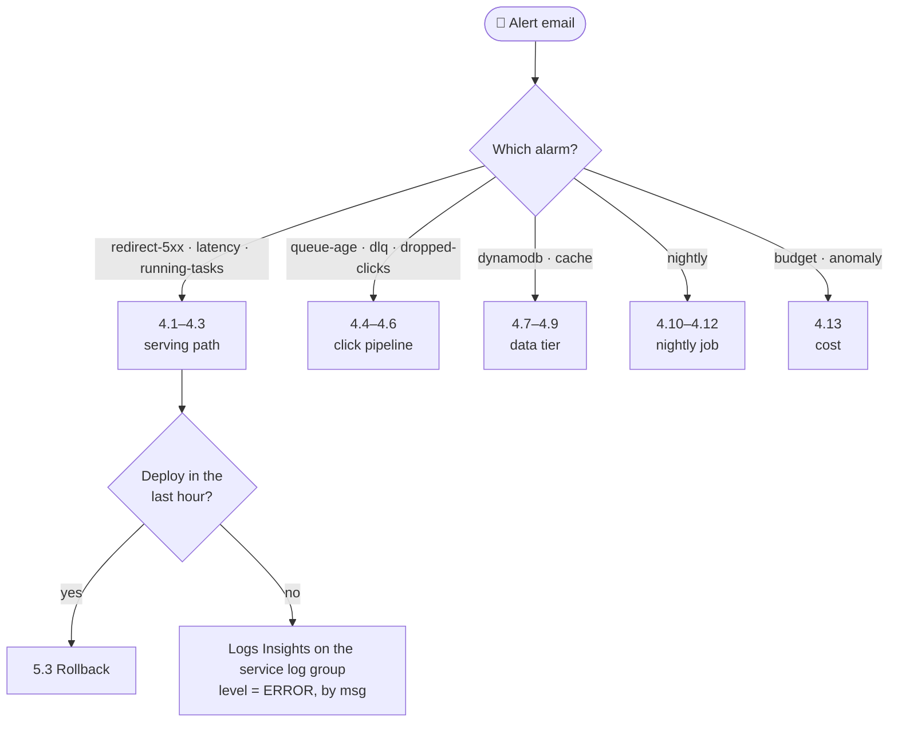

## 2. SLIs and SLOs

| SLO | SLI (how to compute) | Target |
| --- | --- | --- |
| **N1 latency** | ALB `TargetResponseTime` p99 for the redirect target group (dashboard "Redirect · latency"); per-request handler time is EMF `RedirectLatencyMs` | p99 < 50 ms on cache hit, < 100 ms overall |
| **N2 availability (prod)** | `1 − Σ HTTPCode_Target_5XX_Count / Σ RequestCount` for the redirect target group over the calendar month (CloudWatch metric math, period 1 month) | 99.9 % (≈ 43 min of full outage per month) |
| **N3 non-blocking analytics** | `ClickEventsDropped / (ClickEventsEnqueued + ClickEventsDropped)`; redirects never fail because of the queue | drops alarmed (§4.2) |
| **N4 analytics freshness** | SQS `ApproximateAgeOfOldestMessage` | < 2 min typical; alarm at 5 min |

Error-budget check (prod, month to date): CloudWatch → Metrics → Graphed
metrics. Add `RequestCount` and `HTTPCode_Target_5XX_Count` (Sum, redirect
target group), then add the expression `100 * (1 - SUM(METRICS("e5")) / SUM(METRICS("req")))`.
4xx responses (404/410) are correct answers, not errors.

## 3. Alerts and escalation

Every alarm notifies the SNS topic (Terraform output `alert_topic_arn`) on
ALARM **and** OK. Missing data counts as healthy, and "for N min" means every
datapoint in the window breached. Alarm names are `shortener-{env}-<name>`.
They are defined in [`infra/modules/observability`](../infra/modules/observability/main.tf)
([ADR-0022](adr/0022-observability-alerting-and-cost-guardrails.md)).

| Alarm | Fires when | Section |
| --- | --- | --- |
| `redirect-5xx` | redirect target 5xx rate > 1 % for 5 min | [4.1](#41-redirect-5xx) |
| `redirect-latency-p99` | ALB p99 `TargetResponseTime` > 100 ms for 10 min | [4.2](#42-redirect-latency-p99) |
| `running-tasks-{redirect,api,worker}` | running < desired for 5 min | [4.3](#43-running-tasks-redirect--running-tasks-api--running-tasks-worker) |
| `queue-age` | oldest click event > 5 min | [4.4](#44-queue-age) |
| `dlq` | any message in the DLQ | [4.5](#45-dlq) |
| `dropped-clicks` | `ClickEventsDropped` > 0 for 15 min | [4.6](#46-dropped-clicks) |
| `dynamodb-throttles-{links,analytics}` | throttled requests for 5 min | [4.7](#47-dynamodb-throttles-links--dynamodb-throttles-analytics) |
| `cache-errors` | > 50 Valkey errors in 5 min | [4.8](#48-cache-errors) |
| `cache-invalidation-failed` | a cache key could not be deleted after a change | [4.9](#49-cache-invalidation-failed) |
| `nightly-schedule-failures` | Scheduler could not start the nightly task | [4.10](#410-nightly-schedule-failures) |
| `nightly-failed` | the nightly job logged `nightly failed` | [4.11](#411-nightly-failed) |
| EventBridge rule `nightly-nonzero-exit` | the nightly task exited ≠ 0 | [4.12](#412-nightly-non-zero-exit-eventbridge-rule) |
| AWS Budgets, Cost Anomaly Detection | spend thresholds or anomalies | [4.13](#413-budget-and-cost-anomaly-alerts) |

**Escalation ladder** (one-owner project; adapt for a team):

1. **On-call (owner)** acknowledges within 15 min (prod) or next working hour (dev).
2. **User-facing impact** (prod `redirect-5xx`, `redirect-latency-p99`, `running-tasks-redirect`) not mitigated within 30 min:
   roll back (§5.3) first, investigate second.
3. **Suspected AWS service issue** (throttling or errors with no change on our side): check the
   [AWS Health Dashboard](https://health.aws.amazon.com/health/status) and open an AWS Support case.
4. **Security** (malicious links, leaked key): disable/revoke immediately (§5.4, §5.5), then follow the threat model.

To test the alert path end to end, force an alarm state and confirm the email
arrives. The alarm returns to OK at its next evaluation, which sends an OK email too.

```bash
aws cloudwatch set-alarm-state --alarm-name shortener-dev-dlq \
  --state-value ALARM --state-reason "alert path test"
```

Shell variables used below: `env=dev` (or `prod`), `p=shortener-$env`, and the
cluster `$p`.

## 4. Alarm responses

### 4.1 `redirect-5xx`

**Meaning:** more than 1 % of requests to the redirect target group returned 5xx for 5 minutes.
**Impact:** visitors see errors instead of redirects; this burns the 99.9 % availability budget (SPEC N2).

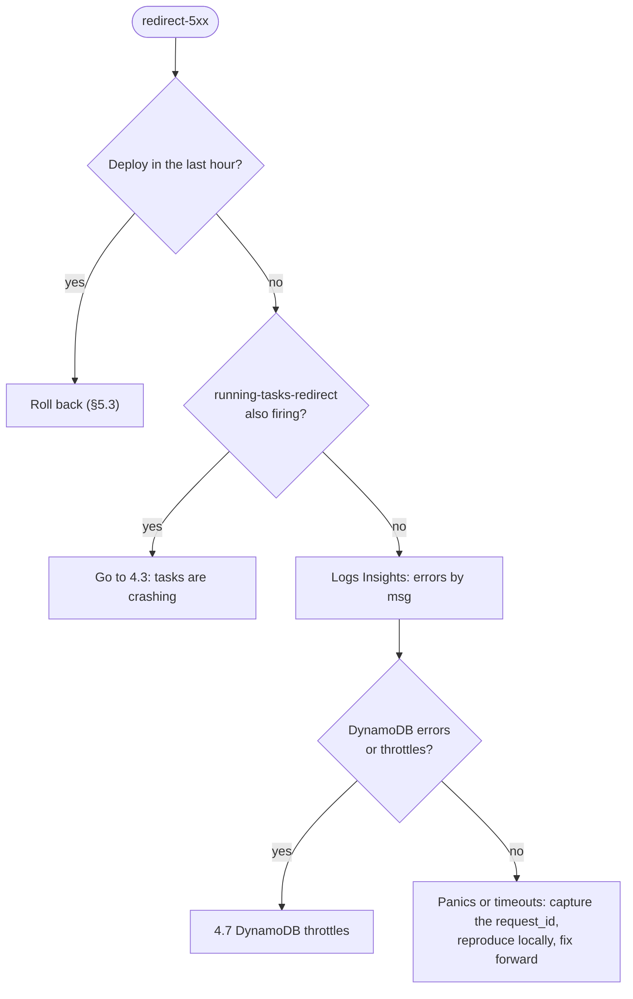

```bash
aws logs start-query --log-group-name /shortener/$env/redirect --start-time $(date -d '-30 min' +%s) --end-time $(date +%s) \
  --query-string 'fields @timestamp, msg, err | filter level = "ERROR" | stats count() by msg'
aws ecs describe-services --cluster $p --services $p-redirect --query 'services[0].events[:5].message'
```

**Remediation:** roll back a bad version (§5.3). For DynamoDB issues see 4.7.
Valkey errors alone never cause 5xx (redirect falls back to DynamoDB).
**Escalation:** prod not mitigated in 30 min → roll back; AWS-side errors → AWS Support.

### 4.2 `redirect-latency-p99`

**Meaning:** redirect p99 at the ALB stayed above 100 ms for 10 minutes (SPEC N1: < 50 ms on cache hit, < 100 ms overall).
**Impact:** slow redirects; usually a cache problem or saturation.

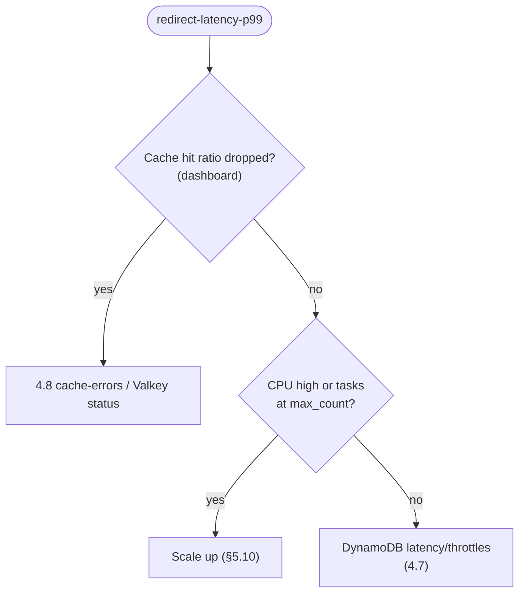

```bash
aws ecs describe-services --cluster $p --services $p-redirect --query 'services[0].[desiredCount,runningCount]'
aws cloudwatch get-metric-statistics --namespace AWS/ECS --metric-name CPUUtilization \
  --dimensions Name=ClusterName,Value=$p Name=ServiceName,Value=$p-redirect \
  --start-time $(date -u -d '-1 hour' +%FT%TZ) --end-time $(date -u +%FT%TZ) --period 300 --statistics Maximum
```

**Remediation:** restore the cache (4.8), or raise `redirect_max_count`/`redirect_min_count` (§5.10).
**Escalation:** sustained in prod > 30 min → on-call owner decides on scale-up apply.

### 4.3 `running-tasks-redirect` · `running-tasks-api` · `running-tasks-worker`

**Meaning:** a service ran fewer tasks than desired for 5 minutes.
**Impact:** for redirect and api, reduced capacity, or an outage at 0
tasks. For the worker, analytics lag (see 4.4).

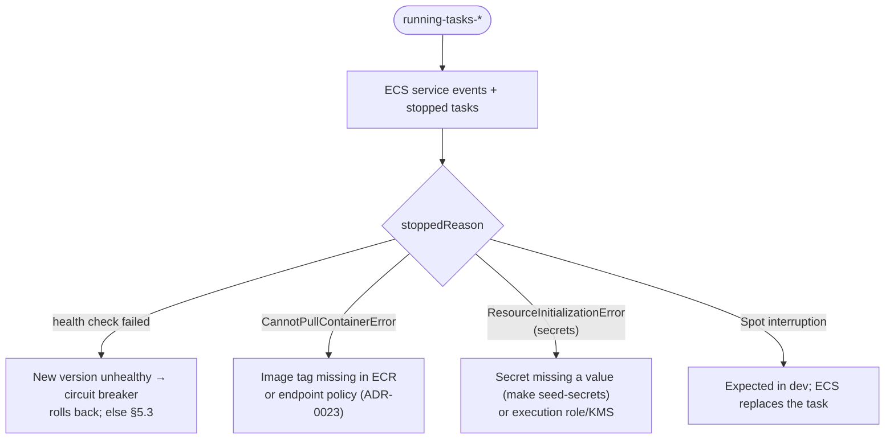

```bash
aws ecs list-tasks --cluster $p --service-name $p-redirect --desired-status STOPPED --query 'taskArns[:3]'
aws ecs describe-tasks --cluster $p --tasks <task-arn> --query 'tasks[0].[stoppedReason,containers[0].exitCode,containers[0].reason]'
```

**Remediation:** fix the cause shown in `stoppedReason`. Failed deployments
roll back automatically. A missing secret value needs `make seed-secrets ENV=$env`.
**Escalation:** redirect at 0 running tasks in prod → treat as an outage; roll back immediately.

### 4.4 `queue-age`

**Meaning:** the oldest click event has waited more than 5 minutes.
**Impact:** stats are stale (SPEC N4 expects < 2 min); redirects are unaffected.

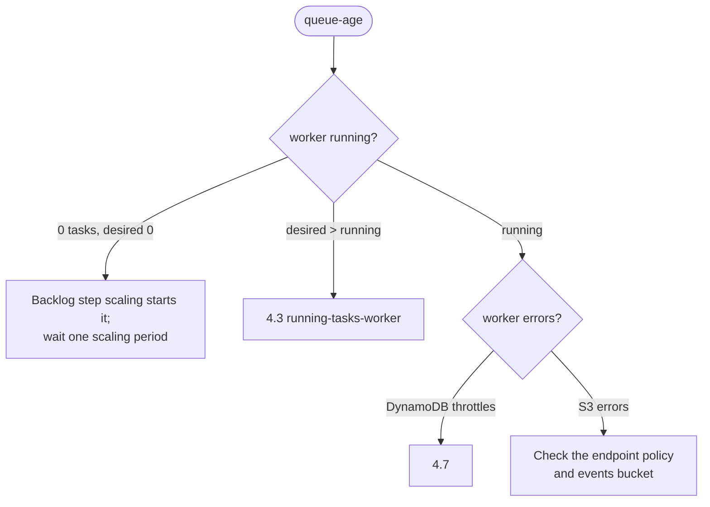

```bash
aws sqs get-queue-attributes --queue-url $(aws sqs get-queue-url --queue-name $p-click-events --query QueueUrl --output text) \
  --attribute-names ApproximateNumberOfMessages ApproximateAgeOfOldestMessage
aws ecs describe-services --cluster $p --services $p-worker --query 'services[0].[desiredCount,runningCount]'
```

**Remediation:** fix the worker failure; raise `worker_max_count` for sustained backlog (§5.10).
Counting is batched ([ADR-0024](adr/0024-batched-exactly-once-click-counting.md)): the dashboard's "Click pipeline" widget shows
counting transactions next to processed events, so a falling ratio of clicks
per transaction means each write carries fewer clicks. Rising `WorkerRetries`
means counting transactions are failing (conflicts on a hot counter between
workers, or throttling) and the clicks wait for redelivery.
**Escalation:** age > 1 h in prod → owner; messages older than 3 days lose dedupe protection (§5.8).

### 4.5 `dlq`

**Meaning:** click events failed 5 receives and were moved to the dead-letter queue.
**Impact:** those clicks are not counted until redriven.

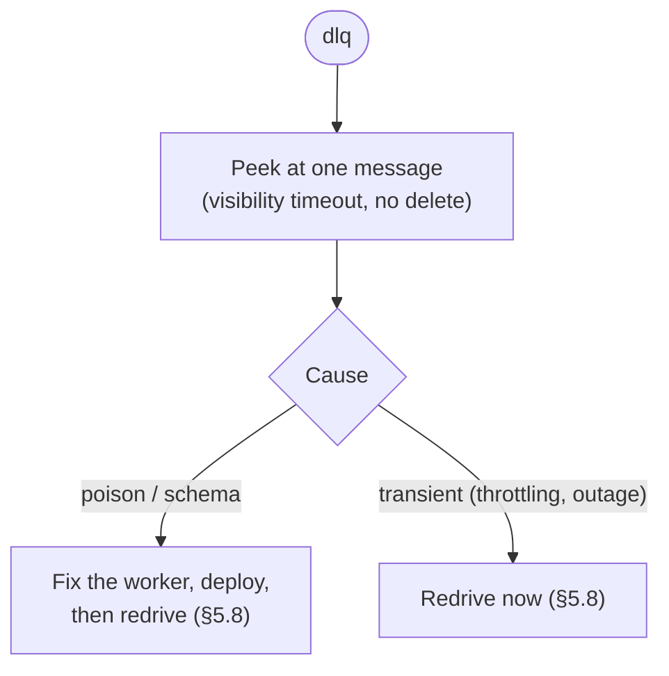

```bash
dlq=$(aws sqs get-queue-url --queue-name $p-click-events-dlq --query QueueUrl --output text)
aws sqs receive-message --queue-url $dlq --max-number-of-messages 1 --visibility-timeout 30
aws logs filter-log-events --log-group-name /shortener/$env/worker --filter-pattern '{ $.level = "ERROR" }' --max-items 20
```

**Remediation:** redrive within **3 days** (§5.8).
**Escalation:** a repeated DLQ after redrive → treat as a worker bug; owner fixes forward.

### 4.6 `dropped-clicks`

**Meaning:** redirect could not enqueue click events (SQS errors or a full in-memory buffer) for 15 minutes.
**Impact:** those clicks are lost. Redirects keep working (SPEC N3).

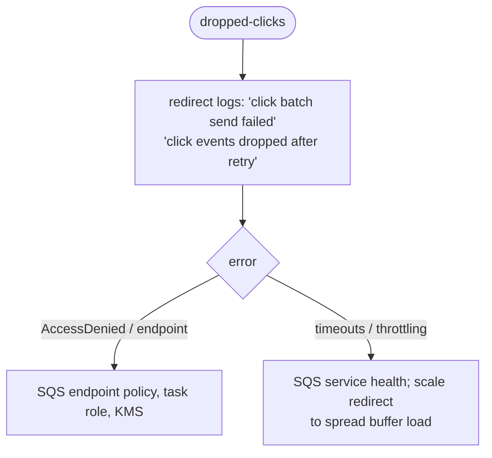

```bash
aws logs filter-log-events --log-group-name /shortener/$env/redirect --filter-pattern '"click batch send failed"' --max-items 10
```

**Remediation:** fix the access or endpoint problem; lost clicks cannot be recovered.
**Escalation:** AWS-side SQS errors → AWS Support.

### 4.7 `dynamodb-throttles-links` · `dynamodb-throttles-analytics`

**Meaning:** a table throttled reads or writes for 5 minutes.
**Impact:** links: slower redirects and API 503s. Analytics: the worker
retries and the queue backs up.

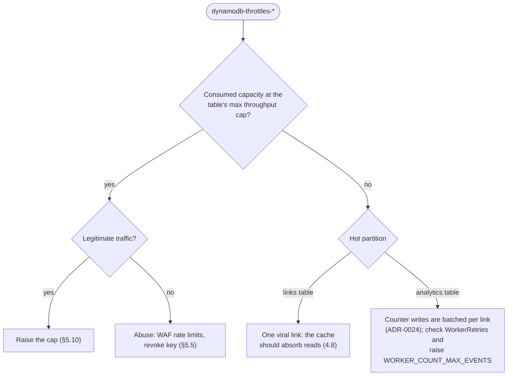

```bash
aws dynamodb describe-table --table-name $p-links --query 'Table.OnDemandThroughput'
aws cloudwatch get-metric-statistics --namespace AWS/DynamoDB --metric-name ConsumedReadCapacityUnits \
  --dimensions Name=TableName,Value=$p-links --start-time $(date -u -d '-1 hour' +%FT%TZ) --end-time $(date -u +%FT%TZ) --period 60 --statistics Sum
```

**Remediation:** raise the max-throughput caps (`infra/modules/dynamodb/variables.tf`) through a reviewed apply.
**Escalation:** caps are a cost guardrail. A raise above 2× needs the owner, who reviews [cost.md](cost.md).

### 4.8 `cache-errors`

**Meaning:** more than 50 Valkey errors in 5 minutes across services.
**Impact (expected degradation):**

- redirect and api read DynamoDB directly, so latency rises and DynamoDB load increases;
- rate limiting fails open (WAF rules remain);
- unique-visitor counting pauses;
- idempotency keys are not honoured.

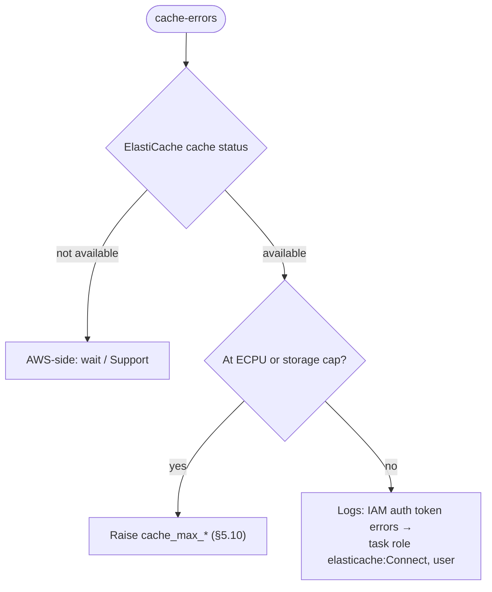

```bash
aws elasticache describe-serverless-caches --serverless-cache-name $p-cache --query 'ServerlessCaches[0].[Status,CacheUsageLimits]'
aws logs filter-log-events --log-group-name /shortener/$env/redirect --filter-pattern '"cache"' --max-items 10
```

**Remediation:** see §5.11 (Valkey failure mode). The services recover by themselves when Valkey returns.
**Escalation:** more than 30 min in prod with rising DynamoDB throttles → owner; consider a temporary scale-up.

### 4.9 `cache-invalidation-failed`

**Meaning:** a link change or disable reached DynamoDB, but the cached entry could not be deleted (both attempts failed).
**Impact:** the old destination can be served for up to 1 hour (the positive TTL). This matters most for a security disable.

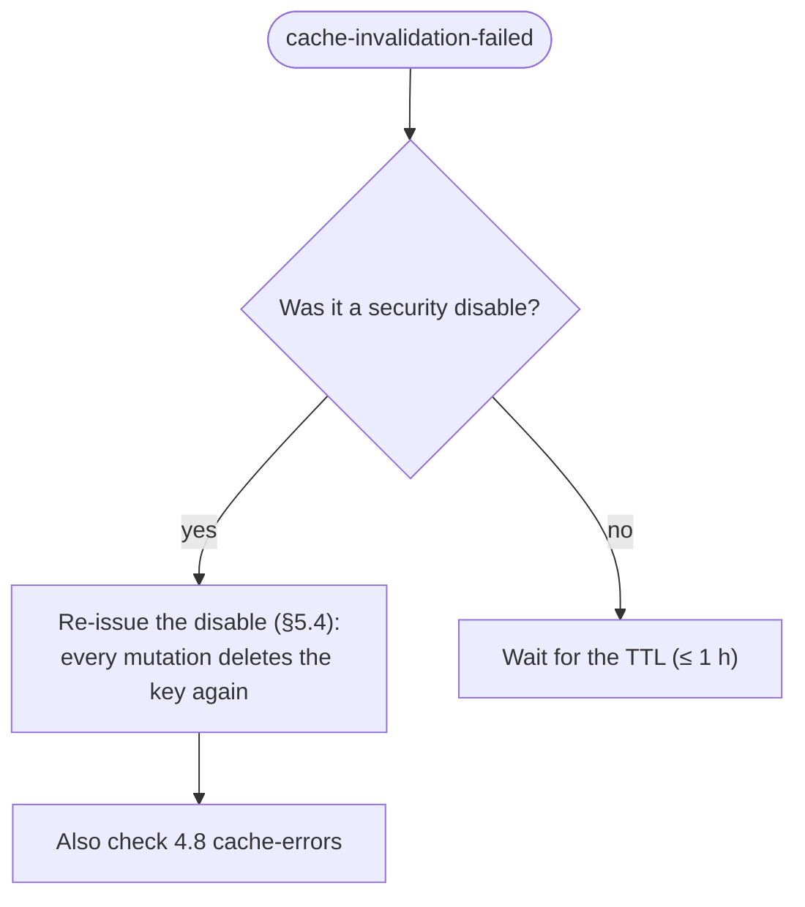

```bash
aws logs filter-log-events --log-group-name /shortener/$env/api --filter-pattern '"cache invalidation failed"' --max-items 10
```

**Remediation:** re-issue the change once Valkey is healthy.
**Escalation:** a malicious link still being served → owner, immediately.

### 4.10 `nightly-schedule-failures`

**Meaning:** EventBridge Scheduler could not start the nightly task (target error or retries exhausted).
**Impact:** no rescans or uniques persistence that night (both catch up on the next successful run).

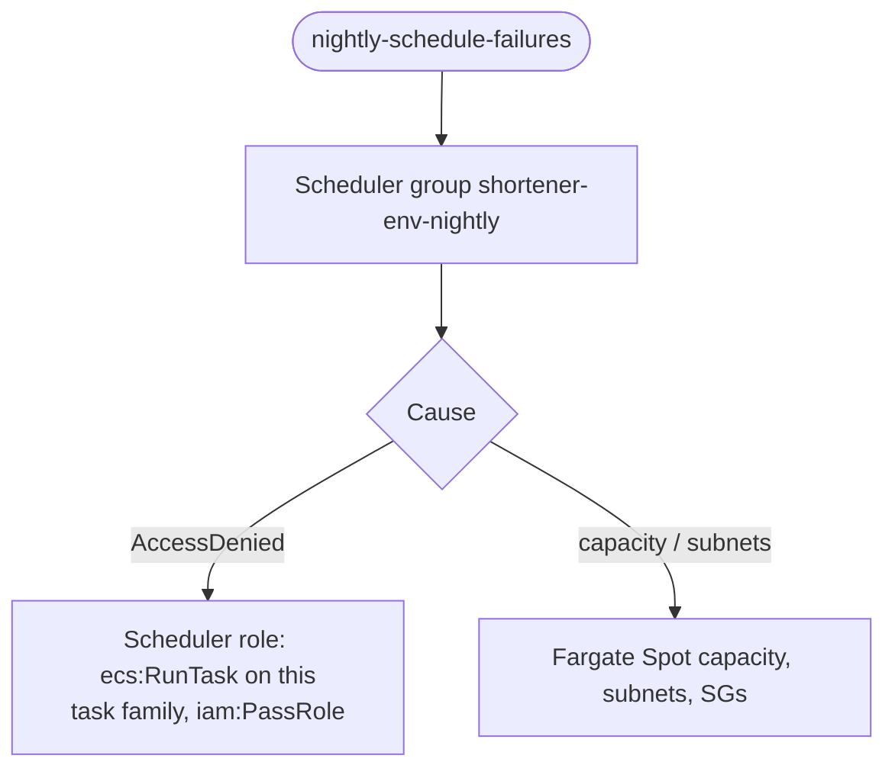

```bash
aws scheduler get-schedule --group-name $p-nightly --name $p-nightly --query '[State,Target.EcsParameters.TaskDefinitionArn]'
```

**Remediation:** fix the cause, then run the job manually (§5.12).
**Escalation:** 2 consecutive nights → owner.

### 4.11 `nightly-failed`

**Meaning:** the nightly job logged `nightly failed` (the log line names the failing step).
**Impact:** as in 4.10, for the failed step only.

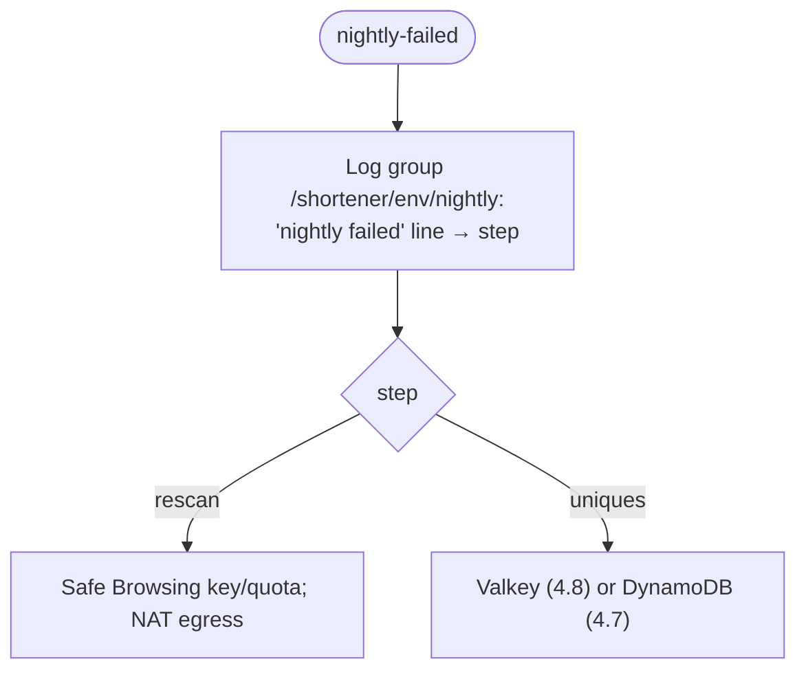

```bash
aws logs filter-log-events --log-group-name /shortener/$env/nightly --filter-pattern '"nightly failed"' --max-items 5
```

**Remediation:** fix the cause and rerun (§5.12); runs are idempotent.
**Escalation:** as in 4.10.

### 4.12 Nightly non-zero exit (EventBridge rule)

**Meaning:** the nightly task stopped with a non-zero exit code. This covers
crashes, OOM kills and image-pull failures that never log `nightly failed`.
The SNS message carries the task ARN and the `stoppedReason`.

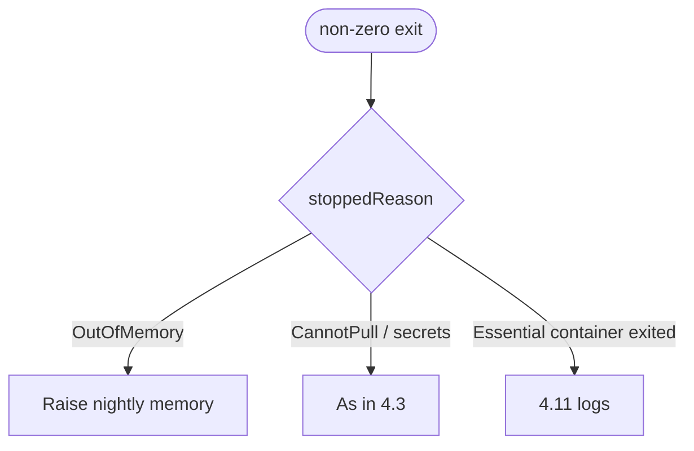

**Remediation and escalation:** as in 4.10 and 4.11.

### 4.13 Budget and cost anomaly alerts

**Meaning:** AWS Budgets crossed 50, 80 or 100 % of the monthly budget (actual),
or 100 % forecast; or Cost Anomaly Detection found unusual spend for
`CostCenter = shortener-{env}`.

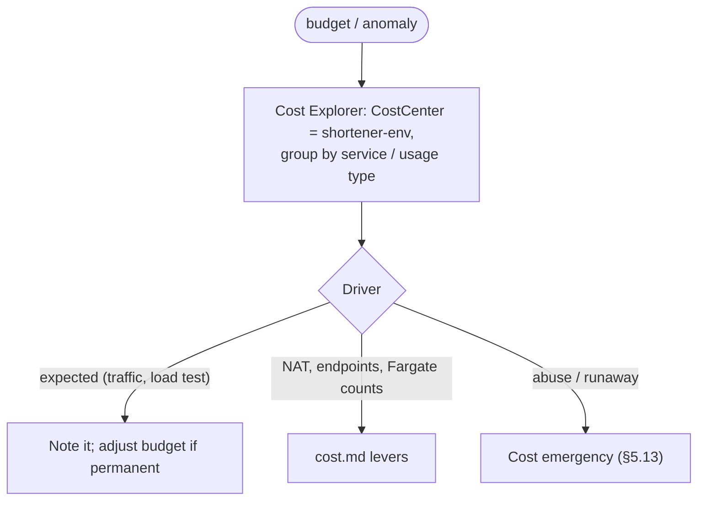

**Remediation:** apply the levers in [cost.md](cost.md#5-cost-drivers-and-levers); in an emergency, §5.13.
**Escalation:** forecast > 150 % of budget → owner decides on scaling down or tearing down dev.

## 5. Procedures

### 5.1 CI/CD setup (one time, 👤 repository admin)

Prerequisites: `make bootstrap` applied, phase 1 applied for the environment,
and `make seed-secrets` done ([GATES.md](../GATES.md) pending list). Values come
from `terraform -chdir=infra/bootstrap output`. None of them are secrets,
except the smoke API keys.

1. **Repository variables:**

   ```bash
   gh variable set AWS_REGION --body us-east-1
   gh variable set OWNER --body perspectivism
   gh variable set TF_STATE_BUCKET --body "$(terraform -chdir=infra/bootstrap output -raw state_bucket)"
   gh variable set TF_STATE_KMS_KEY_ARN --body "$(terraform -chdir=infra/bootstrap output -raw state_kms_key_arn)"
   gh variable set AWS_PLAN_ROLE_ARN --body "$(terraform -chdir=infra/bootstrap output -raw plan_role_arn)"
   ```

2. **Environments `dev` and `prod`:** Settings → Environments. Restrict
   deployment branches to `main`. On `prod`, add **required reviewers** (the
   owner) and enable "Prevent self-review". Then set the variables:

   ```bash
   for env in dev prod; do
     gh variable set AWS_APPLY_ROLE_ARN --env "$env" \
       --body "$(terraform -chdir=infra/bootstrap output -json apply_role_arns | jq -r --arg e "$env" '.[$e]')"
     gh variable set ALERT_EMAIL --env "$env" --body "$ALERT_EMAIL"   # the address that receives alarms
   done
   ```

3. **Smoke API key per environment.** The key goes straight into the GitHub
   secret and is never shown (run with your own AWS credentials):

   ```bash
   env=dev
   go run ./cmd/shortenerctl apikey create --env "$env" --table "shortener-$env-links" \
       --owner ci-smoke --scopes links:read,links:write \
     | tee >(grep -E '^(key_hash|owner|scopes):' >&2) \
     | awk '/^api_key:/ {print $2}' | gh secret set SMOKE_API_KEY --env "$env"
   ```

   Record the printed `key_hash`; you need it to revoke the key.

4. **Branch protection** (Settings → Rules → new branch ruleset on `main`):

   - require a pull request with 1 approval and code-owner review;
   - require these status checks: `go · lint, unit, vuln, secrets`,
     `integration (compose emulators)`, `images · build arm64, non-root, Trivy`,
     `terraform · fmt, validate, tflint, checkov, Trivy, test`,
     `docs and workflows · markdown, Mermaid, links, actionlint, zizmor, pins`,
     `terraform plan (dev)`;
   - block force pushes and deletions.

   [`.github/CODEOWNERS`](../.github/CODEOWNERS) assigns every path to `@perspectivism`.

### 5.2 Deploy

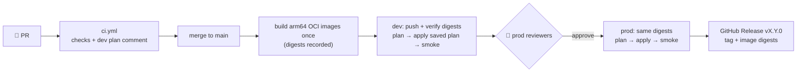

- Normal path: merge a reviewed PR. `deploy.yml` builds once, pushes the
  images to dev and checks each ECR digest against the built manifest. It
  then plans with `image_tag = <12-char SHA>`, applies exactly that plan
  (ECS rolling deploy with the circuit breaker) and runs the smoke suite.
- **Prod** waits for a reviewer to approve the `prod` environment. Before
  approving, check that the dev smoke step is green and the dev dashboard is
  quiet. The prod job pushes the **same digests** and verifies them.
- **Release:** after the prod smoke tests pass, `scripts/release.sh` creates
  the next GitHub Release, bumping the minor version (`v0.1.0` → `v0.2.0`).
  The release creates its tag and records the commits since the previous
  release and the exact image digests now in prod.
  - To cut a **major** release, tag the commit by hand (`git tag -a v1.0.0 -m …`
    and push the tag) before approving prod. The release then uses that tag.
  - Binaries log their build version in every line's `version` field
    ([ADR-0026](adr/0026-release-versioning-with-tags.md)). `git describe --tags <sha>` maps a describe-style version
    (`v0.2.0-4-g<sha>`) to its release.
- Manual deploy, from a clean commit with admin credentials: run `make
  images-oci`, then `APPROVED=yes make push-images ENV=dev`, then set
  `image_tag` in `terraform.tfvars`. Run `make plan ENV=dev`; once the plan is
  approved, run `APPROVED=yes make apply ENV=dev`, then `make smoke-env ENV=dev`.

### 5.3 Rollback

1. **Automatic:** if new tasks fail health checks, the ECS circuit breaker
   restores the previous task definition. `terraform apply` then fails, so the
   pipeline turns red and prod is never reached.
2. **Manual**, for a bad version that passes health checks, choose one:
   - **Revert (preferred):** merge `git revert <bad sha>`. The pipeline ships
     the reverted code through dev and prod as a new, reviewed SHA.
   - **Fast rollback:** use admin credentials with `image_tag` set to the last
     good release's SHA: `git rev-parse --short=12 v0.3.0^{commit}`, or read
     it from the release notes. Its images are still in ECR, since tags are
     immutable. Set it in
     `infra/envs/<env>/terraform.tfvars` and run `make plan ENV=<env>`. After
     approval, run `APPROVED=yes make apply ENV=<env>`, then `make smoke-env ENV=<env>`.
     Afterwards, merge a revert so `main` matches what is deployed.
3. Never delete or overwrite an image tag (tags are immutable).

### 5.4 Disable a malicious link

Use an API key with the `admin` scope:

```bash
curl -fsS -X POST -H "Authorization: Bearer $ADMIN_KEY" "$BASE_URL/api/v1/admin/links/<code>/disable"
```

The link answers 410 at once: the cache key is deleted on every mutation. If
`cache-invalidation-failed` fires, re-issue the call (4.9). Re-enable with
`/enable`. The nightly rescan disables links that Safe Browsing flags by itself.

### 5.5 Revoke an API key

Revocation takes effect within 60 s (the in-process auth cache). Use the
`key_hash` printed when the key was created:

```bash
LINKS_TABLE=shortener-$env-links APP_ENV=$env go run ./cmd/shortenerctl apikey revoke --hash <key_hash>
```

A leaked key must also be checked for links it created or changed (the
owner's `GET /api/v1/links`).

### 5.6 Rotate the Safe Browsing key

1. Create a new key in Google Cloud and restrict it to the Safe Browsing API.
2. `ROTATE=1 make seed-secrets ENV=$env`, then enter the new key at the hidden prompt.
3. Restart the consumers so they read the new version (secrets are injected at task start):
   `aws ecs update-service --cluster $p --service $p-api --force-new-deployment`. The nightly job picks it up at its next run.
4. Revoke the old key in Google Cloud once `URLScanUnavailable` stays at 0.

### 5.7 Rotate the visitor salt

**Impact:** visitor IDs are `HMAC(salt, ip | ua | date)`, so after rotation
the same visitor counts again **for the rest of that day**. Unique counts for
the rotation day are overstated; other days are unaffected
([ADR-0018](adr/0018-privacy-hmac-visitor-ids-referrer-host-only.md)).
Rotate just after midnight UTC to minimise this.

1. `ROTATE=1 make seed-secrets ENV=$env`. A new salt is generated with `get-random-password` and is never displayed.
2. `aws ecs update-service --cluster $p --service $p-redirect --force-new-deployment`.

### 5.8 Redrive the DLQ

Redrive **within 3 days** of the original click: dedupe markers expire after
3 days, and older messages could be counted twice.

```bash
q=$(aws sqs get-queue-url --queue-name $p-click-events --query QueueUrl --output text)
dlq=$(aws sqs get-queue-url --queue-name $p-click-events-dlq --query QueueUrl --output text)
arn() { aws sqs get-queue-attributes --queue-url "$1" --attribute-names QueueArn --query Attributes.QueueArn --output text; }
aws sqs start-message-move-task --source-arn "$(arn $dlq)" --destination-arn "$(arn $q)"
aws sqs list-message-move-tasks --source-arn "$(arn $dlq)"
```

### 5.9 DynamoDB PITR restore (new table, then swap)

Point-in-time recovery is enabled on both tables (35 days). DynamoDB cannot
rename tables, so a restore goes to a new table, and the live name is
re-created from it.

1. **Restore to a new table** (no impact on production):
   `aws dynamodb restore-table-to-point-in-time --source-table-name $p-links --target-table-name $p-links-restore --restore-date-time <UTC time> --sse-specification-override Enabled=true,SSEType=KMS,KMSMasterKeyId=<env CMK ARN>`
2. **Verify** `$p-links-restore`: item count, a sample of known codes and API keys.
3. **Freeze writes:** set the api and worker desired counts to 0 (redirect keeps
   serving from cache and the live table):
   `aws ecs update-service --cluster $p --service $p-api --desired-count 0` (and the same for `$p-worker`).
4. **Swap** (👤 approval, prod only with `PROD_APPLY_CONFIRMED`):
   1. `aws dynamodb create-backup --table-name $p-links-restore --backup-name $p-links-swap`;
   2. disable deletion protection on the live table
      (`aws dynamodb update-table --table-name $p-links --no-deletion-protection-enabled`);
   3. delete it;
   4. `aws dynamodb restore-table-from-backup --target-table-name $p-links --backup-arn <arn> --sse-specification-override …`.
5. **Reconcile with Terraform:** `make plan ENV=$env` must show only in-place
   updates (PITR, TTL, max throughput, deletion protection, tags), then
   `APPROVED=yes make apply ENV=$env`.
6. **Unfreeze.** Terraform ignores `desired_count` because Application Auto
   Scaling owns it, so set it back by hand:
   `aws ecs update-service --cluster $p --service $p-api --desired-count <api_min_count>`.
   The worker can stay at 0 (backlog scaling starts it).
7. **Clean up:** delete `$p-links-restore` and the on-demand backup. Teardown
   expects no on-demand backups.

Redirect errors are possible for codes missing from the cache while the table
is being re-created (minutes). Run this in a maintenance window.

### 5.10 Scale up for a traffic spike

| Bottleneck | Change (reviewed apply) |
| --- | --- |
| Redirect tasks | `redirect_min_count` / `redirect_max_count` (autoscaling: 500 requests per target, CPU 60 %); raise the minimum **before** a planned spike, because Fargate needs 30–60 s to start a task |
| API / worker | `api_max_count`, `worker_max_count` |
| DynamoDB | max-throughput caps in [`infra/modules/dynamodb/variables.tf`](../infra/modules/dynamodb/variables.tf) |
| Valkey | `cache_max_ecpu_per_second`, `cache_max_data_storage_gb` |
| Edge | `waf_redirect_rate_limit_per_minute` (per IP) if legitimate clients share IPs |

Check the dashboard during and after the change; scale back by reverting the variables.

### 5.11 Valkey failure mode

When Valkey is unavailable, the system degrades by design ([ADR-0008](adr/0008-elasticache-serverless-valkey.md)):

- redirects and API reads go straight to DynamoDB (higher latency, more read capacity used);
- per-key rate limiting fails **open**, so WAF per-IP rules are the backstop;
- unique-visitor counting pauses (click totals continue);
- idempotency keys are not honoured, so clients may create duplicates on retry;
- cache invalidation fails (4.9).

Watch DynamoDB throttles (4.7) and scale up if needed. No restart is needed
when Valkey returns, because the services reconnect by themselves.

### 5.12 Run the nightly job manually

```bash
terraform -chdir=infra/envs/$env output -json nightly_run_task   # task definition, subnets, security groups
aws ecs run-task --cluster $p --launch-type FARGATE --task-definition <arn> \
  --network-configuration 'awsvpcConfiguration={subnets=[<ids>],securityGroups=[<ids>],assignPublicIp=DISABLED}'
```

Check that the exit code is 0 and that the `nightly summary` log line appears. Runs are idempotent.

### 5.13 Cost emergency

1. **Stop the bleeding in dev:** set `enable_services = false` and apply
   (plan → approve → apply). This removes services, the ALB, WAF and
   CloudFront and keeps the data (≈ $46/month foundation, [cost.md](cost.md)).
2. **Abuse-driven spend:** tighten the WAF rate limits, revoke abusive keys (§5.5), disable links (§5.4).
3. **Everything:** full teardown (§5.15).

### 5.14 Region outage

There is no second region ([design §11](design.md#11-operations)): an outage
of us-east-1 is an outage of the service, with no data loss (DynamoDB, S3 and
SQS keep their data in the region).

1. Confirm it on the [AWS Health Dashboard](https://health.aws.amazon.com/health/status), and note the start time.
2. Tell link owners that redirects and the API are down. CloudFront answers
   with 5xx errors from the edge.
3. When the region recovers, check service health (4.3), the queue age
   (4.4) and the DLQ (4.5). Redrive within 3 days (§5.8).
4. Afterwards, decide whether the outage justifies cross-region DR, using
   the options and costs in design §11.

### 5.15 Full teardown

Each step needs a typed confirmation and runs as a saved plan
(SPEC §19.1). It goes prod (if deployed: first `force_destroy = true`, then
destroy), then dev, then bootstrap: the state bucket (all versions), OIDC
provider, CI roles and state key. Finally it verifies:

```bash
make teardown          # interactive; or step by step:
make plan-destroy ENV=dev && APPROVED=yes make destroy ENV=dev
make verify-teardown   # read-only; exits non-zero on any leftover
```

- **KMS keys** cannot be deleted immediately: they stay *pending deletion*
  for 7 days (not billed), then AWS deletes them. `verify-teardown` lists them
  as expected.
- **Unconfirmed SNS email subscriptions** cannot be deleted; AWS removes them after 3 days.
- **CloudFront** distributions are disabled before deletion, which can take
  15–30 minutes. Re-run the destroy step if it times out.
