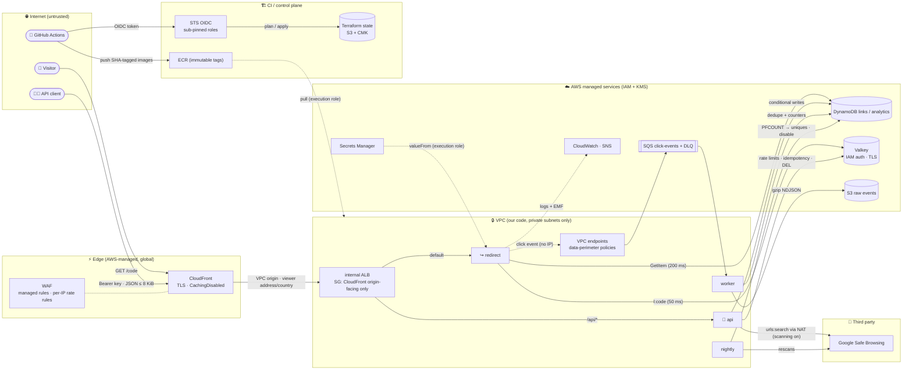

# 🛡️ URL Shortener — Threat Model

> **Status:** v1.0 (M7) — complete per SPEC §17.3: scope, assets, actors, data
> flows with trust boundaries, STRIDE for every element and flow (application,
> infrastructure, CI/CD and supply chain), residual risks and scanner
> suppressions. Every row is **mitigated** or **accepted** with rationale; none is open.

## Contents

1. [Scope](#1-scope)
2. [Assets](#2-assets)
3. [Actors](#3-actors)
4. [Data flow and trust boundaries](#4-data-flow-and-trust-boundaries)
5. [STRIDE — redirect path](#5-stride--redirect-path)
6. [STRIDE — management API](#6-stride--management-api)
7. [STRIDE — click pipeline and nightly job](#7-stride--click-pipeline-and-nightly-job)
8. [STRIDE — infrastructure](#8-stride--infrastructure)
9. [STRIDE — CI/CD and supply chain](#9-stride--cicd-and-supply-chain)
10. [Coverage of SPEC §17.3](#10-coverage-of-spec-173)
11. [Accepted and residual risks](#11-accepted-and-residual-risks)
12. [Scanner suppressions](#12-scanner-suppressions)

## 1. Scope

Everything that runs or deploys URL Shortener:

- the four services (`redirect`, `api`, `worker`, `nightly`) and their use of
  DynamoDB, Valkey, SQS, S3 and Google Safe Browsing;
- API-key authentication;
- the edge (CloudFront, WAF, VPC origin, internal ALB);
- the network, IAM, KMS and observability;
- Terraform state, the GitHub Actions OIDC roles, and the build and dependency
  supply chain.

Out of scope: AWS's and Google's own infrastructure, and visitors' devices.

## 2. Assets

| Asset | Why it matters |
| --- | --- |
| Link integrity | A tampered destination turns trusted short links into phishing |
| Redirect availability | The product's core promise (SPEC N2: 99.9 %) |
| Analytics privacy | Visitor IPs/referrers are personal data (SPEC N6) |
| API keys | Grant control over an owner's links |
| Owner isolation | One customer must not read or change another's links |
| AWS account | Everything above runs in it; includes KMS keys and secrets |
| Terraform state and CI roles | Whoever can write state or assume the apply role controls the infrastructure |
| Build artifacts | Images and dependencies run with the services' IAM permissions |

## 3. Actors

| Actor | Capability | Intent |
| --- | --- | --- |
| Anonymous visitor | Any HTTP request to the edge | Mostly benign; may scan codes or flood |
| API client | Holds a valid API key with some scopes | Benign, or curious about other owners |
| Malicious link creator | Holds (or steals) a key | Phishing, malware distribution, abuse of our domain reputation |
| Compromised dependency | Code running inside our tasks or CI | Exfiltration, persistence |
| Insider / CI | Repository and pipeline access | Accidental or deliberate misuse |

## 4. Data flow and trust boundaries

**Trust boundaries:**

- **Internet → Edge:** TLS, WAF managed rules and per-IP rate limits.
- **Edge → VPC:** only CloudFront can reach the internal ALB, through the VPC
  origin and the origin-facing prefix list ([ADR-0012](adr/0012-cloudfront-vpc-origin-internal-alb-waf.md)).
- **VPC → AWS services:** per-service task roles, VPC endpoints with
  data-perimeter policies, and KMS.
- **VPC → third party:** Safe Browsing over NAT, only when scanning is enabled.
- **CI → AWS:** GitHub OIDC with `sub`-pinned roles under a permissions
  boundary; no static keys.

## 5. STRIDE — redirect path

| # | Threat | STRIDE | L | I | Mitigation | Status |
| --- | --- | --- | --- | --- | --- | --- |
| R1 | **Code enumeration** — scanning random codes to discover links | I | H | M | Codes are non-sequential (Sqids, [ADR-0006](adr/0006-short-code-generation-range-allocation-and-sqids.md)); negative cache 60 s keeps scans off DynamoDB ([`resolver.go`](../internal/links/resolver.go)); invalid code syntax rejected before any lookup; WAF per-IP rate rules (M5) | Mitigated (links are not secrets — [ADR-0006](adr/0006-short-code-generation-range-allocation-and-sqids.md)) |
| R2 | **Open redirect / phishing** — our domain lends credibility to malicious destinations | S/T | H | H | Safe Browsing at create/update + nightly rescan ([ADR-0021](adr/0021-url-safety-scanning-safe-browsing-v5.md)); admin kill switch with immediate cache invalidation; destinations restricted to http(s), no credentials, no private/loopback/link-local IP literals, no non-canonical numeric hosts, not our own domain ([`validate.go`](../internal/links/validate.go)) | Mitigated; zero-day gap accepted ([§11](#11-accepted-and-residual-risks)) |
| R3 | **Cache poisoning** — making `l:{code}` point elsewhere | T | L | H | Only our services write Valkey (IAM auth, SG, TLS — [ADR-0009](adr/0009-valkey-iam-authentication.md)); entries derive solely from DynamoDB; gone links are cached without a destination; CloudFront never caches redirects ([ADR-0007](adr/0007-302-redirects-and-no-edge-caching.md)) | Mitigated |
| R4 | **DoS on the hot path** | D | M | H | WAF rate rules (M5); cache-aside + singleflight per code (stampede protection); 50 ms cache / 200 ms DynamoDB deadlines; server read/write/idle timeouts and `MaxHeaderBytes` ([`server.go`](../internal/httpx/server.go)); click enqueue is non-blocking with a bounded buffer ([`producer.go`](../internal/events/producer.go)); autoscaling (M5) | Mitigated |
| R5 | **Cache outage** turns into a redirect outage | D | M | H | Cache errors fail open to DynamoDB and are counted (`CacheErrors`) | Mitigated |
| R6 | **Analytics backpressure** blocks redirects | D | M | H | Response written before enqueue; full buffer or SQS failure drops the event and counts `ClickEventsDropped` (SPEC N3) | Mitigated |
| R7 | **Viewer IP/country header spoofing** | S | L | M | `CloudFront-Viewer-Address`/`-Country` trusted only because the ALB is reachable solely via CloudFront (M5); config forbids `remote_addr` mode in dev/prod ([`config.go`](../internal/config/config.go)) | Mitigated (verified in M5/M7) |
| R8 | **Privacy leak** of visitor IPs/referrers | I | M | H | Per-day keyed HMAC visitor IDs; referrer host only; IP never leaves the task; logs exclude IPs and destination URLs (tested in [`redirect_test.go`](../internal/redirect/redirect_test.go)) — [ADR-0018](adr/0018-privacy-hmac-visitor-ids-referrer-host-only.md) | Mitigated |
| R9 | **Log injection** via request IDs or paths | T | M | L | Structured JSON logs (values escaped); `X-Amz-Cf-Id` accepted only if it matches a strict charset/length, otherwise a UUIDv7 is generated ([`middleware.go`](../internal/httpx/middleware.go)); access logs record the route pattern, not raw query strings | Mitigated |
| R10 | **Response header injection** via a crafted destination | T | L | M | Destinations are parsed and re-serialized by `net/url` (no CR/LF possible) before storage | Mitigated |
| R11 | **Disabled link re-cached** — a cache fill that read the link before an admin disable writes it back after the invalidation, so the link keeps redirecting for up to 1 h | T | M | H | Invalidation leaves a 10 s fence instead of deleting; fills are `SET NX` and skip the write after 5 s ([ADR-0030](adr/0030-consistency-under-concurrency.md), [`resolver.go`](../internal/links/resolver.go)); race reproduced in `TestResolveFillRacingDisable` | Mitigated |
| R12 | **Edge logs keep visitor data** — CloudFront logs record IPs, full referrers, user agents, query strings, cookies | I | H | M | CloudFront `record_fields` allowlist without those fields; WAF logs keep only blocked/counted requests ([ADR-0029](adr/0029-edge-log-privacy.md), [`edge`](../infra/modules/edge/main.tf)); Terraform test fails if an excluded field returns | Mitigated; WAF client IPs of blocked/counted requests accepted ([§11](#11-accepted-and-residual-risks)) |
| R13 | **Stale read after a disable** — a cache miss reads an eventually consistent replica and redirects to the disabled destination | T | M | H | Link reads use `ConsistentRead` ([ADR-0031](adr/0031-consistent-link-reads-and-owned-idempotency-claims.md), [`store/links.go`](../internal/store/links.go)); stale-replica fake in `TestGetLinkSeesCompletedDisable` | Mitigated |

## 6. STRIDE — management API

| # | Threat | STRIDE | L | I | Mitigation | Status |
| --- | --- | --- | --- | --- | --- | --- |
| A1 | **API key theft** (logs, repos, screenshots) | S | M | H | 256-bit keys shown once, stored as SHA-256 ([ADR-0015](adr/0015-api-key-authentication.md)); `Authorization` never logged; recognisable `shortener_{env}_` prefix with a custom gitleaks rule; per-env prefix check; revocation (≤ 60 s) | Mitigated |
| A2 | **Brute-forcing keys** | S | L | H | 2²⁵⁶ keyspace; malformed keys rejected without a lookup; WAF rate rules on `/api/*` (M5) | Mitigated |
| A3 | **IDOR across owners** — reading/changing another owner's link | E/I | M | H | Every get/update/delete checks `owner_id` and returns 404 (never 403) ([`service.go`](../internal/links/service.go)); list queries the caller's partition only; pagination cursors validated to belong to the caller ([`store/links.go`](../internal/store/links.go)) | Mitigated (unit + integration tests) |
| A4 | **Scope escalation** | E | L | H | Scope checked per route before the handler runs ([`api.go`](../internal/api/api.go)); admin routes require `admin` | Mitigated |
| A5 | **Request smuggling / oversized bodies** | D | M | M | 8 KiB body limit (413); strict JSON (unknown fields, trailing data rejected); `Content-Type` enforced (415); Go `net/http` header limits | Mitigated |
| A6 | **Abuse at volume** (spam link creation) | D | M | M | Per-owner fixed-window rate limits (write 60/min, read 300/min) with `Retry-After`; fail open to WAF backstop if Valkey is down ([`ratelimit.go`](../internal/ratelimit/ratelimit.go)) | Mitigated |
| A7 | **Idempotency misuse** — replaying another owner's response, or key reuse with a different body | T/I | L | M | Records scoped per owner, key hashed; body fingerprint must match or 400 ([`handlers.go`](../internal/api/handlers.go)) | Mitigated |
| A8 | **Alias squatting / race** on custom codes | T | M | L | Conditional `PutItem` — exactly one creator wins (409 for the rest); reserved words blocked | Mitigated |
| A9 | **Lost updates** under concurrent edits | T | L | L | Optimistic concurrency on `updated_at` with bounded retries | Mitigated |
| A10 | **SSRF via destination URLs** | I/E | L | H | The service **never fetches** destination URLs; only Safe Browsing receives them, as data. Private-IP literals are still rejected so links cannot target visitors' internal networks | Mitigated |
| A11 | **Information disclosure in errors** | I | M | M | One error mapper; 5xx responses carry no detail; internal errors are logged with the request ID only ([`api.go`](../internal/api/api.go)) | Mitigated |
| A12 | **Safe Browsing key exposure** | I | L | M | Key from Secrets Manager (M4), sent in `X-Goog-Api-Key` (never in a URL); transport errors stripped of URLs; config `Secret` type cannot be printed or logged ([`reader.go`](../internal/config/reader.go)) | Mitigated |
| A13 | **Concurrent idempotent creates** — two requests with one `Idempotency-Key` both pass the lookup and create two links | T | M | M | Atomic claim (`SET NX`, 30 s) before the create; a repeat in flight gets 409 `request_in_progress`; failures release the claim ([ADR-0030](adr/0030-consistency-under-concurrency.md)); unit test (50 concurrent claims) and integration test (30 requests over 3 API tasks) | Mitigated |
| A14 | **API keys in WAF sampled requests** — samples ignore log redaction and show the `Authorization` header for 3 h to anyone with `wafv2:GetSampledRequests` | I | M | H | Request sampling off on the web ACL and every rule; WAF logs (redacted) replace samples ([ADR-0029](adr/0029-edge-log-privacy.md)); Terraform test fails if sampling is enabled | Mitigated |
| A15 | **Idempotency claim outlived** — a request whose claim expired deletes or overwrites the record of the request that claimed the key next | T | L | M | Each claim carries a random token; release and finish are Valkey scripts that act only while the key holds that claim; claimed work has a 10 s deadline inside the 30 s lease ([ADR-0031](adr/0031-consistent-link-reads-and-owned-idempotency-claims.md)); `TestIdempotencyClaimOwnership` | Mitigated |

L = likelihood, I = impact (H/M/L).

## 7. STRIDE — click pipeline and nightly job

| # | Threat | STRIDE | L | I | Mitigation | Status |
| --- | --- | --- | --- | --- | --- | --- |
| P1 | **Click inflation** by replaying/duplicating messages | T | M | M | Dedupe marker `EVENT#{event_id}` written in the same transaction as the counters it contributes to (batched per link: markers plus summed counters, so each transaction commits exactly the clicks whose markers it creates); existing markers cancel the transaction, which is rebuilt without the duplicates ([`analytics.go`](../internal/store/analytics.go), [ADR-0010](adr/0010-async-click-pipeline.md), [ADR-0024](adr/0024-batched-exactly-once-click-counting.md)); only our tasks can send to the queue (IAM, M5) | Mitigated (integration-tested: 500 replays change nothing; 1,500 hot-link clicks each delivered twice count exactly) |
| P2 | **Click inflation by bots / scripted visits** | T | H | L | UA bot heuristic → `bot_clicks`, excluded from `clicks`, dimensions and uniques; WAF rate rules (M5) | Accepted (heuristic; sophisticated bots can pose as browsers) |
| P3 | **Poison / malformed messages** halt the pipeline | D | M | M | Strict decode with schema version; poison messages are never deleted and go to the DLQ after 5 receives; worker keeps running ([`worker.go`](../internal/worker/worker.go)) | Mitigated |
| P4 | **Data loss** between SQS and S3 | R | L | M | Messages deleted only after DynamoDB *and* S3 succeed; failed flushes are redelivered; Athena dedupes by `event_id` | Mitigated |
| P5 | **Analytics privacy** in raw events | I | M | H | Events carry the HMAC visitor ID, referrer host, country and a 256-byte UA — no IP ([ADR-0018](adr/0018-privacy-hmac-visitor-ids-referrer-host-only.md)); S3 encryption + access control (M4); bounded retention: counters 13 months by TTL, raw events 13 months in prod / 30 days in dev ([ADR-0025](adr/0025-analytics-retention-13-months.md)) | Mitigated |
| P6 | **Dimension cardinality / storage abuse** via crafted referrers or UAs | D | M | L | Values normalized, control characters stripped, capped at 64 chars; referrer reduced to host | Mitigated |
| P7 | **Nightly mis-disables** links (scanner false positives) or fails silently | T/R | L | M | Only Safe Browsing verdicts disable; reason `unsafe_url` recorded; admin can re-enable; job exits non-zero on any failed step, alarmed through a log metric filter, Scheduler target errors and an EventBridge rule on non-zero exit ([ADR-0022](adr/0022-observability-alerting-and-cost-guardrails.md)); idempotent re-runs | Mitigated |
| P8 | **Stats IDOR** — reading another owner's analytics | I | M | M | Stats endpoint checks link ownership first (404 otherwise) ([`stats.go`](../internal/api/stats.go)) | Mitigated |
| P9 | **Scan verdict applied to a replaced URL** — the owner changes the destination while the nightly scan runs, and the old URL's unsafe verdict disables the new one | T/D | L | M | `ApplyScan` takes the scanned URL and changes the link only if it still points there, inside the conditional update ([ADR-0030](adr/0030-consistency-under-concurrency.md)); regression test | Mitigated |
| P10 | **Dedupe window shorter than redelivery** — markers expired 3 days after the click while SQS keeps messages 4 days, so a backlog could be counted twice; an in-batch repeat of a failed event was acknowledged | T | L | M | Marker TTL 4 days from when it is written; a Terraform test keeps queue retention ≤ 4 days; repeats take the first copy's result ([ADR-0030](adr/0030-consistency-under-concurrency.md)) | Mitigated |

## 8. STRIDE — infrastructure

| # | Threat | STRIDE | L | I | Mitigation | Status |
| --- | --- | --- | --- | --- | --- | --- |
| I1 | **Direct origin access** bypassing WAF, or spoofing viewer headers | S/T | M | H | ALB is `internal` in isolated subnets; its SG admits only the CloudFront origin-facing prefix list; reachable only through the VPC origin ([`edge`](../infra/modules/edge/main.tf), [ADR-0012](adr/0012-cloudfront-vpc-origin-internal-alb-waf.md)); `drop_invalid_header_fields`; smoke test `TestALBNotPublic` | Mitigated (cloud verification pending) |
| I2 | **Lateral movement** between tasks and data stores | E | L | H | One SG per service; task SGs admit only the ALB SG on 8080; Valkey and endpoints admit only client SGs; isolated subnets have no internet route ([`network`](../infra/modules/network/main.tf), [ADR-0013](adr/0013-subnet-tiers-vpc-endpoints-nat-only-for-scanning.md)) | Mitigated |
| I3 | **Data exfiltration** from a compromised task | I | M | H | No internet egress except HTTPS via NAT for api/nightly when scanning is on. Gateway endpoints admit only this environment's buckets/tables. Interface endpoints admit only their own service's actions, by this account's principals **and** on this account's resources (`aws:PrincipalAccount` + `aws:ResourceAccount`), so attacker credentials or another account's queue/log group cannot be used. Least-privilege task roles. Every store encrypted with the environment CMK (`kms:ViaService`-scoped grants) | Mitigated |
| I4 | **Privilege escalation via IAM** (over-broad task roles, wildcards) | E | L | H | One task and one execution role per service with resource-scoped ARNs; every Allow wildcard is justified inline and checked (`scripts/check_iam_wildcards.py`); Access Analyzer `validate-policy` over every rendered policy (`make validate-iam`); roles carry the CI permissions boundary | Mitigated (Access Analyzer run pending cloud access) |
| I5 | **Key misuse / data at rest disclosure** | I | L | H | Per-environment CMK with rotation; key policy delegates to IAM, and service principals are limited by encryption context (logs) or `aws:SourceAccount` (alerts); S3 BPA, BucketOwnerEnforced, TLS-only policies; DynamoDB/SQS/Secrets/Valkey/ECR/Logs all use the CMK ([`kms`](../infra/modules/kms/main.tf)) | Mitigated |
| I6 | **Secret disclosure** (Safe Browsing key, visitor salt) | I | L | H | Values entered out of band (`make seed-secrets`), never in Terraform or state; injected via `valueFrom` to the consuming service's execution role only; secret policies deny every other principal ([ADR-0014](adr/0014-secrets-management.md)) | Mitigated |
| I7 | **Container breakout / runtime tampering** | E/T | L | H | Distroless static images, UID 65532, read-only root FS, all capabilities dropped, no shell; ECS Exec off (break-glass only, forbidden in prod) ([ADR-0003](adr/0003-ecs-on-fargate.md)) | Mitigated |
| I8 | **Edge DoS / volumetric abuse** | D | M | H | CloudFront + Shield Standard; WAF per-IP rate rules evaluated **first** so they count every request, answering 429 with `Retry-After`; IP reputation and known-bad-input rule groups; autoscaling; DynamoDB and Valkey throughput caps bound cost | Mitigated |
| I9 | **WAF false positives** blocking legitimate API calls (URLs in bodies) | D | M | L | `SizeRestrictions_BODY` counted so the API answers 413 itself; `AnonymousIpList` in count mode until reviewed in WAF logs; other managed rules block, including destinations with public IP literals in request bodies (`GenericRFI_BODY`), which are phishing indicators anyway | Accepted (tuning via WAF logs; rules switch to count per rule) |
| I10 | **Loss of audit trail** (repudiation) | R | L | M | CloudFront standard logs v2, WAF logs (Authorization redacted), ALB access logs, VPC flow logs and application logs, all with retention and CMK; every log group is Terraform-managed and plan-checked | Mitigated |
| I11 | **Silent failure** (alarms not delivered) | R/D | L | M | Every alarm sends ALARM and OK to a CMK-encrypted, TLS-only topic; plan invariant: every alarm has an action; subscription confirmation is a gate check ([ADR-0022](adr/0022-observability-alerting-and-cost-guardrails.md)) | Mitigated |
| I12 | **Destructive change to stateful resources** | T/D | L | H | Prod: deletion protection, `force_destroy = false`, PITR, versioning, 30-day secret recovery; every apply uses a saved, approved plan; destroys of stateful resources are called out (AGENTS.md §4) | Mitigated |

## 9. STRIDE — CI/CD and supply chain

| # | Threat | STRIDE | L | I | Mitigation | Status |
| --- | --- | --- | --- | --- | --- | --- |
| C1 | **CI role abuse** from forks, other repositories or branches | S/E | M | H | GitHub OIDC with `aud = sts.amazonaws.com` and an exact `sub`: the plan role trusts only `repo:<repo>:pull_request`; each apply role trusts only `repo:<repo>:environment:<env>`; the prod environment requires a reviewer's approval ([runbook §5.1](runbook.md#51-cicd-setup-one-time--repository-admin)) ([`bootstrap`](../infra/bootstrap/main.tf), [ADR-0017](adr/0017-cicd-github-oidc-rolling-deploys.md)) | Mitigated |
| C2 | **Privilege escalation through roles CI creates** | E | L | H | Permissions boundary: CI can only create roles that carry it; boundary is immutable and cannot be detached; only `<project>-*` roles may be modified or passed; IAM users, access keys and login profiles are denied | Mitigated |
| C3 | **Cross-environment damage** from the dev pipeline | T | L | H | Apply roles may not read or write the other environment's state, and are denied every action on resources tagged with the other `Environment` | Mitigated |
| C4 | **State tampering or disclosure** | T/I | L | H | State bucket with versioning, CMK, TLS-only and BPA; bucket and key are off-limits to CI; plan role reads state but no application data ([ADR-0016](adr/0016-terraform-layout-environments-s3-native-locking.md)) | Mitigated |
| C5 | **Compromised third-party action or tool** | T/E | M | H | Actions pinned to full commit SHAs with version comments (`scripts/check-pins.sh` in CI); zizmor audits the workflows; every CLI tool downloaded with checksum verification; Python and Node tools hash-pinned; no `latest` anywhere | Mitigated |
| C6 | **Vulnerable or malicious Go dependency** | T/E | M | H | Small approved dependency list (AGENTS.md §8); `go.sum` checksums; `govulncheck` in every gate and CI run; Dependabot updates ([`dependabot.yml`](../.github/dependabot.yml)) | Mitigated |
| C7 | **Vulnerable or tampered base image** | T/E | M | H | Base images pinned by digest (distroless static nonroot); Trivy scans of images and build history; ECR scan on push and immutable SHA tags; the exact digest promoted from dev to prod, never rebuilt | Mitigated |
| C8 | **Secrets committed to git or baked into images** | I | M | H | gitleaks pre-commit and full-history scan with a custom API-key rule; self-tests prove detection; Trivy secret scan of images; `.env` gitignored, `.env.example` fake values only | Mitigated |
| C9 | **Unreviewed infrastructure change** | T/R | L | H | `terraform plan -out` and apply of exactly that plan after approval; plan invariants and static scanners (checkov, Trivy, tflint) run in CI on every PR ([`ci.yml`](../.github/workflows/ci.yml)); the dev plan is posted to the PR; deploys start only by hand and every environment (dev and prod) needs a reviewer's approval, enforced by `scripts/check-deploy-gate.sh` ([ADR-0027](adr/0027-manual-approval-for-every-deploy.md)) | Mitigated |
| C10 | **PR code runs with AWS credentials during `terraform plan`** (a data source or provider in a same-repository PR can execute code) | E/I | L | M | Only same-repository PRs get the plan role (fork PRs receive no OIDC token); opening such a PR needs write access to the repo; the role is read-only (`ReadOnlyAccess` minus application data: no item reads, queue receives, secret values, log reads or object reads outside the state bucket) and bounded by the permissions boundary; apply roles need a merge to protected `main` or prod reviewers ([`ci.yml`](../.github/workflows/ci.yml), [`bootstrap`](../infra/bootstrap/main.tf)) | Accepted (anyone with write access is trusted; the standard trade-off for PR plans) |
| C11 | **Approval without the plan** — reviewers approve a job that then computes and applies a plan they never saw, or a different saved plan is substituted | T/E | L | H | Plan job (read-only role) publishes the plan and its SHA-256 first; the approval-gated job applies that saved plan only if the hash matches; `check-deploy-gate.sh` fails if an `<env>` job does not depend on `plan-<env>` or skips the check ([ADR-0028](adr/0028-approve-the-saved-plan-versioned-environment-settings.md), [`saved-plan.sh`](../scripts/saved-plan.sh)) | Mitigated |
| C12 | **Saved plan disclosure** — plans contain resource attributes; the text plan appears in the run summary | I | L | M | Saved plans live in the private, KMS-encrypted state bucket (CI roles only), not as workflow artifacts; `alert_email` is a sensitive variable (masked); no secret values exist in Terraform ([ADR-0014](adr/0014-secrets-management.md)) | Accepted (repository readers see infrastructure details in the plan text) |
| C13 | **Settings drift in CI** — local-only tfvars make CI apply variable defaults (custom domain, capacity, budgets) | T | M | M | Committed `deploy.tfvars` per environment used by every plan; the CI overlay holds only `alert_email` and the image tag; `ci-config.sh` checks the repository ([ADR-0028](adr/0028-approve-the-saved-plan-versioned-environment-settings.md)) | Mitigated |
| C14 | **Deploy plan role assumable from main** — any job on `main` with an OIDC token, not only the deploy plan jobs, can assume it | E/I | L | L | Read-only (the PR plan role's permissions) plus `PutObject` on `plans/*`; code reaches `main` only through reviewed merges; a plan written by another job is refused by the apply job's SHA-256 check; `check-deploy-gate.sh` keeps apply roles in `dev`/`prod` ([ADR-0032](adr/0032-two-github-environments-deploy-plans-trust-main.md)) | Accepted (anyone who can merge to main is trusted) |
| C15 | **Committed settings leak personal data or bypass the guard** — an email or sensitive variable in `deploy.tfvars`, or a failed check that the scripts ignore | I/T | L | M | `tf-varfiles.sh` rejects sensitive variables, email addresses and per-run values; `tf-plan.sh` and `teardown.sh` stop on its failure (no process substitution); `test-varfiles.sh` covers both ([ADR-0028](adr/0028-approve-the-saved-plan-versioned-environment-settings.md)) | Mitigated |

## 10. Coverage of SPEC §17.3

| Required topic | Rows |
| --- | --- |
| Open redirect and phishing abuse | R2, R10 |
| Code enumeration | R1 |
| Cache poisoning | R3 |
| DoS on the redirect path | R4, R5, R6, I8 |
| API key theft | A1, A2 |
| IDOR across owners | A3, P8 |
| SSRF (we never fetch destination URLs) | A10 |
| Viewer IP/country header spoofing | R7, I1 |
| Supply chain (pinned actions, image scanning, govulncheck) | C5, C6, C7 |
| CI role abuse (OIDC `sub` conditions, permissions boundary) | C1, C2, C3, C10 |
| Data exfiltration (endpoint policies, KMS) | I3, I5 |
| Log injection | R9 |
| Analytics privacy | R8, P5 |

## 11. Accepted and residual risks

| Risk | Rationale |
| --- | --- |
| Safe Browsing zero-day gap | A destination that turns malicious after creation is caught at the next nightly rescan or by an admin disable. |
| Sqids codes are decodable | Reveals approximate creation order/volume; links are not secrets ([ADR-0006](adr/0006-short-code-generation-range-allocation-and-sqids.md)). |
| Revocation delay ≤ 60 s | In-process auth cache; trades instant revocation for one fewer DynamoDB read per request. |
| Rate limiting fails open | Availability over strictness while Valkey is down; WAF per-IP rules remain. |
| Up to 1 h stale redirect if both cache invalidations fail | Alarmed (`cache-invalidation-failed`, any occurrence); bounded by the positive TTL; the runbook re-issues the disable. |
| Alert suppression or spoofing | The alert topic is CMK-encrypted and TLS-only. Only this account's alarms, rules (by ARN prefix), Budgets and Cost Anomaly Detection may publish. Deleting alarms or subscriptions needs IAM write access (CI roles are bounded, M7). An unconfirmed or unsubscribed email silently drops alerts, so `ListSubscriptionsByTopic` is part of the gate. |
| Deleted links keep their stats for 13 months | Aggregates without IPs, kept for abuse investigations and not readable through the API after deletion; they expire with everything else ([ADR-0025](adr/0025-analytics-retention-13-months.md)). |
| Single region | A region outage is an outage (RTO = AWS recovery; no data loss). Cross-region DR is a cost decision ([design §11](design.md#11-operations)). |
| Cost visibility lags up to 24 h | Budgets and Cost Anomaly Detection are guardrails, not limits; per-table DynamoDB throughput caps, Valkey caps and the WAF rate rules bound spend in real time. |
| Clicks dropped under overload or SQS outage | Redirect availability wins (SPEC N3); `ClickEventsDropped` is alarmed. |
| DLQ redrive after 4 days may double count | Dedupe markers expire 4 days after the click is counted; the runbook requires redriving within 4 days of the click ([ADR-0030](adr/0030-consistency-under-concurrency.md)). |
| WAF logs keep client IPs of blocked and counted requests | AWS WAF cannot redact the client IP; those records are needed for abuse investigation and rule tuning; kept 14/90 days, CMK-encrypted ([ADR-0029](adr/0029-edge-log-privacy.md)). Deviation from SPEC N6. |
| HTTP on the CloudFront→ALB hop without a custom domain | Traffic runs over the CloudFront VPC origin's private connection inside the AWS network; set `domain_name` for HTTPS end to end (SPEC §11.3). |
| HTTP between the ALB and tasks | Isolated subnets, SG-to-SG rules only; TLS to every task would need per-task certificates for little benefit at this scale. |
| Viewer TLS policy fixed by AWS on `*.cloudfront.net` | TLSv1.2_2021 is enforced when the custom domain + ACM certificate is configured. |
| No ECS Exec | Read-only root filesystems and distroless images rule it out; diagnosis via logs, metrics and `/healthz` ([ADR-0003](adr/0003-ecs-on-fargate.md)). |

## 12. Scanner suppressions

Every scanner suppression in the repository (`nolint`, `#checkov:skip`,
`.trivyignore`, tflint ignores, gitleaks allowlists) must have a row here and an
inline justification (AGENTS.md §3).

| Tool | Location | Rule | Justification |
| --- | --- | --- | --- |
| gitleaks | `.gitleaks.toml` | path allowlist `^\.tools/` | Locally installed third-party toolchains (Go stdlib test fixtures, headless Chrome). Gitignored and never committed; only `detect --no-git` reaches it because it does not honour `.gitignore`. Git-history scans are unaffected. |
| golangci-lint (gosec G404) | `internal/telemetry/telemetry.go` (`NewMetrics`) | weak RNG | `math/rand/v2` only selects which latency samples go into the EMF reservoir; no security decision depends on it. |
| checkov CKV_AWS_144 | `infra/modules/s3-bucket/main.tf` | S3 cross-region replication | Multi-region is a SPEC non-goal; versioning (+ PITR for DynamoDB) covers recovery. |
| checkov CKV2_AWS_62 | `infra/modules/s3-bucket/main.tf` | S3 event notifications | No consumer for object events; auditing uses S3 server access logs. |
| checkov CKV_AWS_109, CKV_AWS_111, CKV_AWS_356 | `infra/modules/kms/main.tf`, `infra/bootstrap/main.tf` (key policies) | `kms:*` on `*` | Standard key-policy root delegation; in a key policy `*` means the key itself. |
| checkov CKV2_AWS_19 | `infra/modules/network/main.tf` (NAT EIP) | EIP attached to EC2 | The EIP belongs to the NAT gateway. |
| checkov CKV2_AWS_5 | `infra/modules/network/main.tf`, `infra/modules/cache/main.tf` (client security groups) | SG attached | Client groups are attached to ECS tasks by the ecs-service module (M5). |
| checkov CKV_AWS_338 | `infra/modules/network/main.tf` (flow logs) | 1-year log retention | 14 days dev / 90 days prod per SPEC §12.6 cost guardrails. |
| checkov CKV_AWS_394 | `infra/modules/network/main.tf` (AZ data source) | AZ result pinning | Subnets are keyed by AZ ID and use the first `az_count` AZs; a new AZ never moves subnets. |
| checkov CKV2_AWS_57 | `infra/modules/secrets/main.tf` | automatic rotation | The Safe Browsing key is Google-issued; rotating the salt resets unique-visitor continuity. Both rotate via runbook procedures ([ADR-0014](adr/0014-secrets-management.md)). |
| checkov CKV_AWS_338 | `infra/modules/{ecs-cluster,ecs-service,scheduled-task,edge}/main.tf` (log groups) | 1-year log retention | 14 days dev / 90 days prod per SPEC §12.6. |
| checkov CKV_AWS_382; Trivy AWS-0104 | `infra/modules/ecs-service/main.tf`, `infra/modules/scheduled-task/main.tf` (`internet_https` egress) | egress to 0.0.0.0/0 | HTTPS-only egress to Google Safe Browsing (no fixed IP range) through NAT; created only for api/nightly when `url_scanning_enabled` ([ADR-0013](adr/0013-subnet-tiers-vpc-endpoints-nat-only-for-scanning.md)). |
| checkov CKV2_AWS_5 | `infra/modules/scheduled-task/main.tf` | SG attached | Attached per run through the EventBridge Scheduler ECS target. |
| checkov CKV2_AWS_28, CKV2_AWS_20, CKV_AWS_150 | `infra/modules/edge/main.tf` (`aws_lb`) | WAF on ALB; HTTP→HTTPS redirect; deletion protection | The ALB is internal behind CloudFront (WAF and HTTPS redirect at the edge); deletion protection follows `!force_destroy` (on in prod). |
| checkov CKV_AWS_2, CKV_AWS_103, CKV2_AWS_20; Trivy AWS-0054 | `infra/modules/edge/main.tf` (`aws_lb_listener.http`) | HTTP listener | Internal VPC-origin hop is HTTP without a custom domain (accepted risk below); `domain_name` switches to the HTTPS listener. |
| checkov CKV_AWS_378 | `infra/modules/edge/main.tf` (target groups) | HTTP to targets | ALB→task traffic stays in isolated subnets, SG-to-SG only (accepted risk below). |
| checkov CKV_AWS_86, CKV_AWS_174, CKV2_AWS_42, CKV_AWS_305, CKV_AWS_310, CKV_AWS_374 | `infra/modules/edge/main.tf` (`aws_cloudfront_distribution`) | legacy logging; TLS policy; custom cert; root object; origin failover; geo restriction | Standard logging v2 is used; TLSv1.2_2021 needs the optional custom domain; `/` is the redirect service; single-region by design; global service without geo restriction. |
| golangci-lint | `.golangci.yml` exclusion for `_test.go` | gosec, forcetypeassert, unparam, noctx, bodyclose | Test code uses `httptest` in-memory requests/recorders and fixture data; production code remains fully covered by every linter. |
