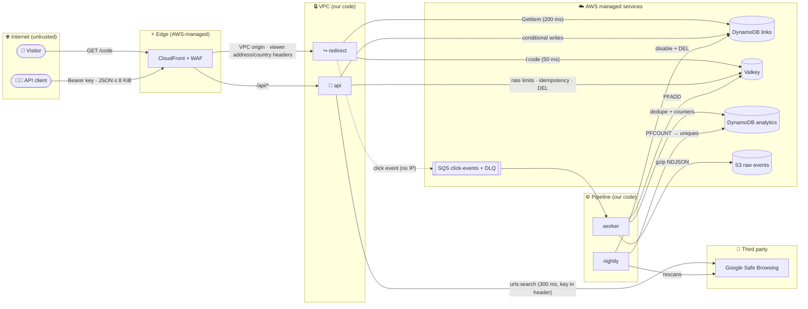

# 🛡️ URL Shortener — Threat Model

> **Status:** v0.3 (M6). Application-level data flows and STRIDE for the
> redirect path, the API and the click pipeline, plus the detection controls
> added in M6. Completed per SPEC §17.3 (infrastructure, CI/CD, full STRIDE) in M7.

## Contents

1. [Scope](#1-scope)
2. [Assets](#2-assets)
3. [Actors](#3-actors)
4. [Data flow and trust boundaries](#4-data-flow-and-trust-boundaries)
5. [STRIDE — redirect path](#5-stride--redirect-path)
6. [STRIDE — management API](#6-stride--management-api)
7. [STRIDE — click pipeline and nightly job](#7-stride--click-pipeline-and-nightly-job)
8. [Accepted and residual risks](#8-accepted-and-residual-risks)
9. [Scanner suppressions](#9-scanner-suppressions)

## 1. Scope

This version covers the application layer: the `redirect`, `api`, `worker` and
`nightly` components, their use of DynamoDB, Valkey, SQS, S3 and Google Safe
Browsing, and API-key authentication.
Infrastructure (network, IAM, edge, KMS) and CI/CD are covered from M4–M8.

## 2. Assets

| Asset | Why it matters |
| --- | --- |
| Link integrity | A tampered destination turns trusted short links into phishing |
| Redirect availability | The product's core promise (SPEC N2: 99.9 %) |
| Analytics privacy | Visitor IPs/referrers are personal data (SPEC N6) |
| API keys | Grant control over an owner's links |
| Owner isolation | One customer must not read or change another's links |
| AWS account | Everything above runs in it |

## 3. Actors

| Actor | Capability | Intent |
| --- | --- | --- |
| Anonymous visitor | Any HTTP request to the edge | Mostly benign; may scan codes or flood |
| API client | Holds a valid API key with some scopes | Benign, or curious about other owners |
| Malicious link creator | Holds (or steals) a key | Phishing, malware distribution, abuse of our domain reputation |
| Compromised dependency | Code running inside our tasks | Exfiltration, persistence |
| Insider / CI | Repository and pipeline access | Accidental or deliberate misuse |

## 4. Data flow and trust boundaries

Trust boundaries: Internet → Edge (TLS, WAF), Edge → VPC (only CloudFront can
reach the internal ALB — ADR-0012, M5), VPC → AWS services (IAM task roles,
VPC endpoints, KMS), VPC → third party (Safe Browsing over NAT, only when
scanning is enabled).

## 5. STRIDE — redirect path

| # | Threat | STRIDE | L | I | Mitigation | Status |
| --- | --- | --- | --- | --- | --- | --- |
| R1 | **Code enumeration** — scanning random codes to discover links | I | H | M | Codes are non-sequential (Sqids, [ADR-0006](adr/0006-short-code-generation-range-allocation-and-sqids.md)); negative cache 60 s keeps scans off DynamoDB ([`resolver.go`](../internal/links/resolver.go)); invalid code syntax rejected before any lookup; WAF per-IP rate rules (M5) | Mitigated (links are not secrets — [ADR-0006](adr/0006-short-code-generation-range-allocation-and-sqids.md)) |
| R2 | **Open redirect / phishing** — our domain lends credibility to malicious destinations | S/T | H | H | Safe Browsing at create/update + nightly rescan ([ADR-0021](adr/0021-url-safety-scanning-safe-browsing-v5.md)); admin kill switch with immediate cache invalidation; destinations restricted to http(s), no credentials, no private/loopback/link-local IP literals, no non-canonical numeric hosts, not our own domain ([`validate.go`](../internal/links/validate.go)) | Mitigated; zero-day gap accepted (§7) |
| R3 | **Cache poisoning** — making `l:{code}` point elsewhere | T | L | H | Only our services write Valkey (IAM auth, SG, TLS — [ADR-0009](adr/0009-valkey-iam-authentication.md)); entries derive solely from DynamoDB; gone links are cached without a destination; CloudFront never caches redirects ([ADR-0007](adr/0007-302-redirects-and-no-edge-caching.md)) | Mitigated |
| R4 | **DoS on the hot path** | D | M | H | WAF rate rules (M5); cache-aside + singleflight per code (stampede protection); 50 ms cache / 200 ms DynamoDB deadlines; server read/write/idle timeouts and `MaxHeaderBytes` ([`server.go`](../internal/httpx/server.go)); click enqueue is non-blocking with a bounded buffer ([`producer.go`](../internal/events/producer.go)); autoscaling (M5) | Mitigated |
| R5 | **Cache outage** turns into a redirect outage | D | M | H | Cache errors fail open to DynamoDB and are counted (`CacheErrors`) | Mitigated |
| R6 | **Analytics backpressure** blocks redirects | D | M | H | Response written before enqueue; full buffer or SQS failure drops the event and counts `ClickEventsDropped` (SPEC N3) | Mitigated |
| R7 | **Viewer IP/country header spoofing** | S | L | M | `CloudFront-Viewer-Address`/`-Country` trusted only because the ALB is reachable solely via CloudFront (M5); config forbids `remote_addr` mode in dev/prod ([`config.go`](../internal/config/config.go)) | Mitigated (verified in M5/M7) |
| R8 | **Privacy leak** of visitor IPs/referrers | I | M | H | Per-day keyed HMAC visitor IDs; referrer host only; IP never leaves the task; logs exclude IPs and destination URLs (tested in [`redirect_test.go`](../internal/redirect/redirect_test.go)) — [ADR-0018](adr/0018-privacy-hmac-visitor-ids-referrer-host-only.md) | Mitigated |
| R9 | **Log injection** via request IDs or paths | T | M | L | Structured JSON logs (values escaped); `X-Amz-Cf-Id` accepted only if it matches a strict charset/length, otherwise a UUIDv7 is generated ([`middleware.go`](../internal/httpx/middleware.go)); access logs record the route pattern, not raw query strings | Mitigated |
| R10 | **Response header injection** via a crafted destination | T | L | M | Destinations are parsed and re-serialized by `net/url` (no CR/LF possible) before storage | Mitigated |

## 6. STRIDE — management API

| # | Threat | STRIDE | L | I | Mitigation | Status |
| --- | --- | --- | --- | --- | --- | --- |
| A1 | **API key theft** (logs, repos, screenshots) | S | M | H | 256-bit keys shown once, stored as SHA-256 ([ADR-0015](adr/0015-api-key-authentication.md)); `Authorization` never logged; recognisable `shortener_{env}_` prefix with a custom gitleaks rule; per-env prefix check; revocation (≤ 60 s) | Mitigated |
| A2 | **Brute-forcing keys** | S | L | H | 2²⁵⁶ keyspace; malformed keys rejected without a lookup; WAF rate rules on `/api/*` (M5) | Mitigated |
| A3 | **IDOR across owners** — reading/changing another owner's link | E/I | M | H | Every get/update/delete checks `owner_id` and returns 404 (never 403) ([`service.go`](../internal/links/service.go)); list queries the caller's partition only; pagination cursors validated to belong to the caller ([`store/links.go`](../internal/store/links.go)) | Mitigated (unit + integration tests) |
| A4 | **Scope escalation** | E | L | H | Scope checked per route before the handler runs ([`api.go`](../internal/api/api.go)); admin routes require `admin` | Mitigated |
| A5 | **Request smuggling / oversized bodies** | D | M | M | 8 KiB body limit (413); strict JSON (unknown fields, trailing data rejected); `Content-Type` enforced (415); Go `net/http` header limits | Mitigated |
| A6 | **Abuse at volume** (spam link creation) | D | M | M | Per-owner fixed-window rate limits (write 60/min, read 300/min) with `Retry-After`; fail open to WAF backstop if Valkey is down ([`ratelimit.go`](../internal/ratelimit/ratelimit.go)) | Mitigated |
| A7 | **Idempotency misuse** — replaying another owner's response, or key reuse with a different body | T/I | L | M | Records scoped per owner, key hashed; body fingerprint must match or 400 ([`handlers.go`](../internal/api/handlers.go)) | Mitigated |
| A8 | **Alias squatting / race** on custom codes | T | M | L | Conditional `PutItem` — exactly one creator wins (409 for the rest); reserved words blocked | Mitigated |
| A9 | **Lost updates** under concurrent edits | T | L | L | Optimistic concurrency on `updated_at` with bounded retries | Mitigated |
| A10 | **SSRF via destination URLs** | I/E | L | H | The service **never fetches** destination URLs; only Safe Browsing receives them, as data. Private-IP literals are still rejected so links cannot target visitors' internal networks | Mitigated |
| A11 | **Information disclosure in errors** | I | M | M | One error mapper; 5xx responses carry no detail; internal errors are logged with the request ID only ([`api.go`](../internal/api/api.go)) | Mitigated |
| A12 | **Safe Browsing key exposure** | I | L | M | Key from Secrets Manager (M4), sent in `X-Goog-Api-Key` (never in a URL); transport errors stripped of URLs; config `Secret` type cannot be printed or logged ([`reader.go`](../internal/config/reader.go)) | Mitigated |

L = likelihood, I = impact (H/M/L).

## 7. STRIDE — click pipeline and nightly job

| # | Threat | STRIDE | L | I | Mitigation | Status |
| --- | --- | --- | --- | --- | --- | --- |
| P1 | **Click inflation** by replaying/duplicating messages | T | M | M | Dedupe marker `EVENT#{event_id}` written in the same transaction as the counters; replays cancel the transaction ([`analytics.go`](../internal/store/analytics.go), [ADR-0010](adr/0010-async-click-pipeline.md)); only our tasks can send to the queue (IAM, M5) | Mitigated (integration-tested: 500 replays change nothing) |
| P2 | **Click inflation by bots / scripted visits** | T | H | L | UA bot heuristic → `bot_clicks`, excluded from `clicks`, dimensions and uniques; WAF rate rules (M5) | Accepted (heuristic; sophisticated bots can pose as browsers) |
| P3 | **Poison / malformed messages** halt the pipeline | D | M | M | Strict decode with schema version; poison messages are never deleted and go to the DLQ after 5 receives; worker keeps running ([`worker.go`](../internal/worker/worker.go)) | Mitigated |
| P4 | **Data loss** between SQS and S3 | R | L | M | Messages deleted only after DynamoDB *and* S3 succeed; failed flushes are redelivered; Athena dedupes by `event_id` | Mitigated |
| P5 | **Analytics privacy** in raw events | I | M | H | Events carry the HMAC visitor ID, referrer host, country and a 256-byte UA — no IP ([ADR-0018](adr/0018-privacy-hmac-visitor-ids-referrer-host-only.md)); S3 encryption + access control (M4) | Mitigated |
| P6 | **Dimension cardinality / storage abuse** via crafted referrers or UAs | D | M | L | Values normalized, control characters stripped, capped at 64 chars; referrer reduced to host | Mitigated |
| P7 | **Nightly mis-disables** links (scanner false positives) or fails silently | T/R | L | M | Only Safe Browsing verdicts disable; reason `unsafe_url` recorded; admin can re-enable; job exits non-zero on any failed step, alarmed through a log metric filter, Scheduler target errors and an EventBridge rule on non-zero exit ([ADR-0022](adr/0022-observability-alerting-and-cost-guardrails.md)); idempotent re-runs | Mitigated |
| P8 | **Stats IDOR** — reading another owner's analytics | I | M | M | Stats endpoint checks link ownership first (404 otherwise) ([`stats.go`](../internal/api/stats.go)) | Mitigated |

## 8. Accepted and residual risks

| Risk | Rationale |
| --- | --- |
| Safe Browsing zero-day gap | A destination that turns malicious after creation is caught at the next nightly rescan or by an admin disable. |
| Sqids codes are decodable | Reveals approximate creation order/volume; links are not secrets ([ADR-0006](adr/0006-short-code-generation-range-allocation-and-sqids.md)). |
| Revocation delay ≤ 60 s | In-process auth cache; trades instant revocation for one fewer DynamoDB read per request. |
| Rate limiting fails open | Availability over strictness while Valkey is down; WAF per-IP rules remain. |
| Up to 1 h stale redirect if both cache invalidations fail | Alarmed (`cache-invalidation-failed`, any occurrence); bounded by the positive TTL; the runbook re-issues the disable. |
| Alert suppression or spoofing | The alert topic is CMK-encrypted and TLS-only. Only this account's alarms, rules (by ARN prefix), Budgets and Cost Anomaly Detection may publish. Deleting alarms or subscriptions needs IAM write access (CI roles are bounded, M7). An unconfirmed or unsubscribed email silently drops alerts, so `ListSubscriptionsByTopic` is part of the gate. |
| Cost visibility lags up to 24 h | Budgets and Cost Anomaly Detection are guardrails, not limits; per-table DynamoDB throughput caps, Valkey caps and the WAF rate rules bound spend in real time. |
| Clicks dropped under overload or SQS outage | Redirect availability wins (SPEC N3); `ClickEventsDropped` is alarmed. |
| DLQ redrive after 3 days may double count | Dedupe markers expire after 3 days; the runbook requires redriving within that window. |
| HTTP on the CloudFront→ALB hop without a custom domain | Traffic runs over the CloudFront VPC origin's private connection inside the AWS network; set `domain_name` for HTTPS end to end (SPEC §11.3). |
| HTTP between the ALB and tasks | Isolated subnets, SG-to-SG rules only; TLS to every task would need per-task certificates for little benefit at this scale. |
| Viewer TLS policy fixed by AWS on `*.cloudfront.net` | TLSv1.2_2021 is enforced when the custom domain + ACM certificate is configured. |
| No ECS Exec | Read-only root filesystems and distroless images rule it out; diagnosis via logs, metrics and `/healthz` (ADR-0003). |

## 9. Scanner suppressions

Every scanner suppression in the repository (`nolint`, `#checkov:skip`,
`.trivyignore`, tflint ignores, gitleaks allowlists) must have a row here and an
inline justification (AGENTS.md §3).

| Tool | Location | Rule | Justification |
| --- | --- | --- | --- |
| gitleaks | `.gitleaks.toml` | path allowlist `^\.tools/` | Locally installed third-party toolchains (Go stdlib test fixtures, headless Chrome). Gitignored and never committed; only `detect --no-git` reaches it because it does not honour `.gitignore`. Git-history scans are unaffected. |
| golangci-lint (gosec G404) | `internal/telemetry/telemetry.go` (`NewMetrics`) | weak RNG | `math/rand/v2` only selects which latency samples go into the EMF reservoir; no security decision depends on it. |
| checkov CKV_AWS_144 | `infra/modules/s3-bucket/main.tf` | S3 cross-region replication | Multi-region is a SPEC non-goal; versioning (+ PITR for DynamoDB) covers recovery. |
| checkov CKV2_AWS_62 | `infra/modules/s3-bucket/main.tf` | S3 event notifications | No consumer for object events; auditing uses S3 server access logs. |
| checkov CKV_AWS_109, CKV_AWS_111, CKV_AWS_356 | `infra/modules/kms/main.tf`, `infra/bootstrap/main.tf` (key policies) | `kms:*` on `*` | Standard key-policy root delegation; in a key policy `*` means the key itself. |
| checkov CKV2_AWS_19 | `infra/modules/network/main.tf` (NAT EIP) | EIP attached to EC2 | The EIP belongs to the NAT gateway. |
| checkov CKV2_AWS_5 | `infra/modules/network/main.tf`, `infra/modules/cache/main.tf` (client security groups) | SG attached | Client groups are attached to ECS tasks by the ecs-service module (M5). |
| checkov CKV_AWS_338 | `infra/modules/network/main.tf` (flow logs) | 1-year log retention | 14 days dev / 90 days prod per SPEC §12.6 cost guardrails. |
| checkov CKV_AWS_394 | `infra/modules/network/main.tf` (AZ data source) | AZ result pinning | Subnets are keyed by AZ ID and use the first `az_count` AZs; a new AZ never moves subnets. |
| checkov CKV2_AWS_57 | `infra/modules/secrets/main.tf` | automatic rotation | The Safe Browsing key is Google-issued; rotating the salt resets unique-visitor continuity. Both rotate via runbook procedures (ADR-0014). |
| checkov CKV_AWS_338 | `infra/modules/{ecs-cluster,ecs-service,scheduled-task,edge}/main.tf` (log groups) | 1-year log retention | 14 days dev / 90 days prod per SPEC §12.6. |
| checkov CKV_AWS_382; Trivy AWS-0104 | `infra/modules/ecs-service/main.tf`, `infra/modules/scheduled-task/main.tf` (`internet_https` egress) | egress to 0.0.0.0/0 | HTTPS-only egress to Google Safe Browsing (no fixed IP range) through NAT; created only for api/nightly when `url_scanning_enabled` (ADR-0013). |
| checkov CKV2_AWS_5 | `infra/modules/scheduled-task/main.tf` | SG attached | Attached per run through the EventBridge Scheduler ECS target. |
| checkov CKV2_AWS_28, CKV2_AWS_20, CKV_AWS_150 | `infra/modules/edge/main.tf` (`aws_lb`) | WAF on ALB; HTTP→HTTPS redirect; deletion protection | The ALB is internal behind CloudFront (WAF and HTTPS redirect at the edge); deletion protection follows `!force_destroy` (on in prod). |
| checkov CKV_AWS_2, CKV_AWS_103, CKV2_AWS_20; Trivy AWS-0054 | `infra/modules/edge/main.tf` (`aws_lb_listener.http`) | HTTP listener | Internal VPC-origin hop is HTTP without a custom domain (accepted risk below); `domain_name` switches to the HTTPS listener. |
| checkov CKV_AWS_378 | `infra/modules/edge/main.tf` (target groups) | HTTP to targets | ALB→task traffic stays in isolated subnets, SG-to-SG only (accepted risk below). |
| checkov CKV_AWS_86, CKV_AWS_174, CKV2_AWS_42, CKV_AWS_305, CKV_AWS_310, CKV_AWS_374 | `infra/modules/edge/main.tf` (`aws_cloudfront_distribution`) | legacy logging; TLS policy; custom cert; root object; origin failover; geo restriction | Standard logging v2 is used; TLSv1.2_2021 needs the optional custom domain; `/` is the redirect service; single-region by design; global service without geo restriction. |
| golangci-lint | `.golangci.yml` exclusion for `_test.go` | gosec, forcetypeassert, unparam, noctx, bodyclose | Test code uses `httptest` in-memory requests/recorders and fixture data; production code remains fully covered by every linter. |
